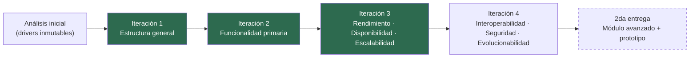

# Plan de iteraciones ADD

El enunciado exige **un mínimo de 4 iteraciones** del proceso ADD (§4). Este plan fija el objetivo
de cada una siguiendo el orden del método de Cervantes & Kazman, de modo que cada iteración se
apoye en las estructuras que dejó la anterior.

## Por qué este orden y no otro

ADD no permite elegir el orden de las iteraciones a gusto. Las tácticas de atributos de calidad se
aplican **sobre** elementos arquitectónicos, de modo que no se puede refinar para disponibilidad
antes de que exista una estructura a la cual asignar redundancia, ni se puede descomponer la
funcionalidad primaria antes de haber elegido un estilo general que diga qué forma tienen los
elementos. De ahí la secuencia: primero la estructura general, después la funcionalidad, después
los atributos de calidad agrupados por afinidad de tácticas.

El sistema es *greenfield* y novedoso (no es una variación de un sistema existente), por lo que el
**propósito de diseño global** es «diseñar un sistema nuevo completo hasta el punto en que se pueda
construir un prototipo que demuestre la viabilidad de la arquitectura».

## Tabla resumen

| Iteración | Objetivo de diseño | Elementos a refinar | Drivers que consume | Artefactos esperados | Estado |
|---|---|---|---|---|---|
| **1** | Establecer la estructura general del sistema: un marco donde ubicar la funcionalidad y que no impida alcanzar los QA más riesgosos | El sistema completo | QA-01, QA-04, QA-05, QA-09, QA-11, QA-13; CON-01…CON-10; CRN-01, CRN-08 | ADR-0001…ADR-0009; vistas de contexto, módulos N1, C&C N1 y despliegue N1; kanban de drivers | ✅ [Completa](../02-proceso-add/iteracion-1/README.md) |
| **2** | Identificar las estructuras que soportan la funcionalidad primaria | `itinerary`, `mail-ingest`, `booking-extraction`, `provider-sync`, `preferences` | RF-01…RF-03, RF-05…RF-10, RF-14, RF-15; CRN-06 | Modelo de dominio canónico; vista de módulos N2; diagramas de secuencia UC-1…UC-7; ADR sobre persistencia, deduplicación e idempotencia | ✅ [Completa](../02-proceso-add/iteracion-2/README.md) |
| **3** | Refinar las estructuras para alcanzar los objetivos de rendimiento, disponibilidad y escalabilidad | Plano de lectura, plano de ingesta, plano de datos, infraestructura de despliegue | QA-01…QA-09; CRN-03, CRN-04, CRN-08, CRN-09, CRN-12, CRN-13 | Vista de despliegue N2; verificación de los presupuestos de latencia, frescura y error; especificación ejecutable de pruebas de carga y SLOs; ADR-0018…ADR-0026 | ✅ [Completa](../02-proceso-add/iteracion-3/README.md) |
| **4** | Refinar para interoperabilidad, seguridad y privacidad, evolucionabilidad y uso internacional | Capa de anticorrupción, `identity-access`, `sharing`, `analytics-plane`, capa de clientes | QA-10…QA-18; CON-07, CON-08, CON-10; CRN-05, CRN-07, CRN-10, CRN-14, CRN-15 | Vista de módulos de los adaptadores; vista de seguridad y de datos; guía «cómo agregar un medio de transporte»; contratos versionados; ADR-0027…ADR-0035 | 📋 [Planificada](../02-proceso-add/iteracion-4-plan.md) |

## Criterio de cierre de cada iteración

Una iteración se cierra solo cuando se cumplen las tres condiciones:

1. **Los drivers asignados a la iteración quedan en estado «completamente tratado»** en el kanban
   de drivers, o se registra explícitamente por qué se posponen y a qué iteración.
2. **Cada decisión tomada tiene su ADR** en estado `aceptado`, con las alternativas descartadas
   documentadas (no solo la elegida).
3. **Las vistas afectadas quedan actualizadas** y son consistentes entre sí: un elemento que
   aparece en la vista de módulos tiene su contraparte en la vista C&C y un destino en la vista de
   despliegue.

## Riesgos del plan

| Riesgo | Impacto | Mitigación |
|---|---|---|
| El volumen de documentación de 4 iteraciones excede el tiempo disponible del equipo (CON-05, CON-09) | Entregar iteraciones flacas que no demuestren el método | Las iteraciones 2 a 4 tienen alcance declarado por adelantado en este plan; se recorta profundidad de refinamiento, nunca pasos del método |
| Una decisión de la iteración 3 o 4 invalida la estructura de la iteración 1 | Retrabajo en cascada sobre vistas y ADRs | La iteración 1 ataca deliberadamente primero los cinco escenarios de cuadrante (H,H) del [árbol de utilidad](../01-analisis-inicial/08-arbol-de-utilidad.md), que son los que más probablemente fuercen cambios estructurales |
| El módulo avanzado de la 2da entrega no encaja en la estructura diseñada | Rediseño en la entrega final | La iteración 4 incluye como criterio de salida que la arquitectura exponga un punto de extensión capaz de alojar tanto la Opción A como la Opción B sin cambios estructurales |
