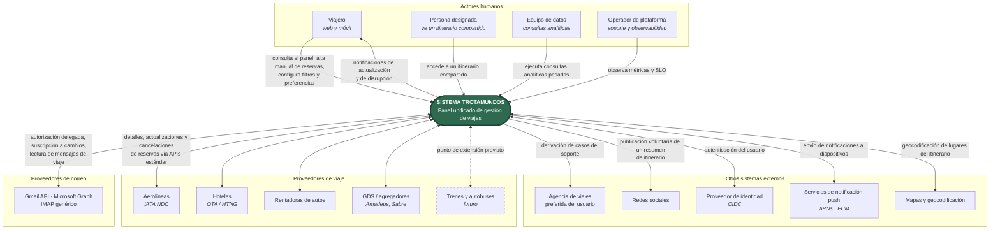

# 1.2 Diagrama de contexto

El enunciado recomienda fuertemente elaborar un diagrama de contexto para establecer los límites
del sistema y sus interacciones con actores externos (§3). Esto es lo que fija qué es
responsabilidad de Trotamundos y qué no, y es la base de los escenarios de interoperabilidad.

## Tabla de interfaces externas

| # | Entidad externa | Dirección | Qué se intercambia | Protocolo / estándar previsto | Drivers asociados |
|---|---|---|---|---|---|
| E-01 | Viajero (navegador web) | Bidireccional | Panel de viajes, altas y bajas manuales, filtros, preferencias | HTTPS, API REST/JSON | RF-04, RF-06, RF-09, QA-02 |
| E-02 | Viajero (app móvil) | Bidireccional | Ídem E-01, más posición del dispositivo | HTTPS, API REST/JSON, APNs/FCM | RF-09, RF-10, QA-03, QA-17 |
| E-03 | Persona designada | Entrante | Lectura de un itinerario compartido, autenticada | HTTPS, enlace de acceso ligado a identidad | RF-11, QA-12 |
| E-04 | Equipo de datos | Entrante | Consultas analíticas sobre tendencias, destinos y cancelaciones | SQL sobre el almacén analítico | RF-14, QA-09 |
| E-05 | Proveedor de correo (Gmail / Microsoft 365) | Bidireccional | Consentimiento OAuth, notificación de mensajes nuevos, contenido de mensajes de viaje | OAuth 2.0, Gmail API `watch` / Microsoft Graph *subscriptions* | RF-01, RF-02, QA-11, QA-13 |
| E-06 | Proveedor de correo (IMAP genérico) | Entrante (sondeo) | Mensajes de viaje | IMAP sobre TLS | RF-02, QA-11 |
| E-07 | Aerolíneas | Bidireccional | Detalle de reserva, cambios, cancelaciones | IATA NDC / API del proveedor | RF-05, QA-10 |
| E-08 | Hoteles | Bidireccional | Ídem | OTA / HTNG | RF-05, QA-10 |
| E-09 | Rentadoras de autos | Bidireccional | Ídem | API del proveedor | RF-05, QA-10 |
| E-10 | GDS / agregadores | Bidireccional | Reservas multi-proveedor | API del GDS | RF-05, QA-10 |
| E-11 | Trenes y autobuses | Bidireccional | Ídem | **A definir** — punto de extensión | QA-15 |
| E-12 | Agencia de viajes preferida | Saliente | Caso de soporte con el contexto del viaje | API de la agencia / webhook | RF-12, QA-10 |
| E-13 | Redes sociales | Saliente | Resumen de itinerario sin datos sensibles | API de la red social, OAuth | RF-13, QA-12 |
| E-14 | Proveedor de identidad | Bidireccional | Autenticación del usuario | OpenID Connect | RF-01, QA-13 |
| E-15 | Servicio de notificación push | Saliente | Notificación de actualización o disrupción | APNs / FCM | RF-10, QA-01 |
| E-16 | Mapas y geocodificación | Bidireccional | Coordenadas de lugares del itinerario | API del proveedor | QA-17 |

## Observaciones del refinado

Tres cosas quedan en evidencia al dibujar el contexto, y las tres tienen consecuencia
arquitectónica directa:

1. **La mayoría de las interfaces del sistema son con terceros que no controlamos.** De las 16
   interfaces, 12 son con sistemas externos. Esto convierte a la interoperabilidad en un atributo
   estructural y no en un detalle de integración, y es el origen de la decisión de
   [ADR-0006](../03-adr/ADR-0006-capa-de-anticorrupcion.md).

2. **El objetivo de disponibilidad no puede abarcar a los terceros.** Ningún proveedor de correo o
   de viaje ofrece un SLA compatible con 5 minutos de inactividad al mes. Si la medición
   incluyera las integraciones, el driver sería imposible por construcción. Esto se resuelve en
   [AMB-02](07-supuestos-y-carga-derivada.md#ambigüedades-del-enunciado-y-su-resolución) y
   [ADR-0008](../03-adr/ADR-0008-alcance-disponibilidad.md).

3. **E-13 y E-03 están en tensión.** El enunciado pide compartir itinerarios en redes sociales y,
   al mismo tiempo, garantizar que «solo personas específicas designadas puedan visualizarlos».
   Son dos mecanismos distintos con dos modelos de confianza distintos, no uno solo; ver
   [AMB-10](07-supuestos-y-carga-derivada.md#ambigüedades-del-enunciado-y-su-resolución).
