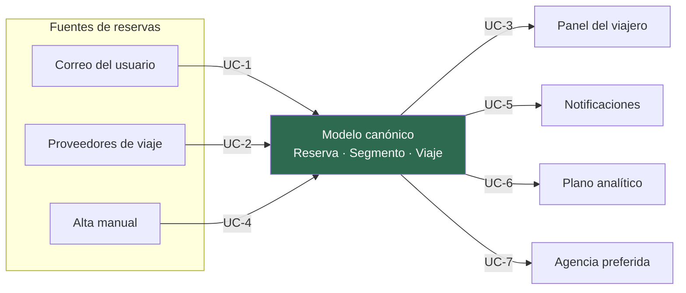

# 1.3 Requisitos funcionales

El enunciado presenta siete bullets de requerimientos funcionales en forma narrativa. Aquí están
desagregados en requisitos identificables y priorizados, que es lo que ADD necesita como entrada.

## Criterio de priorización

La prioridad combina dos ejes, siguiendo la recomendación de ADD de distinguir entre lo que el
negocio necesita y lo que la arquitectura tiene que resolver:

- **Valor de negocio** (Alto / Medio / Bajo): cuánto aporta a las metas MN-1…MN-8.
- **Significancia arquitectónica** (Alta / Media / Baja): cuánto condiciona la estructura del
  sistema. Un requisito puede valer mucho para el negocio y no afectar la arquitectura (un ABM
  sencillo), o lo contrario.

Un requisito es **primario** (y por lo tanto entra como driver de la iteración 2) cuando es alto
en ambos ejes, o alto en significancia arquitectónica con valor de negocio al menos medio.

## Catálogo

| ID | Requisito | Valor de negocio | Signif. arq. | Primario | Origen en el enunciado |
|---|---|---|---|---|---|
| RF-01 | **Conectar una cuenta de correo** con autorización explícita del usuario, y gestionar el ciclo de vida del consentimiento (otorgar, renovar, revocar) | Alto | Alta | ✅ | «garantizarse el acceso seguro y autorizado a los correos» |
| RF-02 | **Obtener los mensajes de viaje** de las cuentas conectadas de forma continua | Alto | Alta | ✅ | «sondear y escanear el correo electrónico de los usuarios» |
| RF-03 | **Extraer y normalizar** las reservas contenidas en esos mensajes y agregarlas al itinerario | Alto | Alta | ✅ | «para agregar automáticamente las reservas al itinerario» |
| RF-04 | **Filtrar remitentes y administrar whitelists** de remitentes seguros de correo de viaje | Medio | Baja | | «permitir filtrar y crear listas de remitentes seguros (whitelists)» |
| RF-05 | **Sincronizar con proveedores de viaje** vía APIs estándar para obtener detalles, actualizaciones y cancelaciones | Alto | Alta | ✅ | «integrarse de manera fluida con sistemas de viajes e interfaces de agencias de terceros» |
| RF-06 | **Gestión manual de reservas**: agregar, actualizar y eliminar reservas dentro del panel | Alto | Media | ✅ | «los clientes deben poder agregar, actualizar o eliminar sus reservas existentes de forma manual» |
| RF-07 | **Agrupar reservas en viajes** automáticamente, resolviendo duplicados entre fuentes | Alto | Alta | ✅ | «los elementos en el panel de control deben poder agruparse por viaje» |
| RF-08 | **Ciclo de vida del viaje**: al completarse, archivarlo (o eliminarlo a pedido) y retirarlo de la vista principal | Medio | Media | | «una vez que el viaje se completa, deben archivarse o eliminarse automáticamente de la vista principal» |
| RF-09 | **Visualizar el panel unificado** centrado en el viaje, desde web y desde móvil | Alto | Alta | ✅ | «ver todas sus reservas existentes organizadas por viaje, ya sea a través de la web o desde su dispositivo móvil» |
| RF-10 | **Notificar** al usuario las actualizaciones de sus reservas y las disrupciones de viaje | Alto | Alta | ✅ | «las actualizaciones de viaje deben presentarse en la aplicación»; «interrupciones importantes de viajes» |
| RF-11 | **Compartir un itinerario** con personas designadas, que puedan visualizarlo | Medio | Media | | «permitir el uso compartido de itinerarios asegurando que solo personas específicas designadas puedan visualizarlos» |
| RF-12 | **Derivar un caso de soporte** a la agencia de viajes preferida del usuario, con el contexto del viaje | Medio | Alta | ✅ | «integrarse con la agencia de viajes preferida del usuario para facilitar una rápida resolución de problemas» |
| RF-13 | **Publicar un resumen del itinerario** en una red social del usuario | Bajo | Baja | | «interoperar […] con redes sociales para compartir itinerarios» |
| RF-14 | **Ejecutar consultas analíticas** sobre tendencias, destinos y cancelaciones, para monetización por el equipo de datos | Alto | Alta | ✅ | «recopilará datos analíticos de los viajes […] implicando la ejecución de consultas analíticas pesadas» |
| RF-15 | **Administrar preferencias del usuario**: agencia preferida, idioma, región, zona horaria, política de archivado | Medio | Media | | Derivado de RF-08, RF-12 y del requisito de internacionalización |

**9 de 15 requisitos son primarios.** Son los que la iteración 2 debe soportar estructuralmente.

## Casos de uso primarios

Los requisitos primarios se agrupan en siete casos de uso, que son los que se modelarán con
diagramas de secuencia en la iteración 2. El criterio de agrupación es el flujo de datos: cada
caso de uso atraviesa el sistema de punta a punta y por lo tanto ejercita las interfaces entre
elementos, que es lo que ADD quiere validar.

| ID | Caso de uso | RF que realiza | Por qué es primario |
|---|---|---|---|
| **UC-1** | Ingesta automática de una reserva desde el correo del usuario | RF-01, RF-02, RF-03, RF-04, RF-07 | Es el flujo que define la propuesta de valor y el que más carga asíncrona genera |
| **UC-2** | Sincronización de una actualización o cancelación desde un proveedor de viaje | RF-05, RF-07, RF-10 | Ejercita la capa de anticorrupción y el presupuesto de frescura de 5 minutos |
| **UC-3** | Consulta del panel de viajes agrupado | RF-09, RF-08 | Es el camino crítico de latencia (800 ms en web, 1,4 s de FCP en móvil) |
| **UC-4** | Alta, modificación o baja manual de una reserva | RF-06, RF-07 | Compite con las fuentes automáticas sobre el mismo dato: define la política de resolución de conflictos |
| **UC-5** | Notificación de una disrupción de viaje | RF-10 | Es el escenario de pico de carga, y el de mayor valor percibido |
| **UC-6** | Ejecución de una consulta analítica pesada | RF-14 | Es la carga que debe quedar aislada del plano operacional |
| **UC-7** | Derivación de un caso a la agencia preferida | RF-12 | Ejercita la integración saliente con un tercero con contrato propio |

El diagrama muestra la forma general del sistema que se desprende de los casos de uso primarios:
**tres fuentes heterogéneas que convergen en un modelo canónico, y cuatro consumidores con
perfiles de carga muy distintos**. Esa asimetría es el argumento central de
[ADR-0001](../03-adr/ADR-0001-estilo-arquitectonico.md) y de
[ADR-0003](../03-adr/ADR-0003-separacion-planos.md).

## Requisitos funcionales de la 2da entrega

Registrados aquí para que la arquitectura los contemple como punto de extensión, sin diseñarlos.

| ID | Requisito | Opción |
|---|---|---|
| RF-A1 | Sugerir proactivamente alternativas de alojamiento, transporte o rutas, analizando historial y preferencias | A — Sistema de recomendación |
| RF-A2 | Refinar el modelo de recomendación con la interacción del usuario sobre las sugerencias (*human-in-the-loop*) | A |
| RF-B1 | Atender consultas de estado, reprogramaciones y problemas menores mediante un bot conversacional | B — Asistente virtual |
| RF-B2 | Delegar a la agencia preferida únicamente los casos que el bot no resuelve | B |

Ambas opciones consumen el mismo insumo —el historial de viajes del usuario y el modelo canónico—
y ambas producen acciones sobre el itinerario o sobre un caso de soporte. Por eso la arquitectura
las puede alojar en el mismo punto de extensión, que se valida como criterio de salida de la
[iteración 4](../02-proceso-add/iteracion-4-plan.md).
