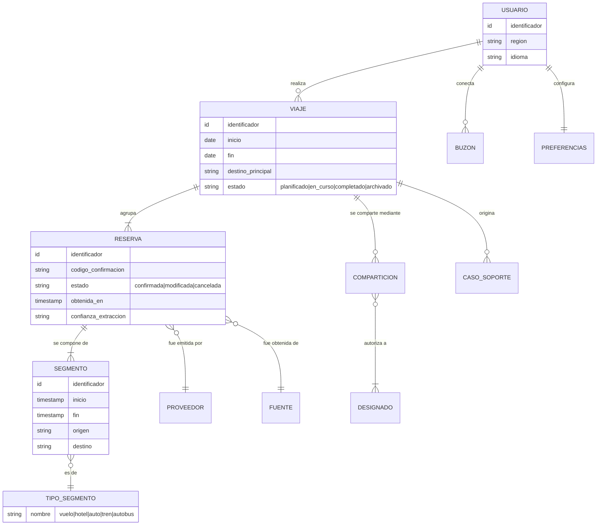

# 1.9 Glosario y modelo conceptual

El enunciado usa «reserva», «arreglo de viaje», «itinerario» y «viaje» de forma intercambiable.
Para diseñar hace falta distinguirlos, porque no son el mismo concepto y la agrupación automática
(RF-07) depende precisamente de esa distinción.

## Modelo conceptual del dominio

## Glosario

| Término | Definición en este trabajo | Qué **no** es |
|---|---|---|
| **Viaje** (*trip*) | Agrupación de reservas que corresponden a un mismo desplazamiento del usuario, con fecha de inicio, fecha de fin y destino principal. Es la unidad de presentación del panel y la unidad del ciclo de vida (RF-07, RF-08) | No es una reserva. Un viaje típico agrupa varias |
| **Reserva** (*booking*) | Compromiso contraído con **un** proveedor, identificado por un código de confirmación. Es la unidad que se obtiene de una fuente y la unidad de deduplicación | No es un segmento: una reserva de vuelo de ida y vuelta con escala tiene una reserva y cuatro segmentos |
| **Segmento** (*segment*) | Tramo individual con un inicio, un fin y un tipo. Es la unidad que el usuario ve en la línea de tiempo del viaje | — |
| **Tipo de segmento** | Clasificación del segmento: vuelo, hotel, auto, tren, autobús. Es el **punto de extensión** del modelo para QA-15 | — |
| **Itinerario** | Vista ordenada en el tiempo de los segmentos de un viaje. Es una proyección, no una entidad persistida con identidad propia | No es el viaje: es cómo se lo presenta |
| **Fuente** (*source*) | De dónde se obtuvo una reserva: correo, proveedor o alta manual. Se persiste porque determina la precedencia al resolver conflictos (CRN-11) | — |
| **Proveedor** (*provider*) | Sistema externo que emitió la reserva: aerolínea, hotelera, rentadora, GDS | No es la *agencia de viajes preferida*, que es un actor de soporte |
| **Agencia de viajes preferida** | La agencia que el usuario eligió en sus preferencias, a la que se derivan los casos de soporte (RF-12) | — |
| **Buzón** (*mailbox*) | Cuenta de correo que el usuario conectó, con su consentimiento vigente y su token de acceso delegado | — |
| **Designado** | Persona a la que el usuario autorizó explícitamente a ver un viaje compartido. El acceso exige autenticación y pertenencia a la lista (QA-12) | No es cualquiera que tenga el enlace |
| **Disrupción** | Evento externo que invalida o altera masivamente segmentos de muchos usuarios a la vez: cancelación de vuelos de un *hub*, huelga, evento climático. Es el escenario de pico (QA-04) | — |
| **Confianza de extracción** | Grado de certeza con que se extrajo una reserva desde un correo. Una extracción de baja confianza **no** se inserta silenciosamente en el itinerario (QA-11) | — |
| **Plano operacional** | Los elementos y almacenes que atienden al usuario en tiempo real | — |
| **Plano analítico** | Los elementos y almacenes que atienden las consultas pesadas del equipo de datos (RF-14) | — |
| **Modelo canónico** | Representación interna única de reserva/segmento/viaje, independiente de cualquier proveedor. Es lo que los adaptadores producen y lo que el dominio consume | — |
| **Capa de anticorrupción** | Conjunto de adaptadores que traducen entre los modelos de los sistemas externos y el modelo canónico, impidiendo que los conceptos ajenos se filtren al dominio | — |

## Convención de identificadores

| Prefijo | Qué identifica | Fijado en |
|---|---|---|
| `MN-n` | Meta de negocio | [1.1](01-proposito-y-alcance.md) |
| `E-nn` | Interfaz con una entidad externa | [1.2](02-diagrama-de-contexto.md) |
| `RF-nn` | Requisito funcional | [1.3](03-requisitos-funcionales.md) |
| `UC-n` | Caso de uso primario | [1.3](03-requisitos-funcionales.md) |
| `QA-nn` | Escenario de atributo de calidad | [1.4](04-escenarios-de-calidad.md) |
| `CON-nn` / `CON-An` | Restricción / restricción autoimpuesta | [1.5](05-restricciones.md) |
| `CRN-nn` | Inquietud arquitectónica | [1.6](06-concerns-arquitectonicos.md) |
| `AMB-nn` | Ambigüedad del enunciado y su resolución | [1.7](07-supuestos-y-carga-derivada.md) |
| `S-nn` | Supuesto | [1.7](07-supuestos-y-carga-derivada.md) |
| `ASR-n` | Escenario significativo para la arquitectura | [1.8](08-arbol-de-utilidad.md) |
| `ADR-nnnn` | Decisión arquitectónica | [3](../03-adr/README.md) |

Estos identificadores son **inmutables**: no se renumeran. Es la condición para que la
[matriz de trazabilidad](../05-trazabilidad/matriz-drivers-decisiones.md) y QA-16 tengan sentido.
