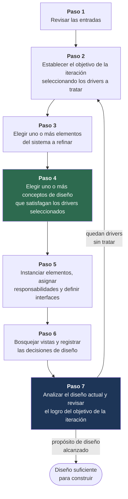

# 2. Proceso ADD

El método **ADD** (*Attribute-Driven Design*, Cervantes & Kazman) estructura el diseño como una
secuencia de iteraciones, cada una de las cuales recorre siete pasos. Lo que distingue a ADD de
«dibujar una arquitectura» es que cada decisión se toma **contra un driver identificado** y se
registra con las alternativas que se descartaron.

Los pasos 4 y 7 están resaltados porque son los que más suelen quedar flacos y los que el
enunciado evalúa de forma explícita: el paso 4 es donde se consideran **alternativas** (y no solo
se anuncia la elegida), y el paso 7 es donde se verifica honestamente qué quedó sin resolver.

## Iteraciones de este trabajo

| Iteración | Objetivo | Estado |
|---|---|---|
| [**Iteración 1**](iteracion-1/README.md) | Establecer la estructura general del sistema | ✅ Completa |
| [**Iteración 2**](iteracion-2/README.md) | Identificar las estructuras que soportan la funcionalidad primaria | ✅ Completa |
| [**Iteración 3**](iteracion-3/README.md) | Refinar para rendimiento, disponibilidad y escalabilidad | ✅ Completa |
| [**Iteración 4**](iteracion-4/README.md) | Refinar para interoperabilidad, seguridad, evolucionabilidad y uso internacional | ✅ Completa |

El fundamento de este orden está en el [plan de iteraciones](../00-gestion/plan-de-iteraciones.md#por-qué-este-orden-y-no-otro).

## Estado global de los drivers

Resumen del [kanban final de drivers](iteracion-4/paso-7-analisis.md#kanban-final-de-drivers-cierre-de-la-1ra-entrega)
al cierre de la iteración 4 (**cierre de la 1ra entrega**). En ADD, el avance se mide por cuántos
drivers quedaron tratados, no por cuántos diagramas se dibujaron.

| Estado | Cantidad | Qué significa |
|---|---|---|
| ⬜ No tratado | **0 (0 %)** | Ningún driver quedó sin decisión arquitectónica al cierre de la 1ra entrega |
| 🟨 Parcialmente tratado | **5 (9 %)** | Diseño arquitectónico completo; el tramo restante corresponde estrictamente a la ejecución o calibración del prototipo en la **2da entrega** (`RF-07`, `QA-16`, `CON-04`, `CON-05`, `CON-06`) |
| 🟩 Completamente tratado | **53 (91 %)** | Las decisiones tomadas lo satisfacen (incluidos los **5 ASRs**) y tienen criterio de confirmación verificable |
| **Total** | **58 (100 %)** | 15 RF + 18 QA + 10 CON + 15 CRN (`CRN-01`…`CRN-15`) |

Evolución por iteración: **Iteración 1** (`15 ⬜ · 27 🟨 · 11 🟩 = 53`) → **Iteración 2** (`8 ⬜ · 28 🟨 · 19 🟩 = 55`) → **Iteración 3** (`6 ⬜ · 14 🟨 · 36 🟩 = 56`) → **Iteración 4 / Cierre 1ra entrega** (`0 ⬜ · 5 🟨 · 53 🟩 = 58`).
