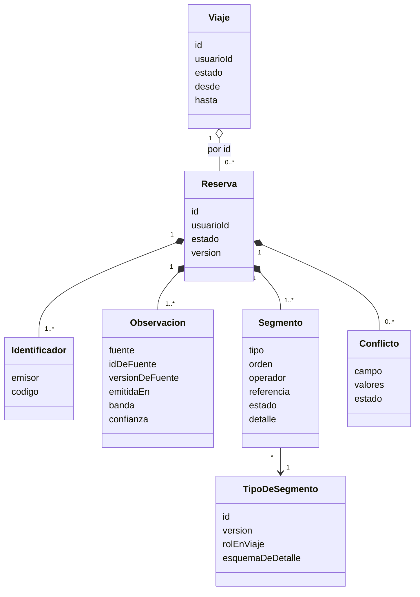

# Iteración 2 — Identificar las estructuras que soportan la funcionalidad primaria

> **Estado:** ✅ Completa · **Fecha:** 2026-10-28 · **Responsable de coordinación:** Jeremias Aguilar · **Participantes:** los cuatro integrantes

| Página de esta iteración | Contenido |
|---|---|
| Esta página | Pasos 1, 2, 3, 5 y 6 del método |
| [Paso 4 — Conceptos de diseño y alternativas](paso-4-alternativas.md) | Las 8 decisiones de la iteración (D10 a D17), con las alternativas evaluadas y descartadas |
| [Paso 7 — Análisis y kanban de drivers](paso-7-analisis.md) | Verificación del objetivo, criterios de salida y estado de los 55 drivers |

Plan que guió la iteración: [iteracion-2-plan.md](../iteracion-2-plan.md).

---

## Paso 1 — Revisar las entradas

Las entradas son las del análisis inicial **más** los productos de la
[iteración 1](../iteracion-1/README.md). Esa diferencia cambia el tipo de trabajo: la iteración 1
decidió la *forma* del sistema; esta decide el *comportamiento de sus partes*.

| Categoría de entrada | Contenido | Dónde está |
|---|---|---|
| **Propósito de diseño** | El mismo de la iteración 1: un sistema nuevo completo, hasta el punto en que un prototipo demuestre la viabilidad frente a los escenarios más riesgosos | [1.1](../../01-analisis-inicial/01-proposito-y-alcance.md#propósito-de-diseño-en-el-sentido-de-add) |
| **Requisitos funcionales primarios** | 9 de 15, agrupados en 7 casos de uso primarios UC-1…UC-7. **En esta iteración los 15 entran en foco** | [1.3](../../01-analisis-inicial/03-requisitos-funcionales.md#casos-de-uso-primarios) |
| **Escenarios de atributos de calidad** | QA-01…QA-18. Entran QA-11 y QA-15, y en parte QA-02 y QA-08 | [1.4](../../01-analisis-inicial/04-escenarios-de-calidad.md) |
| **Restricciones** | CON-01…CON-10 y CON-A1…CON-A4. Se satisfacen siempre | [1.5](../../01-analisis-inicial/05-restricciones.md) |
| **Inquietudes arquitectónicas** | CRN-01…CRN-10, **más CRN-11 y CRN-12 que entran ahora** | [1.6](../../01-analisis-inicial/06-concerns-arquitectonicos.md) |
| **Productos de la iteración 1** | Estructura de 13 elementos, nueve ADRs, cuatro vistas de nivel 1 y el [kanban de drivers](../iteracion-1/paso-7-analisis.md#kanban-de-drivers) | [iteración 1](../iteracion-1/README.md) |

### Lo que las entradas dicen antes de diseñar nada

Tres observaciones condicionan esta iteración entera:

1. **El kanban de la iteración 1 es el plan de trabajo.** Dejó 15 drivers en ⬜, **todos los
   requisitos funcionales sin tratar completamente**, y declaró que eso era lo esperado. Esta
   iteración no tiene un driver estrella como QA-05: su criterio de éxito es la **completitud del
   recorrido** de cada caso de uso, no la habilitación de un escenario.
2. **El problema difícil del dominio es reconciliar versiones de la verdad, no almacenarlas.** Una
   misma reserva real llega por correo, por el proveedor y por la mano del usuario, con
   identificadores y valores distintos y en cualquier orden. La promesa de ser el «único punto de
   verdad» (MN-1) no se cumple con una base de datos: se cumple con **reglas de identidad, de
   precedencia y de idempotencia**. De ahí que CRN-11 (conflictos) y CRN-12 (idempotencia) entren
   como drivers nuevos.
3. **El modelo canónico es la decisión de mayor alcance de todo el trabajo.** De él dependen
   QA-15, QA-10, QA-11 y la viabilidad del punto de extensión de la 2da entrega. Equivocarlo es
   el escenario de retrabajo más caro del proyecto, y por eso el paso 7 lo valida explícitamente
   contra los **cinco** tipos de segmento, incluidos los dos que todavía no se implementan.

---

## Paso 2 — Establecer el objetivo de la iteración

> **Objetivo de la iteración 2:** identificar las estructuras internas que soportan los 9
> requisitos funcionales primarios y los 7 casos de uso primarios, de modo que cada caso de uso
> tenga un recorrido completo y especificado entre elementos con interfaces declaradas.

La formulación contrasta con la de la iteración 1. Allí el criterio era **habilitación** («no
impedir»); acá es **completitud**: un caso de uso con un paso «por definir» no cumple el objetivo.

### Drivers seleccionados para esta iteración

| Driver | Estado al cerrar la iteración 1 | Qué debe lograr esta iteración |
|---|---|---|
| RF-03, RF-07 | 🟨 / ⬜ | **El modelo canónico** de Reserva, Segmento, Viaje y Tipo de segmento. Es el artefacto central de la iteración |
| RF-01 | 🟨 | Ciclo de vida del consentimiento de un buzón: otorgar, renovar, revocar |
| RF-02 | 🟨 | Diseño interno de suscripciones y del sondeo de reconciliación |
| RF-04 | ⬜ | Filtros y whitelists de remitentes |
| RF-05 | 🟨 | Contrato canónico de adaptador de proveedor, concreto |
| RF-06 | ⬜ | Gestión manual, incluida la resolución de conflictos con las fuentes automáticas |
| RF-08 | ⬜ | Ciclo de vida del viaje y archivado (política de AMB-08) |
| RF-09 | 🟨 | Contratos de los dos BFF |
| RF-10 | 🟨 | Reglas de notificación y canales |
| RF-12, RF-15 | ⬜ | Caso de soporte y preferencias |
| RF-14 | 🟨 | Modelo dimensional del plano analítico |
| QA-11 | 🟨 | Umbral de confianza de extracción y flujo hacia el usuario |
| CRN-06 | 🟨 | Estrategia concreta de pruebas de contrato |
| **CRN-11** | nuevo | **Resolución de conflictos** entre fuentes que describen la misma reserva |
| **CRN-12** | nuevo | **Idempotencia** de la ingesta: el mismo mensaje puede llegar dos veces |
| QA-15 | 🟨 | Validar el modelo canónico: agregar «tren» toca a lo sumo dos elementos |
| QA-02, QA-08 | 🟨 / ⬜ | **Solo la parte estructural**: la proyección de lectura del panel y la persistencia particionada (D12). El resto se trata en la iteración 3 |
| CON-01…CON-10, CON-A1…CON-A4 | — | Las restricciones se satisfacen siempre, en toda iteración |

### Drivers explícitamente excluidos de esta iteración

Para que el paso 7 pueda ser honesto, hay que declarar qué se dejó afuera a propósito:

| Excluido | Se trata en |
|---|---|
| R-1 y CRN-13 — consistencia de datos entre regiones activas | Iteración 3 |
| QA-01, QA-03, QA-04, QA-05, QA-06, QA-07 — tácticas concretas de rendimiento, disponibilidad y escalado | Iteración 3 |
| QA-08 completo, CRN-04, CRN-08, CRN-09 — crecimiento, despliegue continuo, costo y cuotas | Iteración 3 |
| RF-11, RF-13 — compartición y publicación en redes en detalle; QA-12, QA-13 | Iteración 4 |
| QA-14, QA-17, QA-18, CRN-05, CRN-10, CON-10 — auditoría, ubicación, región nueva, secretos, i18n, normativa | Iteración 4 |

---

## Paso 3 — Elegir los elementos del sistema a refinar

Ningún elemento nuevo se agrega a la estructura: **siguen siendo los 13 del plano operacional** más
los 2 del analítico, de modo que CON-A4 (menos de 15 elementos) se mantiene. Lo que cambia es el
*interior* de los elementos donde está el riesgo.

### Refinados con descomposición interna

| Elemento | Por qué |
|---|---|
| `itinerary` | Es el núcleo del dominio, el elemento más grande y el que concentra más riesgo (ver [R-5](paso-7-analisis.md#riesgos-residuales)) |
| `booking-extraction` | Es el elemento del riesgo **R-2** (fragilidad de la extracción desde correo) |
| `mail-ingest` | Tiene dos caminos de ingesta que deben converger ([ADR-0004](../../03-adr/ADR-0004-obtencion-de-correo.md)) |
| `provider-sync` | El contrato canónico de adaptador determina si QA-10 y QA-15 se cumplen |
| `preferences` | Es pequeño y habilita RF-08, RF-12 y RF-15 |

### Tratados en comportamiento y contrato, sin descomposición interna

Los drivers de esta iteración también tocan a otros elementos, pero lo que falta definir es **qué
hacen** y **qué contrato ofrecen**, no cómo se organizan por dentro (son lo bastante simples):

| Elemento | Qué se define | Driver |
|---|---|---|
| `identity-access` | Ciclo de vida del consentimiento del buzón | RF-01 |
| `notification` | Reglas de severidad, canales y coalescencia | RF-10 |
| `support-liaison` | El caso de soporte y su derivación | RF-12 |
| `bff-web`, `bff-mobile` | Contratos de las operaciones expuestas | RF-09 |
| `event-pipeline`, `analytics-store` | Modelo dimensional | RF-14 |

---

## Paso 4 — Elegir los conceptos de diseño

Esta es la parte sustantiva de la iteración y está en su propia página, con las alternativas
evaluadas y los motivos de descarte de cada una:

### → [Paso 4 — Conceptos de diseño y alternativas](paso-4-alternativas.md)

Resumen de las siete decisiones estructurales:

| # | Decisión | Concepto de diseño elegido | ADR |
|---|---|---|---|
| D10 | Modelo del dominio y sus límites | Agregados con límites transaccionales explícitos: `Reserva` y `Viaje` | [ADR-0010](../../03-adr/ADR-0010-modelo-canonico-reserva-segmento-viaje.md) |
| D11 | Extensibilidad del tipo de segmento | Registro de tipos con esquema declarado | [ADR-0011](../../03-adr/ADR-0011-extensibilidad-del-tipo-de-segmento.md) |
| D12 | Persistencia del plano operacional | Relacional con campos semiestructurados para el detalle por tipo | [ADR-0012](../../03-adr/ADR-0012-persistencia-del-plano-operacional.md) |
| D13 | Deduplicación y conflictos | Identificadores múltiples + precedencia por fuente con intervención del usuario; la coincidencia difusa solo sugiere | [ADR-0013](../../03-adr/ADR-0013-deduplicacion-y-conflictos.md) |
| D14 | Idempotencia de la ingesta | Clave de idempotencia por mensaje + fusión determinista | [ADR-0014](../../03-adr/ADR-0014-idempotencia-de-la-ingesta.md) |
| D15 | Confianza de extracción | Umbral por extractor con tres bandas y confirmación del usuario en la banda media | [ADR-0015](../../03-adr/ADR-0015-politica-de-confianza-de-extraccion.md) |
| D16 | Modelo del plano analítico | Esquema en estrella alimentado desde eventos crudos | [ADR-0016](../../03-adr/ADR-0016-modelo-dimensional-analitico.md) |

Y una decisión de proceso que cierra el criterio de salida 3:

| # | Decisión | ADR |
|---|---|---|
| D17 | Pruebas derivadas de la especificación, con suite de conformidad de complementos | [ADR-0017](../../03-adr/ADR-0017-estrategia-de-pruebas-y-contratos.md) |

---

## Paso 5 — Instanciar elementos, asignar responsabilidades y definir interfaces

### 5.1 `itinerary`: descomposición interna

`itinerary` se descompone en **nueve módulos**. Son módulos y no elementos: se despliegan juntos y
no agregan interfaces de red.

| Módulo | Responsabilidad única | Depende de | Drivers |
|---|---|---|---|
| `tipos-de-segmento` | Registro de descriptores versionados; valida el detalle de cada segmento contra el esquema de su tipo | — | QA-15 |
| `reservas` | Agregado `Reserva`: observaciones, segmentos, estados e invariantes | `tipos-de-segmento` | RF-03, RF-06 |
| `fusion` | Resolución de identidad por identificadores, consolidación por precedencia y apertura de conflictos | `reservas`, `tipos-de-segmento` | CRN-11, RF-06 |
| `viajes` | Agregado `Viaje`: membresía, agrupación y ciclo de vida | `tipos-de-segmento` (el rol), `reservas` (solo por id) | RF-07, RF-08 |
| `gestion-manual` | Comandos del usuario: alta, edición, baja, fijar un campo, mover entre viajes, resolver un conflicto | `reservas`, `fusion`, `viajes` | RF-06 |
| `ingesta` | Consumo de `ReservaExtraida` y `ReservaObservada`; bandeja de entrada | `fusion` | CRN-12 |
| `proyeccion-panel` | Modelo de lectura por usuario, mantenido por eventos internos | — (solo eventos) | RF-09, QA-02 |
| `publicacion` | *Outbox* y publicación de los eventos de dominio | — | CRN-12 |
| `api` | Exposición REST de lectura y de comandos | los anteriores | RF-09 |

**Reglas de dependencia** (se verifican en la [vista de módulos de nivel 2](../../04-vistas/vista-modulos-nivel-2.md)):
`reservas` no conoce a `viajes` ni a la inversa, y se comunican por eventos internos; solo `api` e
`ingesta` son puntos de entrada; `proyeccion-panel` no importa lógica de dominio.

**Dos modos de despliegue, un solo elemento.** Coherente con D1 (la ingesta y la lectura escalan por
separado), `itinerary` se despliega como `itinerary-escritura` (ingesta, fusión, reservas, viajes,
gestión manual, publicación) e `itinerary-lectura` (proyección y API de lectura), desde el mismo
código. El dimensionamiento va a la iteración 3 (QA-04).

#### Reglas de agrupación de reservas en viajes (RF-07)

La agrupación razona por **rol** y **lugar**, nunca por tipo, para que no conozca al tren:

1. Una reserva nueva se une al viaje activo cuyo período, ampliado por un margen, la contiene o
   la toca, **y** cuyo lugar de fin coincide con su lugar de inicio (continuidad geográfica) o un
   alojamiento está en la ciudad de destino.
2. Si ninguna regla aplica, se crea un viaje nuevo.
3. Una asignación hecha por el usuario queda **fijada**: ningún proceso automático la mueve.
4. El título y el período del viaje se derivan de sus reservas; el usuario puede renombrarlo.

Los valores (el margen, el criterio de «misma ciudad») son [supuestos iniciales](#511-parámetros-iniciales-supuestos-a-calibrar) que el prototipo calibra.

#### Ciclo de vida del viaje (RF-08)

| Estado | Entra cuando | Efecto sobre la vista principal |
|---|---|---|
| `Planificado` | Todas sus reservas son futuras | Visible |
| `EnCurso` | Comenzó su primer segmento | Visible, destacado |
| `Completado` | Pasó el margen tras el fin del último segmento activo | **Sale de la vista principal automáticamente**; se publica `ViajeCompletado` |
| `Archivado` | Pasó la gracia configurable desde `Completado` (AMB-08: archivar por omisión) | Solo en «Archivo»; se publica `ViajeArchivado` |
| `Eliminado` | El usuario lo elimina | Fuera de toda vista. La retención se decide en la iteración 4 (CON-10) |
| `Cancelado` | Todas sus reservas están canceladas | Visible hasta que el usuario lo descarte |

Las transiciones por tiempo las ejecutan trabajos programados por zona horaria (la adopción
acotada de funciones prevista en D1).

---

### 5.2 El modelo canónico

El modelo se organiza en dos agregados, y la parte variable por tipo vive en un registro.



**`Reserva`** es la unidad de identidad y de fusión. **`Observación`** es lo que una fuente
afirma sobre una reserva en un momento; **solo se agrega** y de ellas se deriva la vista
consolidada. **`Segmento`** es un tramo con inicio y fin; una reserva tiene al menos uno (un
localizador de vuelo con escalas tiene varios; un hotel, uno).

```yaml
Segmento:
  tipo: vuelo | hotel | auto | tren | autobus   # clave del registro
  orden: entero
  inicio: { instante, precision, zonaHoraria, lugar }
  fin:    { instante, precision, zonaHoraria, lugar }
  operador: texto
  referencia: texto?      # número de vuelo, de tren, línea, habitación...
  estado: confirmado | cancelado
  detalle: objeto         # validado contra el esquema del tipo
Lugar: { nombre, codigo?, esquemaDeCodigo?, pais, coordenadas?, zonaHoraria }
precision: instante | dia   # un boleto abierto de tren o autobús vale «ese día», sin hora
```

**Estados de una `Reserva`:** `PorConfirmar` → `Confirmada` → `Cancelada` / `Finalizada`; el usuario
puede llevar una `PorConfirmar` a `Descartada`.

#### El descriptor de tipo (el registro de QA-15)

Cada tipo se declara en un archivo versionado en `contratos/tipos-de-segmento/`. Ejemplo
abreviado:

```yaml
tipo: tren
version: 1
rolEnViaje: traslado          # traslado | alojamiento | movilidadLocal
esquemaDeDetalle:             # JSON Schema abreviado
  numeroDeTren: { tipo: texto, requerido: true }
  coche:  { tipo: texto }
  asiento: { tipo: texto }
  clase:  { tipo: texto }
camposRelevantes:             # para notification
  - { campo: inicio.instante, severidad: critica, umbralMinutos: 15 }
  - { campo: detalle.andén,   severidad: critica }
presentacion:                 # para los BFF y los clientes
  icono: tren
  titulo: "{operador} {referencia}"
  filas: [ coche, asiento, clase ]
dimension:                    # para el plano analítico
  atributos: [ operador, clase ]
```

Quién consume el descriptor, y por eso no necesita código nuevo por tipo: `itinerary` (valida),
adaptadores y extractores (validan su salida), `notification` (qué campos avisan), los BFF y
clientes (cómo se muestra; `GET /tipos-de-segmento`) y `event-pipeline` (qué atributos pasan a la
analítica).

---

### 5.3 `booking-extraction`

| Módulo | Responsabilidad única | Drivers |
|---|---|---|
| `registro-de-extractores` | Catálogo de extractores cargados como complementos por configuración; elige cuáles aplican a un mensaje | QA-11, QA-15 |
| `extractor-<formato>` *(complementos)* | Cada uno entiende un formato de remitente y cumple el contrato de abajo | RF-03 |
| `validador-canonico` | Valida la salida contra el esquema del tipo y aplica las verificaciones estructurales | QA-11 |
| `evaluador-de-confianza` | Calcula la confianza (mínimo de los campos obligatorios) y la compara con los umbrales del extractor para fijar la banda | QA-11 |
| `observabilidad-de-calidad` | Métricas por extractor y **disyuntor de calidad** («solo confirmación») | R-2 |
| `publicador` | Publica `ReservaExtraida` o `ExtraccionNoReconocida` | RF-03 |

**Contrato del extractor** (`contratos/plugins/extractor.yaml`):

```yaml
Extractor:
  id: texto
  version: texto
  remitentesQueReconoce: [patrón]      # alimenta el catálogo de remitentes seguros
  umbrales: { alto: 0.90, bajo: 0.60 } # valores iniciales, calibrados por extractor
  reconoce(mensaje: MensajeNormalizado) -> { aplica: bool }
  extrae(mensaje: MensajeNormalizado)  -> {
    observaciones: [ObservacionCanonica],
    confianza: { global: 0..1, porCampo: { campo: 0..1 } },
    advertencias: [texto]
  }
```

### 5.4 `mail-ingest`

Los dos caminos de [ADR-0004](../../03-adr/ADR-0004-obtencion-de-correo.md) (el *push* y la
reconciliación) **convergen en una cola de «buzones con cambios»**; desde ahí hay un único camino.

| Módulo | Responsabilidad única | Drivers |
|---|---|---|
| `suscripciones` | Crea, renueva antes de que expiren y detecta la caída de las suscripciones de notificación; ante una caída, fuerza una reconciliación | RF-02 |
| `receptor` | Recibe el aviso del proveedor y encola «buzón con cambios» | RF-02, QA-01 |
| `reconciliador` | Sondeo escalonado por actividad del buzón; encola igual que el receptor | RF-02, CRN-09 |
| `descargador` | Pide un token de uso acotado a `identity-access`, baja los **metadatos** y, si pasan los filtros, el mensaje | QA-13 |
| `filtros` | Whitelist y bloqueo por remitente, evaluados **sobre los metadatos antes de descargar el cuerpo** | RF-04 |
| `normalizador` | Convierte el mensaje al formato común `MensajeNormalizado` | RF-02 |
| `deduplicador` | Bandeja de entrada por `(buzón, idDeMensaje)` | CRN-12 |
| `publicador` | Publica `MensajeDeViajeRecibido` | RF-02 |

**Filtros (RF-04).** Hay tres listas: el **catálogo de remitentes reconocidos** (derivado del
registro de extractores, por lo que un formato nuevo se incorpora solo), las **permitidas** por el
usuario (su agencia, por ejemplo) y las **bloqueadas**. La precedencia es bloquear > permitir >
catálogo. Un remitente permitido cuyo formato ningún extractor reconoce termina en
`ExtraccionNoReconocida`, no se ignora. Filtrar antes de bajar el cuerpo reduce los datos
personales que el sistema llega a procesar.

**Lo que `mail-ingest` sigue sin hacer:** interpretar el contenido (es de `booking-extraction`).

### 5.5 `provider-sync`

| Módulo | Responsabilidad única | Drivers |
|---|---|---|
| `registro-de-adaptadores` | Catálogo de adaptadores como complementos, por configuración | QA-10, QA-15 |
| `adaptador-<proveedor>` *(complementos)* | Traduce un proveedor al modelo canónico, con el contrato de abajo | RF-05 |
| `seguimiento` | Índice de qué reservas se siguen en cada proveedor y de qué usuario son | RF-05, RF-10 |
| `receptor-de-notificaciones` | Webhooks entrantes de los proveedores | QA-01 |
| `programador` | Trabajos programados de consulta para los proveedores sin notificación | RF-05, CRN-09 |
| `detector-de-disrupciones` | Reconoce una disrupción y la expande a los usuarios afectados con `seguimiento` | UC-5, QA-04 |
| `proteccion` | Un cortacircuitos y un mamparo por adaptador (los umbrales son de la iteración 3) | QA-06 |
| `publicador` | Publica `ReservaObservada` y `DisrupcionDetectada` | RF-05 |

**Contrato del adaptador** (`contratos/plugins/adaptador.yaml`):

```yaml
AdaptadorDeProveedor:
  id: texto
  version: texto
  tiposDeSegmento: [tipo]
  capacidades: { push: bool, sondeo: bool, cancelaciones: bool, cuotaPorMinuto: entero }
  obtenerReserva(credencial, referencia)  -> ObservacionCanonica
  traducirNotificacion(payload)           -> [CambioObservado]   # webhook entrante
  sondear(credencial, desde)              -> [CambioObservado]   # trabajo programado
  detectarDisrupcion(cambio)              -> Disrupcion?
```

`provider-sync` **ya no publica** `ReservaActualizada` ni `ReservaCancelada`: publica
`ReservaObservada`, y esos dos eventos los emite solo `itinerary` ya fusionados (ver
[ajustes a la iteración 1](paso-7-analisis.md#ajustes-a-la-iteración-1)).

### 5.6 `preferences`

| Dato | Para qué |
|---|---|
| Agencia preferida | RF-12 |
| Idioma, zona horaria, región | RF-09, RF-10, QA-18 |
| Política de archivado (días de gracia) | RF-08 |
| Canales habilitados y horas de silencio | RF-10 |

Cada cambio publica `PreferenciasActualizadas`, y los consumidores (`notification`, `itinerary`,
`support-liaison`) **mantienen una copia local**: así no hay una llamada sincrónica a
`preferences` por cada notificación durante un pico de disrupción (QA-04). Los filtros de correo
(RF-04) **no** viven acá sino en `mail-ingest`, para que el camino caliente de ingesta no dependa
de otro elemento.

---

### 5.7 Elementos tratados en comportamiento y contrato

#### `identity-access` — consentimiento del buzón (RF-01)

| Estado | Entra cuando | Efecto |
|---|---|---|
| `Solicitado` | El usuario inicia la autorización con su proveedor de correo | — |
| `Activo` | El proveedor otorga el consentimiento y el token se guarda cifrado | `mail-ingest` crea la suscripción |
| `RequiereReautorizacion` | Falla la renovación, el proveedor revocó el permiso o redujo el alcance | La ingesta de ese buzón se pausa; se avisa al usuario |
| `Revocado` | El usuario desconecta el buzón | Se revoca el token en el proveedor, se destruye en la bóveda y se baja la suscripción |

Cada cambio publica `EstadoDeBuzonCambiado`. Qué se hace con los datos ya extraídos de un buzón
revocado lo decide la iteración 4 (CON-10); por omisión **se conservan**, porque son datos del
usuario.

#### `notification` — reglas de aviso (RF-10)

| Severidad | Disparadores | Canales por omisión | Horas de silencio |
|---|---|---|---|
| **Crítica** | Cancelación; cambio de horario o de puerta/andén declarado relevante por el descriptor; `DisrupcionDetectada` alta | Push + canal interno (correo si el push está inhabilitado) | **No** se respetan |
| **Informativa** | Reserva agregada o por confirmar; cambios menores | Canal interno; push si el usuario lo habilitó | Se respetan |
| **Administrativa** | Buzón que requiere reautorización; extracción no reconocida; conflicto abierto | Canal interno + correo | Se respetan |

Reglas transversales: la primera crítica sale de inmediato y las siguientes del mismo viaje se
agrupan en una ventana corta (coalescencia); una disrupción y el cambio de reserva que provoca se
correlacionan por un `idDeCausa` y producen **un solo** aviso; el canal interno de la aplicación
se actualiza siempre, de modo que la ventana no consume el presupuesto de QA-01.

#### `support-liaison` — caso de soporte (RF-12)

Un `Caso` tiene el **contexto del viaje en el momento de abrirlo** (una instantánea inmutable), el
motivo, la agencia destino y su estado: `Abierto` → `Derivado` → `EnGestión` → `Resuelto` o
`Cerrado`. La creación es **idempotente** (`Idempotency-Key`), de modo que un doble toque no abre
dos casos. La conexión con cada agencia es un adaptador cargado como complemento (mismo patrón que
D6), y si la agencia no ofrece una interfaz de estado, el usuario lo marca como resuelto. Se
publica `CasoDerivado`. Sin agencia preferida, el comando se rechaza indicando cómo configurarla.

#### `bff-web` y `bff-mobile` — operaciones expuestas (RF-09)

| Operación | Descripción | Observación |
|---|---|---|
| `GET /panel`, `GET /panel/resumen` (móvil) | Viajes activos, reservas por confirmar y conflictos abiertos | Una sola ida y vuelta |
| `GET /viajes/{id}` | Detalle del viaje | |
| `GET /tipos-de-segmento` | Descriptores para renderizar | Cacheable |
| `POST /reservas` | Alta manual | `Idempotency-Key`; devuelve posibles duplicados |
| `PUT /reservas/{id}`, `DELETE /reservas/{id}` | Edición (fija los campos tocados) y baja | |
| `POST /reservas/{id}/confirmacion` | Confirma o descarta una reserva `PorConfirmar` | |
| `POST /reservas/{id}/conflictos/{cid}/resolucion` | Resuelve un conflicto de fuentes | |
| `PUT /viajes/{vid}/reservas/{rid}` | Mueve una reserva a otro viaje (queda fijada) | |
| `POST /viajes/{id}/archivo`, `DELETE /viajes/{id}` | Archiva o elimina | |

---

### 5.8 Esquemas de persistencia del plano operacional

Todas las tablas llevan `usuario_id` como **clave de partición** (D12). El producto concreto y la
replicación entre regiones se deciden en la iteración 3.

| Tabla | Clave y restricciones | Notas |
|---|---|---|
| `reserva` | `(usuario_id, reserva_id)` | Estado, versión y marcas de tiempo |
| `reserva_identificador` | **Único** `(usuario_id, emisor, codigo)` → `reserva_id` | Es lo que vuelve exacta la resolución de identidad de D13 |
| `observacion` | **Único** `(reserva_id, fuente, id_de_fuente)` | Solo se agrega. Guarda banda, confianza, `version_de_fuente` y la carga canónica (JSON). Se compacta |
| `segmento` | `(usuario_id, reserva_id, segmento_id)` | Núcleo en columnas; `detalle` en JSON; `fijados` indica los campos fijados |
| `conflicto` | `(usuario_id, reserva_id, conflicto_id)` | Campo, valores en disputa, estado |
| `viaje` | `(usuario_id, viaje_id)` | Estado, período, título, versión |
| `viaje_reserva` | `(usuario_id, viaje_id, reserva_id)` | `fijada` indica asignación del usuario |
| `bandeja_entrada` | **Único** `(consumidor, evento_id)` | Retención acotada (ver D14) |
| `bandeja_salida` | `evento_id` | Evento pendiente de publicar, escrito junto con el cambio |
| `panel_usuario` | `(usuario_id)` | Proyección de lectura del panel |

### 5.9 El modelo dimensional del plano analítico

Dos hechos y seis dimensiones, alimentados desde los eventos de dominio retenidos crudos (D16).

| Hecho | Tipo y granularidad | Medidas | Dimensiones |
|---|---|---|---|
| `hecho_cambio_reserva` | Transaccional: una fila por evento de reserva (creada, actualizada, cancelada, unificada) | Cantidad; anticipación en días (inicio − evento); proporción de cambios por fuente | fecha, tipo de segmento, proveedor, lugar de origen, lugar de destino, fuente, usuario |
| `hecho_viaje` | *Snapshot* acumulativo: una fila por viaje, con hitos de creado, iniciado, completado y archivado | Reservas, segmentos, duración en días, cancelaciones, disrupciones, conflictos | fecha (cuatro roles), destino principal, usuario |

| Dimensión | Contenido | Nota |
|---|---|---|
| `dim_fecha` | Calendario | |
| `dim_tipo_segmento` | Un registro por tipo, alimentado desde el registro de tipos | **Tipo nuevo = fila nueva** |
| `dim_proveedor` | Operadores y proveedores | Historial de cambios (SCD tipo 2) |
| `dim_lugar` | País > ciudad > punto (aeropuerto, estación, hotel) | |
| `dim_fuente` | Correo, proveedor, manual | |
| `dim_usuario` | **Seudónimo**, región, cohorte de alta | Sin datos personales; la política es de la iteración 4 |

Preguntas que responde (RF-14): tendencias (`hecho_cambio_reserva` por fecha y tipo), destinos
(`hecho_viaje` por `dim_lugar`) y cancelaciones (cambios de tipo «cancelada» por proveedor y
anticipación).

### 5.10 Catálogo de eventos actualizado

Los eventos pasan de 8 a **15**. En negrita lo que cambia respecto de la iteración 1; el detalle de
los ajustes está en el [paso 7](paso-7-analisis.md#ajustes-a-la-iteración-1).

| Evento | Lo publica | Lo consumen |
|---|---|---|
| `MensajeDeViajeRecibido` | `mail-ingest` | `booking-extraction` |
| `ReservaExtraida` (ahora con `banda` y `confianza`) | `booking-extraction` | `itinerary` |
| **`ReservaObservada`** *(nuevo)* | `provider-sync` | `itinerary` |
| **`ExtraccionNoReconocida`** *(nuevo)* | `booking-extraction` | `notification` |
| `ReservaActualizada` | **solo `itinerary`**, ya fusionada | `notification`, `event-pipeline` |
| `ReservaCancelada` | **solo `itinerary`**, ya fusionada | `notification`, `event-pipeline`, `support-liaison` |
| **`ConflictoDeFuentesDetectado`** *(nuevo)* | `itinerary` | `notification`, `event-pipeline` |
| `ViajeArmado` | `itinerary` | `event-pipeline`, *punto de extensión de la 2da entrega* |
| `ViajeCompletado` | `itinerary` | `event-pipeline`, `notification` |
| **`ViajeArchivado`** *(nuevo)* | `itinerary` | `event-pipeline` |
| `DisrupcionDetectada` (ahora con los usuarios afectados) | `provider-sync` | `notification`, `support-liaison` |
| **`EstadoDeBuzonCambiado`** *(nuevo)* | `identity-access` | `mail-ingest`, `notification` |
| **`PreferenciasActualizadas`** *(nuevo)* | `preferences` | `notification`, `itinerary`, `support-liaison` |
| **`CasoDerivado`** *(nuevo)* | `support-liaison` | `notification`, `event-pipeline` |
| `NotificacionEmitida` | `notification` | `event-pipeline` |

### 5.11 Parámetros iniciales (supuestos a calibrar)

Estos valores **no son drivers**: son puntos de partida para que el diseño sea concreto, y se
calibran con el prototipo.

| Parámetro | Valor inicial | Se calibra con |
|---|---|---|
| Umbrales de confianza por extractor (alto / bajo) | 0,90 / 0,60 | El corpus de referencia de cada extractor |
| Margen para dar por `Completado` un viaje | 24 h tras el fin del último segmento activo, en la zona horaria del lugar de fin | El prototipo |
| Gracia entre `Completado` y `Archivado` | 3 días (configurable por el usuario) | Uso real |
| Margen de agrupación entre reservas | 72 h | RF-07, con datos reales |
| Ventana de la bandeja de entrada | 14 días (debe superar el intervalo máximo de reconciliación) | [ADR-0004](../../03-adr/ADR-0004-obtencion-de-correo.md) |
| Ventana de coalescencia de notificaciones | 30 s; la primera crítica sale de inmediato | QA-01 |
| Horas de silencio por omisión | 22:00 a 07:00 locales, salvo críticas | Preferencias |

---

## Paso 6 — Bosquejar vistas y registrar las decisiones de diseño

### Vistas producidas o actualizadas en esta iteración

| Vista | Qué muestra | Enlace |
|---|---|---|
| Módulos — nivel 2 | Los módulos internos de `itinerary` y `booking-extraction` y sus dependencias permitidas | [vista-modulos-nivel-2](../../04-vistas/vista-modulos-nivel-2.md) |
| Secuencias de los casos primarios | UC-1 a UC-7, sin pasos «por definir» | [secuencias-casos-primarios](../../04-vistas/secuencias-casos-primarios.md) |
| Componentes y conectores — nivel 1 *(actualizada)* | Los nuevos eventos y el cambio de publicador de `ReservaActualizada` | [vista-cyc-nivel-1](../../04-vistas/vista-cyc-nivel-1.md) |
| Glosario *(ampliado)* | El modelo de dominio detallado, con el vocabulario de esta página | [09-glosario](../../01-analisis-inicial/09-glosario.md) |

### Contratos declarados en el repositorio

Todas las interfaces de la [vista C&C de nivel 1](../../04-vistas/vista-cyc-nivel-1.md) tienen
contrato bajo `contratos/` ([ADR-0009](../../03-adr/ADR-0009-contratos-spec-driven.md)).

| Interfaz | Contrato | Estado |
|---|---|---|
| `api-gateway` (HTTP público) | `contratos/openapi/api-gateway.yaml` | Completo |
| `bff-web`, `bff-mobile` | `contratos/openapi/bff-web.yaml`, `bff-mobile.yaml` | Completo |
| `identity-access` | `contratos/openapi/identity-access.yaml` | Completo |
| `itinerary` | `contratos/openapi/itinerary.yaml` | Completo |
| `mail-ingest` y `provider-sync` (webhooks entrantes) | `contratos/openapi/mail-ingest-webhooks.yaml`, `provider-sync-webhooks.yaml` | Completo |
| `support-liaison` | `contratos/openapi/support-liaison.yaml` | Completo |
| `preferences` | `contratos/openapi/preferences.yaml` | Completo |
| `sharing` | `contratos/openapi/sharing.yaml` | **Borrador**: operaciones y esquemas base; se completa en la iteración 4 (RF-11, RF-13) |
| Eventos de dominio (15) | `contratos/asyncapi/eventos-de-dominio.yaml` | Completo |
| Contratos de complementos | `contratos/plugins/extractor.yaml`, `adaptador.yaml` | Completo |
| Descriptores de tipo de segmento | `contratos/tipos-de-segmento/` (vuelo, hotel, auto, tren, autobús) | Completo, incluidos los dos tipos que aún no se implementan |
| `analytics-store` (SQL analítico) | `contratos/analitica/modelo-dimensional.sql` | Completo |

### Decisiones registradas

Ocho ADRs nuevos en formato MADR, todos en estado `aceptado`:
[ADR-0010](../../03-adr/ADR-0010-modelo-canonico-reserva-segmento-viaje.md) ·
[ADR-0011](../../03-adr/ADR-0011-extensibilidad-del-tipo-de-segmento.md) ·
[ADR-0012](../../03-adr/ADR-0012-persistencia-del-plano-operacional.md) ·
[ADR-0013](../../03-adr/ADR-0013-deduplicacion-y-conflictos.md) ·
[ADR-0014](../../03-adr/ADR-0014-idempotencia-de-la-ingesta.md) ·
[ADR-0015](../../03-adr/ADR-0015-politica-de-confianza-de-extraccion.md) ·
[ADR-0016](../../03-adr/ADR-0016-modelo-dimensional-analitico.md) ·
[ADR-0017](../../03-adr/ADR-0017-estrategia-de-pruebas-y-contratos.md)

[ADR-0006](../../03-adr/ADR-0006-capa-de-anticorrupcion.md) recibe una nota de actualización por el
cambio de publicador de los eventos de reserva.

---

## Paso 7 — Analizar el diseño y revisar el logro del objetivo

### → [Paso 7 — Análisis y kanban de drivers](paso-7-analisis.md)

**Veredicto:** el objetivo de la iteración se alcanzó. Los 7 casos de uso tienen un recorrido
completo, ningún requisito funcional queda en ⬜ y el modelo canónico se validó contra los cinco
tipos de segmento. Quedan completamente tratados 19 de los 55 drivers (eran 11 de 53 al cierre de la iteración 1). El propósito de diseño
global **no** está alcanzado: el análisis deja **cinco riesgos residuales**, dos de ellos nuevos
(R-4, R-5), y la iteración 3 debe resolver R-1 y R-4 **juntos**.