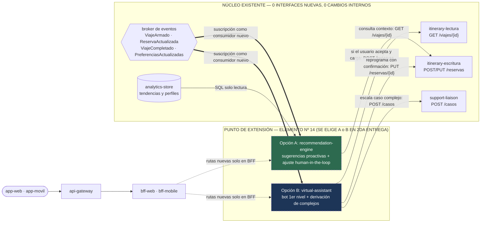

# Iteración 4 — Refinar para interoperabilidad, seguridad, evolucionabilidad y uso internacional

> **Estado:** ✅ Completa · **Fecha:** 2026-10-29 · **Responsable de la iteración:** Juan Emilio Pardo · **Participantes:** los cuatro integrantes

| Página de esta iteración | Contenido |
|---|---|
| Esta página | Pasos 1, 2, 3, 5 y 6 del método, modelo de seguridad/privacidad y verificación en papel de las Opciones A y B |
| [Paso 4 — Conceptos de diseño y alternativas](paso-4-alternativas.md) | Las 9 decisiones de la iteración (D27 a D35), con las alternativas evaluadas y descartadas |
| [Paso 7 — Análisis, cierre de la 1ra entrega y kanban final](paso-7-analisis.md) | Verificación de los 6 criterios de salida, auditoría de consistencia entre vistas, estado final de los 58 drivers y transición a la 2da entrega |
| [Guías de extensión verificables](guias-de-extension.md) | Procedimientos paso a paso para agregar un medio de transporte (`QA-15`: caso `tren`), un proveedor (`QA-10`) y una región (`QA-18`) |

Plan que guió la iteración: [iteracion-4-plan.md](../iteracion-4-plan.md).

---

## Paso 1 — Revisar las entradas

Esta es la **cuarta y última iteración** de la primera entrega. Recibe la arquitectura estructural de
la [iteración 1](../iteracion-1/README.md), el diseño interno y el modelo canónico de la
[iteración 2](../iteracion-2/README.md), y las tácticas operativas, de consistencia multirregión y de
costo de la [iteración 3](../iteracion-3/README.md) (`ADR-0001` a `ADR-0026`).

| Categoría de entrada | Contenido | Dónde está |
|---|---|---|
| **Propósito de diseño** | Completar el diseño arquitectónico del sistema hasta dejar verificados todos los drivers de diseño y demostrado que el módulo avanzado de la 2da entrega encaja sin cambios estructurales | [1.1](../../01-analisis-inicial/01-proposito-y-alcance.md#propósito-de-diseño-en-el-sentido-de-add) |
| **Escenarios de atributos de calidad** | **QA-10 a QA-18** entran como foco de cierre y verificación; se cierran los dos últimos ASRs del cuadrante `(A, A)` (**`QA-11`** y **`QA-13`**) | [1.4](../../01-analisis-inicial/04-escenarios-de-calidad.md) · [1.8](../../01-analisis-inicial/08-arbol-de-utilidad.md) |
| **Restricciones** | En foco directo **CON-01** (4ta iteración), **CON-05** (criterio de recorte del prototipo), **CON-06** (punto de extensión para Opción A y B), **CON-07**, **CON-08** y **CON-10** (GDPR y Ley 25.326), manteniendo **CON-A4** (`< 15` elementos) | [1.5](../../01-analisis-inicial/05-restricciones.md) |
| **Inquietudes arquitectónicas** | **CRN-05**, **CRN-07**, **CRN-10**, más las dos últimas inquietudes previstas por el análisis inicial: **CRN-14** (versionado de contratos) y **CRN-15** (residencia de datos) | [1.6](../../01-analisis-inicial/06-concerns-arquitectonicos.md) |
| **Estado heredado de la iteración 3** | [Kanban de 56 drivers](../iteracion-3/paso-7-analisis.md#kanban-de-drivers) (`36 🟩 · 14 🟨 · 6 ⬜`) y **dos únicos riesgos abiertos**: **`R-2`** (fragilidad de formatos de correo desconocidos) y **`R-6`** (tensión entre el registro testigo transregional de `D18` y la residencia estricta de datos personales) | [iteración 3, paso 7](../iteracion-3/paso-7-analisis.md#riesgos-residuales) |

### Lo que las entradas dicen antes de diseñar nada

Tres observaciones conectan directamente las decisiones previas con el cierre de esta iteración:

1. **La seguridad y el cumplimiento normativo (`QA-13`, `QA-14`, `CON-10`, `R-6`) se resuelven sobre
   la clave `usuario_id` y la `región_primaria` que ya existen.** Como la iteración 2 particionó el
   dominio por `usuario_id` (`D12`) y seudonimizó `dim_usuario` (`D16`), y la iteración 3 asignó una
   `región_primaria` a cada cuenta (`D18` / `D23`), asignar **una clave de cifrado de datos por
   usuario (`DEK_u`) envuelta por una clave maestra regional (`KEK_region`)** resuelve en un único
   movimiento la custodia de tokens (`QA-13`), la supresión en almacenes inmutables (`QA-14`) y la
   protección criptográfica del registro testigo transregional (`R-6`).
2. **La evolucionabilidad (`QA-10`, `QA-15`, `QA-18`, `CRN-14`) depende de hacer explícitos los
   contratos de frontera, no de abrir más microservicios.** Ya existen los registros de complementos
   (`D6`), el descriptor declarativo de `TipoDeSegmento` (`D11`) y el protocolo *expand/contract*
   (`D22`); falta fijar cómo evolucionan sus versiones sin romper consumidores y demostrar el
   recorrido paso a paso con esfuerzos medibles.
3. **Verificar `CON-06` exige diseñar en papel *ambas* opciones de la 2da entrega, no elegir una
   ahora.** Si tanto el recomendador *human-in-the-loop* (Opción A) como el asistente conversacional
   (Opción B) se integran consumiendo los eventos e interfaces publicados en las iteraciones 1 y 2
   sin tocar ningún servicio de dominio, el riesgo de retrabajo en la 2da entrega desaparece.

---

## Paso 2 — Establecer el objetivo de la iteración

> **Objetivo de la iteración 4:** refinar las estructuras del sistema para satisfacer los escenarios
> de interoperabilidad, seguridad y privacidad normativa, evolucionabilidad, usabilidad móvil e
> internacionalización; cerrar el riesgo `R-6` y el flujo arquitectónico de `R-2`; verificar en papel
> que la arquitectura aloja tanto la Opción A como la Opción B de la 2da entrega sin cambios
> estructurales; y cerrar la primera entrega con **cero drivers en ⬜** y el **100 % de los 58 drivers
> trazados a decisiones arquitectónicas**.

### Drivers seleccionados para esta iteración

| Driver | Estado al cerrar la iteración 3 | Qué debe lograr esta iteración |
|---|---|---|
| **QA-10** | 🟩 | **Verificar documentalmente** que integrar un proveedor NDC nuevo modifica `0` elementos existentes en `≤ 40 h-p`, apoyado en el contrato versionado |
| **QA-11** *(ASR-4)* | 🟨 | Cerrar el flujo hacia el usuario ante `ExtraccionNoReconocida`, el registro anónimo de huellas de formato (`0 %` inserción silenciosa errónea) y acotar `R-2` |
| **QA-12** | 🟩 | **Verificar** control de acceso, caducidad (30 días), revocación (`≤ 60 s`) y cerrar el caso del **designado sin cuenta previa** |
| **QA-13** *(ASR-5)* | 🟨 | Cifrado por sobres, rotación de claves, auditoría del `100 %`, detección de extracción masiva (`≤ 5 min`) y revocación regional en bloque (`≤ 15 min`) |
| **QA-14** | ⬜ | Catálogo de datos personales, exportación de inventario e historial en `≤ 72 h` y supresión verificable en `≤ 30 días` en **ambos planos** (operacional y analítico) |
| **QA-15** | 🟩 | **Verificar en papel con `tren`**: `≤ 2` elementos existentes tocados, `0` servicios de dominio modificados y esfuerzo `≤ 80 h-p` |
| **QA-16** | 🟨 | Completar el `100 %` de la matriz de trazabilidad documental (58/58 drivers); solo resta el eslabón al código del prototipo en la 2da entrega |
| **QA-17** | ⬜ | Contexto espacial por GPS en móvil (`≥ 90 %` de acierto en segmento próximo) con privacidad en el dispositivo y degradación limpia sin permiso |
| **QA-18** | ⬜ | Externalización total de localización (`0` literales en código), formatos CLDR y apertura de nueva región en `≤ 120 h-p` con `0` cambios en lógica de negocio |
| **CON-10** | ⬜ | Cumplimiento de GDPR (UE) y Ley 25.326 (Argentina): bases legales, minimización, derechos del titular y residencia de datos |
| **CON-08** | 🟩 | Cerrar el asunto abierto de [ADR-0007](../../03-adr/ADR-0007-identidad-y-comparticion.md) para buzones IMAP sin soporte OAuth |
| **CON-06 / CON-05** | 🟨 / ⬜ | **Verificar** en papel Opción A y Opción B sobre el punto de extensión sin interfaces nuevas, y fijar el criterio de recorte del prototipo para la 2da entrega |
| **CON-01** | 🟨 | Completar la cuarta iteración del proceso ADD |
| **CRN-05** | 🟨 | Custodia, rotación periódica y revocación de secretos y tokens delegados |
| **CRN-07** | 🟩 | Verificar la cadena completa `driver → decisión → ADR → vista → contrato` |
| **CRN-10** | ⬜ | Internacionalización como propiedad estructural desde el diseño |
| **CRN-14** | *nuevo* | Versionado y evolución compatible de contratos HTTP, eventos AsyncAPI y complementos |
| **CRN-15** | *nuevo* | Residencia de datos por jurisdicción y resolución del riesgo **`R-6`** |
| **RF-01, RF-03, RF-05, RF-11, RF-12, RF-13** | 🟨 | Cerrar todos los bordes funcionales pendientes de consentimiento, formato desconocido, adaptadores, compartición y publicación segura |

---

## Paso 3 — Elegir los elementos del sistema a refinar

Se mantiene inalterado el catálogo de `13` servicios operacionales + `2` elementos analíticos
(`CON-A4`), refinando el interior y las políticas transversales de cinco áreas y validando el encaje
del elemento `14` reservado para la 2da entrega:

| Elemento / Subsistema | Qué se refina en esta iteración | Drivers que lo motivan |
|---|---|---|
| **Capa de anticorrupción** (`provider-sync`, `booking-extraction`, `mail-ingest`, `support-liaison`) | Estructura estática del subsistema de complementos, versionado `SemVer` de contratos, flujo de cuarentena/asistencia ante formato desconocido y vía segura para correo sin OAuth | `QA-10`, `QA-11`, `QA-15`, `CRN-14`, `CON-08`, `RF-01`, `RF-03`, `RF-05`, `RF-12` |
| **`identity-access` y bóveda regional (`VAULT`)** | Descomposición en 5 módulos internos (`autenticacion-oidc`, `consentimiento-buzones`, `custodia-boveda`, `motor-autorizacion-abac`, `auditoria-y-revocacion`), cifrado por sobres, detección `≤ 5 min` y revocación `≤ 15 min` | `QA-12`, `QA-13`, `QA-14`, `CRN-05`, `CON-10` |
| **`sharing`** | Separación estructural e implementación de `comparticion-designados` (incluyendo flujo para designados sin cuenta previa) y `publicacion-resumen` por lista blanca estricta | `QA-12`, `RF-11`, `RF-13`, `AMB-10` |
| **Plano de datos operacional y `analytics-store`** | Clasificación de datos por residencia (`R-6` resuelto con testigo cifrado jurisdiccional), inventario auditable y protocolo de supresión en `≤ 30 días` en OLTP y Parquet columnar | `QA-14`, `CON-10`, `CRN-15`, `QA-18` |
| **Capa de clientes (`bff-*`, `app-web`, `app-movil`) y recursos `i18n`** | Paquetes externalizados de localización ICU/CLDR y módulo nativo `contexto-ubicacion` con geocercas en el dispositivo y degradación sin GPS | `QA-17`, `QA-18`, `CRN-10`, `RF-15` |
| **Punto de extensión de 2da entrega** (`recommendation-engine` / `virtual-assistant`) | Verificación arquitectónica completa en papel de Opción A y Opción B como elemento nº 14 sobre los eventos y APIs ya publicados | `CON-06`, `CON-05`, `CON-A4` |

---

## Paso 4 — Elegir los conceptos de diseño

El análisis comparativo completo de opciones y motivos de descarte está en su propia página:

### → [Paso 4 — Conceptos de diseño y alternativas](paso-4-alternativas.md)

Resumen de las siete decisiones tácticas y estructurales:

| # | Decisión | Concepto de diseño elegido | ADR |
|---|---|---|---|
| D27 | Versionado de contratos publicados | Evolución aditiva compatible por omisión (*tolerant reader*), cabecera de medio solo ante ruptura mayor en HTTP, `versionEsquema` con doble emisión acotada en eventos y `SemVer` en complementos | [ADR-0027](../../03-adr/ADR-0027-versionado-y-evolucion-de-contratos.md) |
| D28 | Autorización, designados y publicación | Autenticación OIDC en borde + políticas declarativas ABAC firmadas; verificación ligera sin contraseña para designados sin cuenta; proyección de lista blanca para redes sociales | [ADR-0028](../../03-adr/ADR-0028-autorizacion-comparticion-y-publicacion.md) |
| D29 | Cifrado, custodia y rotación de claves | Cifrado por sobres (`KEK` regional en HSM/KMS + `DEK` por usuario), mTLS por identidad de servicio, detección de anomalía en `≤ 5 min` y revocación regional en `≤ 15 min` | [ADR-0029](../../03-adr/ADR-0029-cifrado-custodia-y-rotacion-de-claves.md) |
| D30 | Auditoría y supresión en ambos planos | Bitácora inmutable encadenada (`≤ 72 h` para inventario) + borrado físico en OLTP + cripto-supresión inmediata de vínculo y compactación programada (`≤ 25 d`) en `analytics-store` | [ADR-0030](../../03-adr/ADR-0030-auditoria-y-supresion-datos-personales.md) |
| D31 | Residencia normativa por región (`R-6`) | Tres clases de sensibilidad; datos identificables fijos en `región_primaria` y registro testigo transregional cifrado con clave bajo custodia jurisdiccional de origen (*ciphertext-only witness*) | [ADR-0031](../../03-adr/ADR-0031-residencia-de-datos-por-region.md) |
| D32 | Internacionalización y localización | Dominio neutral con códigos canónicos e instantes `UTC + IANA TZ`, catálogos ICU externalizados en CDN y formateo CLDR nativo | [ADR-0032](../../03-adr/ADR-0032-internacionalizacion-y-localizacion.md) |
| D33 | Ubicación GPS móvil y degradación | Geocodificación previa de lugares del viaje + evaluación de geocercas en el propio dispositivo (sin rastreo continuo al servidor) y caída automática a orden temporal sin permiso | [ADR-0033](../../03-adr/ADR-0033-capacidades-nativas-gps-y-degradacion.md) |

Y dos decisiones de evolución de alcance y frontera de entrada (`CON-06`, `CON-05`, `CON-08`, `QA-11`):

| # | Decisión | Concepto de diseño elegido | ADR |
|---|---|---|---|
| D34 | Punto de extensión y recorte de 2da entrega | Consumidor de eventos y cliente de APIs existentes como elemento nº 14 invariante para Opción A y Opción B, más recorte del prototipo guiado por los 5 ASRs | [ADR-0034](../../03-adr/ADR-0034-punto-de-extension-modulo-avanzado.md) |
| D35 | Buzones sin OAuth y formatos desconocidos | Prohibición absoluta de contraseña primaria; dirección de reenvío dedicada verificada (DKIM/SPF) + IMAP solo con credencial delegada/de aplicación revocable; flujo asistido sin inserción silenciosa | [ADR-0035](../../03-adr/ADR-0035-buzones-sin-oauth-y-formatos-desconocidos.md) |

---

## Paso 5 — Instanciar elementos, asignar responsabilidades y definir interfaces

### 5.1 Reglas de versionado y evolución de contratos publicados (D27 · `CRN-14`)

En una arquitectura *spec-driven* ([ADR-0009](../../03-adr/ADR-0009-contratos-spec-driven.md)) con
despliegues canarios independientes por servicio ([ADR-0022](../../03-adr/ADR-0022-despliegue-progresivo-y-reversion.md)),
los productores y consumidores nunca se actualizan en el mismo segundo. Se fijan cuatro reglas
normativas sobre `contratos/`:

| Familia de contrato | Mecanismo de versión | Cambio compatible (`MINOR`: sin coordinar despliegues) | Cambio incompatible (`MAJOR`: excepcional) | Verificación automática en CI |
|---|---|---|---|---|
| **HTTP REST (`OpenAPI`)** (`api-gateway`, `bff-*`, dominio) | Rutas canónicas estables (`GET /panel`, `GET /viajes/{id}`, `POST /reservas`) + negociación por cabecera `Accept: application/vnd.trotamundos.v{N}+json` (por omisión `v1`) | Agregar rutas nuevas, parámetros de consulta opcionales o campos de respuesta nuevos (los clientes aplican *tolerant reader*) | Coexistencia de representación `v{N}` y `v{N+1}` en el mismo *endpoint* durante ventana de retiro **≥ 90 días**, anunciada con cabeceras estándar `Deprecation` y `Sunset` | `openapi-diff` + pruebas de contrato guiadas por el consumidor (*CDC*) bloquean rupturas no versionadas |
| **Eventos de dominio (`AsyncAPI`)** (15 eventos en *broker*) | Atributo obligatorio `versionEsquema` (`MAJOR.MINOR`, ej. `"1.1"`) en el sobre de cada evento sobre el mismo tópico | Agregar atributos opcionales o nuevos tipos de evento sin alterar campos ni invariantes existentes | Doble emisión o adaptador *upcaster* durante al menos **14 días** (supera los `7 días` de retención del *broker*, `D20`) hacia un esquema `2.0` | Validación contra registro de esquemas AsyncAPI en compatibilidad `BACKWARD_TRANSITIVE` |
| **Complementos (`AdaptadorDeProveedor`, `Extractor`)** | `SemVer` en el manifiesto del complemento (`apiContrato: "1.x"`) verificado por el cargador al iniciar | Nuevas capacidades opcionales con valor por omisión en el anfitrión (`provider-sync` / `booking-extraction`) | El anfitrión mantiene un adaptador puente para `1.x` durante un ciclo completo antes de exigir `2.x` | Suite de conformidad de complementos (`D17`) ejecutada por cada adaptador registrado |
| **Descriptores `TipoDeSegmento`** (`QA-15`) | Campo entero `version` en el descriptor (`tren v1`, `tren v2`) | Campos opcionales nuevos en `esquemaDeDetalle` o nuevas filas en `presentacion` | Nueva versión coexistente: los segmentos históricos se validan contra la `(tipo, version)` con que fueron creados | Prueba sobre lote histórico verificando que ningún segmento previo quede inválido |

---

### 5.2 Cierre de `QA-11` (`R-2`) y tratamiento de buzones sin OAuth (D35 · `CON-08`)

#### 1. Buzones sin soporte OAuth 2.0 (cierre del asunto abierto en `ADR-0007`)

Para proteger de manera innegociable `CON-08` («acceso seguro y autorizado», jamás almacenar la
contraseña principal del correo del usuario), los proveedores de correo sin OAuth (`E-06`) se
atienden con un esquema en dos niveles:

| Vía | Cómo funciona | Qué cubre y por qué cumple `CON-08` y `QA-13` |
|---|---|---|
| **Vía universal recomendada: buzón de reenvío dedicado por usuario** | `mail-ingest` genera un alias único `viajes+<token_aleatorio>@ingesta.trotamundos.app` vinculado al `usuario_id`. El usuario configura una regla de reenvío automático de remitentes de viaje o reenvía confirmaciones manualmente; el receptor verifica firma `DKIM`/`SPF`/`ARC` y que el remitente coincida con el correo verificado del usuario, y procesa el mensaje por el **mismo pipeline** `MensajeNormalizado → booking-extraction` en `< 5 s` (`QA-01`) | Funciona con **el 100 % de los servidores de correo del mundo**, exige consentimiento activo del usuario, **Trotamundos custodia cero credenciales del buzón** y se revoca instantáneamente rotando el alias |
| **Vía complementaria: IMAP con `XOAUTH2` o contraseña de aplicación específica** | Solo se habilita conexión directa `IMAPs` (`TLS 1.3`) cuando el proveedor soporta `XOAUTH2` o emite *app-specific passwords* revocables independientes de la clave primaria (verificado por dominio del proveedor). Esa credencial se cifra bajo `DEK_u` / `KEK_region` en `identity-access` (`D29`) y se rechaza explícitamente el alta de cuentas que pretendan entregar su contraseña maestra | Evita exponer la cuenta completa del usuario ante cualquier incidente y mantiene a `identity-access` como único custodio |

#### 2. Recorrido extremo a extremo ante un formato de correo desconocido (`QA-11`)

Cuando `mail-ingest` entrega un `MensajeDeViajeRecibido` cuyo remitente pasó los filtros (`RF-04`),
pero en `booking-extraction` ningún extractor lo reconoce o el puntaje cae en la **banda baja
(`< 0,60`)** o falla la validación estructural (`D15`):

1. **Cero corrupción silenciosa (`0 %`).** `booking-extraction` **no emite `ReservaExtraida`**; ningún
   dato dudoso llega al agregado `Reserva`.
2. **Registro de huella estructural sin datos personales.** El módulo `observabilidad-de-calidad`
   calcula un `fingerprint_formato` aplicando un *hash* sobre el esqueleto estructural del mensaje
   (dominio del remitente, árbol de etiquetas DOM/MIME y nombres de cabeceras, **descartando por
   completo textos, nombres, códigos y cuerpo**, `AMB-09`). Si una aerolínea cambia su plantilla de
   correo de la noche a la mañana, el contador de esa huella sube de inmediato y dispara una tarea de
   ingeniería priorizada por volumen para incorporar o ajustar el complemento extractor (`≤ 16 h-p`).
3. **Asistencia transparente al usuario.** Se publica `ExtraccionNoReconocida` incluyendo únicamente
   metadatos seguros del sobre (remitente, fecha del correo, asunto truncado y campos candidatos no
   validados etiquetados como `borradorSugerido`). `notification` envía un aviso administrativo
   respetando horas de silencio (`iteración 2 §5.7`) con acción directa al formulario de alta manual
   (`RF-06`) pre-rellenado para que el viajero confirme o corrija en un paso.

---

### 5.3 Descomposición interna de `identity-access` y custodia de secretos (D28, D29 · `QA-13`, `CRN-05`)

Se cierra el pendiente explícito de la [vista de módulos de nivel 1](../../04-vistas/vista-modulos-nivel-1.md#pendiente-para-las-iteraciones-siguientes)
descomponiendo `identity-access` en cinco módulos internos cohesivos (detalle estático en
[vista-modulos-adaptadores](../../04-vistas/vista-modulos-adaptadores.md)):

| Módulo interno | Responsabilidad única | Garantía frente a `QA-12`, `QA-13`, `QA-14` y `CRN-05` |
|---|---|---|
| `autenticacion-oidc` | Federación OpenID Connect (`E-14`), emisión de sesiones con `región_primaria` y flujo liviano de código único (OTP) para invitados designados sin cuenta previa | Cero contraseñas de usuarios almacenadas en Trotamundos |
| `consentimiento-buzones` | Máquina de estados del buzón (`Solicitado → Activo → RequiereReautorizacion → Revocado`, `RF-01`) e intercambio OAuth 2.0 | Alcance mínimo de solo lectura; revocación en proveedor y bóveda |
| `custodia-boveda` | Único cliente autorizado de `VAULT` (`Regla R5`). Implementa **cifrado por sobres**: `DEK_u` (AES-256-GCM por usuario) cifrada con `KEK_region` residente en HSM/KMS; entrega a `mail-ingest` únicamente tokens OAuth efímeros (`TTL ≤ 15 min`) por mTLS | Un compromiso de `mail-ingest`, `itinerary` o cualquier otro servicio **no permite descifrar la base de tokens** |
| `motor-autorizacion-abac` | Evalúa políticas declarativas por atributos (`sujeto`, `recurso`, `propietario`, `designados`, `expiracion`) y firma vales de autorización de corta vida verificables en `sharing` e `itinerary` | Impide el antipatrón de *diputado confundido* (*confused deputy*) entre microservicios |
| `auditoria-y-revocacion` | Registra el `100 %` de accesos a secretos y datos compartidos; analiza tasa por identidad de carga de trabajo; ejecuta rotación de claves y revocación masiva regional | **Detección de extracción anómala `≤ 5 min`** (corte automático en `≤ 2 min`) y **revocación del `100 %` de tokens de una región en `≤ 15 min`** |

**Cómo cierra el presupuesto de `15 minutos` para revocación regional masiva (`QA-13`):**
1. **`t ≤ 30 s` (bloqueo criptográfico instantáneo interno):** se inhabilita la versión comprometida
   de `KEK_region` en el KMS regional e invalida la lista de identidades de carga de trabajo; a partir
   de ese segundo, ningún proceso interno puede descifrar ni un solo *refresh token* almacenado.
2. **`t = 30 s … 12 min` (revocación externa ante proveedores `E-05`):** un grupo de trabajadores de
   emergencia recorre los `64` *buckets* regionales (`~3 M` de buzones por región en escala plena)
   ejecutando llamadas paralelas a los endpoints de revocación OAuth (o invalidación de *grant* de
   aplicación cuando el proveedor lo soporta por lote), completando la invalidación externa en
   **`≤ 12 minutos < 15 minutos`**.

---

### 5.4 Refinamiento de `sharing`: designados con/sin cuenta y publicación segura (D28 · `RF-11`, `RF-13`, `QA-12`)

Se completan las dos operaciones que la iteración 2 dejó en borrador contractual:

| Aspecto | Operación 1: Compartir con designados (`POST /viajes/{id}/comparticiones`) | Operación 2: Publicar resumen en redes (`POST /viajes/{id}/publicaciones`) |
|---|---|---|
| **Modelo de confianza** | Acceso restringido nominalmente (`QA-12`) | Divulgación pública voluntaria (`AMB-10`) |
| **Qué crea / envía** | Registra `{ comparticion_id (UUIDv4 opaco), viaje_id, usuario_id_dueño, designados: [email_normalizado], expira_en (≤ 30 días), estado: Activa }` | Construye `ResumenPublicable` por **lista blanca estricta** y lo entrega al conector OAuth de la red social elegida (`E-13`) tras confirmación explícita del viajero |
| **Caso del designado CON cuenta** | Inicia sesión OIDC habitual; `sharing` verifica con `motor-autorizacion-abac` que su correo verificado pertenezca a `designados` y que `ahora < expira_en` | — |
| **Caso del designado SIN cuenta previa** *(cierra pendiente de `ADR-0007`)* | Abre el enlace → ingresa su correo → `autenticacion-oidc` valida si el correo figura como designado **sin revelarlo en pantalla** (mensaje neutro «Si tu correo está autorizado, recibirás un código») → envía código de un solo uso (`TTL 10 min`) → emite token OIDC efímero con alcance exclusivo `lectura:comparticion:{id}` | — |
| **Rechazo, auditoría y revocación** | Cualquier visitante no designado, enlace inexistente o vencido recibe **exactamente la misma respuesta `404 Not Found` sin cuerpo informativo** (`0` fugas de existencia) y genera entrada en `registro_auditoria`. Al revocar (`DELETE /viajes/{id}/comparticiones/{cid}`), se invalida la caché regional en `< 5 s` (**efecto total `≤ 60 s`**) | El tipo `ResumenPublicable` **carece por esquema** de `codigoReserva`, `identificadores`, `documento`, `precio`, `domicilioExacto` y `correo`: solo admite `{ tituloViaje, ciudadesDestino[], mesAnio, tiposTransporte[] }` (verificado por prueba automática de contrato) |

---

### 5.5 Privacidad normativa: catálogo de datos, supresión en ambos planos y cierre de `R-6` (D30, D31 · `QA-14`, `CON-10`, `CRN-15`)

#### 1. Clasificación de residencia y cierre definitivo de `R-6` (`D31`)

La iteración 3 advirtió en **`R-6`** que enviar proyecciones y el registro testigo de `D18` hacia otra
región geográfica podía colisionar con regímenes de residencia estricta como el **Reglamento (UE)
2016/679 (GDPR, Cap. V)** o la **Ley 25.326 (Art. 12, transferencia internacional)**. Se resuelve sin
alterar la topología ni perder el `RPO = 0` de `QA-05`:

| Clase de dato | Qué contiene | Política de residencia geográfica (`CRN-15`) |
|---|---|---|
| **Clase R1 — Identidad y secretos críticos** | Nombre completo, correo electrónico, documento/pasaporte, tokens delegados de buzones, clave `DEK_u` y tabla `mapa_seudonimo_usuario` | **Residencia estricta exclusiva en la `región_primaria` del usuario.** Jamás se replican fuera de la jurisdicción |
| **Clase R2 — Operación de itinerario y contingencia** | Filas de `reserva`, `segmento`, `observacion`, `panel_usuario` y el **registro testigo transregional** de `D18` | Primario en `región_primaria`. El **registro testigo** y la copia de contingencia en `región_respaldo` viajan **cifrados en origen con `DEK_u`** (cuya `KEK_region` reside únicamente en el HSM jurisdiccional primario: *ciphertext-only witness*). En reposo fuera de la región, el respaldo no expone texto plano identificable; solo se descifra si se ejecuta una conmutación por desastre regional real o cuando el propio viajero consulta su itinerario estando físicamente en tránsito en ese continente (excepción de ejecución contractual a pedido del titular, GDPR Art. 49.1.b, en caché efímera) |
| **Clase R3 — Analítica agregada y telemetría** | Hechos `hecho_cambio_reserva` y `hecho_viaje` (con `seudonimo_analitico`, país/ciudad IATA sin domicilios ni códigos PNR) y métricas OpenTelemetry | Apto para consolidación global en `analytics-store` porque ningún registro contiene identificadores directos ni indirectos reidentificables fuera de la `región_primaria` |

#### 2. Flujo verificable de acceso (`≤ 72 h`) y supresión en el 100 % de los almacenes (`≤ 30 días`, `QA-14`)

El inventario completo por almacén, base legal y retención se documenta en la
[vista de seguridad y datos](../../04-vistas/vista-seguridad-y-datos.md#4-catálogo-de-datos-personales-con-10--qa-14).
Ante el ejercicio de derechos del usuario:

* **Derecho de acceso e historial de auditoría (`≤ 72 h`):** `identity-access` consulta por
  `usuario_id` el `registro_auditoria` inmutable y solicita en paralelo la exportación del *bucket*
  del usuario en `itinerary`, `preferences`, `sharing` y `support-liaison`, generando un paquete JSON/PDF
  firmado y descargable en **`< 2 horas`** (muy por debajo del tope de `72 horas` de `QA-14`).
* **Derecho de supresión / olvido (`≤ 30 días` en ambos planos, cerrando el pendiente de `ADR-0003`):**
  1. *Fase síncrona/inmediata (`< 24 h`, plano operacional):* revocación de consentimientos externos,
     borrado físico transaccional por clave de partición `usuario_id` en tablas operacionales, caché
     regional y objetos fríos, **más destrucción irrecuperable de `DEK_u` y de la fila en
     `mapa_seudonimo_usuario`**. Desde ese instante, cualquier respaldo histórico o testigo cifrado
     queda criptográficamente ilegible para siempre, y las filas históricas de `analytics-store`
     quedan desvinculadas de toda persona física.
  2. *Fase de barrido columnar (`≤ 25 días < 30 días`, plano analítico):* `event-pipeline` registra el
     `seudonimo_analitico` eliminado en una tabla de exclusión (`lista_supresion_analitica`, aplicada
     en tiempo de lectura de inmediato mediante vista filtrada) y un trabajo programado quincenal
     reescribe únicamente las particiones mensuales Parquet que contienen ese seudónimo eliminando las
     filas individuales (o conservando solo contadores agregados anónimos de destino/mes), emitiendo
     el acta de verificación auditable antes del día `30`.

---

### 5.6 Internacionalización (`QA-18`, `CRN-10`) y ubicación GPS móvil (`QA-17`) (D32, D33)

#### 1. Arquitectura de internacionalización sin tocar lógica de negocio (`D32`)

* **Cero texto visible en servicios de *backend*:** el dominio solo persiste y emite claves semánticas
  estables (`estado: Confirmada`, `motivoConflicto: HorarioDivergente`), monedas ISO 4217 y tiempos
  duales `{ instanteUTC, zonaHorariaIANA }` (indispensable para que un vuelo que despega a las `09:00
  Asia/Tokyo` se muestre como `09:00 JST` aunque el viajero lo revise desde `America/Argentina/Buenos_Aires`).
* **Paquetes de recursos ICU MessageFormat desacoplados:** las traducciones de `app-web`, `app-movil`,
  plantillas de `notification` y etiquetas legibles de `TipoDeSegmento` viven en un repositorio/carpeta
  de recursos `locales/{idioma}-{region}.json` publicado en el CDN de `edge` (`D19`), con resolución
  jerárquica (`preferencia explícita en preferences` → `Accept-Language` del dispositivo → `es`).
* **Incorporación de una región nueva (`QA-18` ≤ 120 h-p):** se limita a (1) agregar el archivo de
  locale traducido, (2) declarar el perfil en `politica_residencia` y (3) instanciar el módulo de IaC
  regional (`D26`). **Elementos de lógica de negocio modificados: `0`** (procedimiento verificado en
  [guias-de-extension.md](guias-de-extension.md#3-guía-cómo-incorporar-una-región-geográfica-nueva-verificación-de-qa-18)).

#### 2. Contexto espacial por GPS en el dispositivo móvil y degradación limpia (`D33` · `QA-17`)

1. **Enriquecimiento previo una sola vez:** al normalizar una reserva en `itinerary-escritura`, si el
   `Lugar` (aeropuerto IATA, estación, dirección de hotel) aún no tiene coordenadas en el catálogo
   cacheado de lugares, se resuelve una única vez contra `E-16` (geocodificación) y las coordenadas
   viajan dentro del detalle del viaje `EnCurso` hacia `app-movil` (y quedan en su instantánea local
   cifrada, `D19`).
2. **Evaluación local en `app-movil` (privacidad por diseño):** al abrir la app durante un viaje
   `EnCurso`, el módulo nativo `contexto-ubicacion` lee la posición actual del sistema operativo y
   evalúa **localmente en memoria** la distancia Haversine y la ventana horaria contra los segmentos
   del viaje activo (`≤ 5 km` para aeropuertos, `≤ 1,5 km` para estaciones de tren/autobús y hoteles),
   fijando en la cabecera del panel la tarjeta destacada del segmento pertinente sin enviar la
   ubicación continua del usuario al *backend*.
3. **Degradación garantizada sin permiso o sin red:** si el usuario deniega el permiso de ubicación o
   está sin señal en un túnel/avión, `contexto-ubicacion` conmuta sin errores ni pantallas bloqueantes
   al selector cronológico local (próximo segmento según `inicio.instante` y reloj del dispositivo),
   mostrando el itinerario completo desde la instantánea local cifrada.

---

### 5.7 Verificación en papel del punto de extensión para la 2da entrega (D34 · `CON-06`, `CON-05`)

El criterio de salida 4 exige demostrar en papel que **tanto la Opción A como la Opción B** del
enunciado se alojan sobre la arquitectura diseñada **sin modificar servicios de dominio existentes ni
agregar interfaces nuevas en ellos**, respetando además el techo de `< 15` elementos operacionales
(`CON-A4`: `13` actuales + `1` módulo avanzado = **`14 < 15`**).

| Dimensión de verificación | **Opción A — `recommendation-engine`** (`RF-A1`, `RF-A2`) | **Opción B — `virtual-assistant`** (`RF-B1`, `RF-B2`) |
|---|---|---|
| **Insumos que consume (todos ya existen)** | Se suscribe como grupo consumidor nuevo en el *broker* a `ViajeArmado`, `ReservaActualizada`, `ViajeCompletado` y `PreferenciasActualizadas`, y lee agregados históricos de `analytics-store` | Lee en tiempo real el viaje y sus conflictos mediante `GET /viajes/{id}` (`itinerary-lectura`) y preferencias cacheadas (`PreferenciasActualizadas`), más `DisrupcionDetectada` del *broker* |
| **Lógica propia encapsulada en el elemento 14** | Detecta huecos del viaje (ej. vuelo sin hotel en destino o conexión terrestre faltante), puntúa alternativas según historial/preferencias y mantiene un vector de pesos por usuario refinado con cada interacción **human-in-the-loop** (`aceptar`, `descartar`, `ajustar presupuesto/zona/horario`) | Gestiona el estado de diálogo multi-turno, responde dudas de estado/puertas/equipaje, propone opciones ante problemas menores y clasifica cuándo la complejidad o falta de API directa exige intervención humana |
| **Cómo actúa sobre el sistema (contratos ya existentes)** | Expone a los BFF `GET /viajes/{id}/sugerencias` y `POST /sugerencias/{id}/feedback`; si el usuario decide incorporar una alternativa a su itinerario, usa el comando estándar `POST /reservas` de `itinerary-escritura` | Expone a los BFF `POST /asistente/sesiones/{sid}/mensajes`; ejecuta cambios simples autorizados por el usuario vía `POST/PUT /reservas` y **delega casos complejos invocando el contrato estándar `POST /casos` de `support-liaison`** con el resumen estructurado del diálogo |
| **Frontera de degradación (`QA-04`) y seguridad (`QA-13`, `QA-14`)** | Nivel 3 degradable (`D20`): en `Pico elevado` o `Disrupción masiva` se desactiva sin afectar el panel. No accede a `VAULT` (`R5`) y particiona su estado de feedback por `usuario_id` para borrarse en `< 24 h` (`D30`) | Prioridad 2/3 configurable; jamás toca `VAULT`, evalúa autorización con el JWT del propio viajero (`D28`) y redacta PII innecesaria antes de invocar cualquier modelo lingüístico externo |
| **Interfaces nuevas exigidas al dominio existente** | **`0`** (`itinerary`, `preferences`, `analytics-store` y el *broker* no cambian ni una firma) | **`0`** (`itinerary` y `support-liaison` ya exponen exactamente `GET /viajes/{id}`, `PUT /reservas/{id}` y `POST /casos`) |

**Criterio arquitectónico de recorte del prototipo (`CON-05`):** al abrir la 2da entrega se construye
una tajada vertical (*walking skeleton*) que implementa los contratos reales de los caminos que
demuestran los **5 ASRs** (un flujo de ingesta y extracción con banda de confianza, custodia aislada
de tokens, lectura cacheada/resiliente del panel y aislamiento analítico) más **uno** de los dos
módulos avanzados (A o B), reemplazando los restantes proveedores externos por dobles contractuales
verificados contra OpenAPI (`D17`).

---

### 5.8 Parámetros iniciales (supuestos a calibrar)

Valores operativos iniciales adoptados en esta iteración que no alteran drivers inmutables:

| Parámetro | Valor inicial | Se calibra / gobierna con |
|---|---|---|
| Vida máxima de tokens OAuth efímeros entregados a `mail-ingest` | `15 min` (solo en memoria) | `QA-13` y latencia de descarga de correo |
| Frecuencia de rotación automática de `KEK_region` | Cada `90 días` (sin corte por versionado de clave) | `CRN-05` |
| Umbral del detector de anomalías sobre `VAULT` | `> 3×` la tasa p99 histórica por instancia o acceso fuera de *buckets* arrendados (corte en `≤ 2 min`) | `QA-13` (`≤ 5 min`) |
| Ventana mínima de retiro para versiones mayores de API (`Sunset`) | `90 días` (HTTP) · `14 días` (eventos en *broker*) | `CRN-14` (`ADR-0027`) |
| Frecuencia del barrido de compactación de supresión en Parquet | Quincenal (`cada 15 días`, con filtro lógico inmediato en lectura) | Tope legal `≤ 30 días` de `QA-14` |
| Radios de geocerca local en `app-movil` | `5 km` aeropuertos · `1,5 km` estaciones y hoteles · ventana `[-4 h, +2 h]` | Pruebas de usabilidad `QA-17` (`≥ 90 %`) |

---

## Paso 6 — Bosquejar vistas, guías y registrar las decisiones de diseño

### Vistas y guías producidas en esta iteración

| Artefacto | Qué documenta o verifica | Enlace |
|---|---|---|
| **Módulos — nivel 2 (adaptadores, identidad y localización)** | Estructura estática del subsistema de complementos con contratos versionados, descomposición interna de `identity-access` y `sharing`, paquetes `i18n` y encaje del elemento nº 14 | [vista-modulos-adaptadores](../../04-vistas/vista-modulos-adaptadores.md) |
| **Seguridad, privacidad y residencia de datos** | Fronteras de confianza, cifrado por sobres, resolución gráfica de `R-6`, puntos de auditoría, catálogo completo de datos personales por almacén y flujo de supresión en los dos planos | [vista-seguridad-y-datos](../../04-vistas/vista-seguridad-y-datos.md) |
| **Guías de extensión verificables** | Procedimientos paso a paso y presupuestos horarios que verifican documentalmente `QA-15` (agregar `tren`), `QA-10` (agregar proveedor NDC) y `QA-18` (agregar región nueva) | [guias-de-extension](guias-de-extension.md) |
| **Matriz de trazabilidad completa (100 %)** | Los **58 drivers** referenciados por al menos un ADR, con `0` huecos de trazabilidad al cierre de la 1ra entrega | [matriz-drivers-decisiones](../../05-trazabilidad/matriz-drivers-decisiones.md) |

### Decisiones registradas

Nueve ADRs nuevos en formato MADR, todos en estado `aceptado` (completando `ADR-0001` a `ADR-0035`):
[ADR-0027](../../03-adr/ADR-0027-versionado-y-evolucion-de-contratos.md) ·
[ADR-0028](../../03-adr/ADR-0028-autorizacion-comparticion-y-publicacion.md) ·
[ADR-0029](../../03-adr/ADR-0029-cifrado-custodia-y-rotacion-de-claves.md) ·
[ADR-0030](../../03-adr/ADR-0030-auditoria-y-supresion-datos-personales.md) ·
[ADR-0031](../../03-adr/ADR-0031-residencia-de-datos-por-region.md) ·
[ADR-0032](../../03-adr/ADR-0032-internacionalizacion-y-localizacion.md) ·
[ADR-0033](../../03-adr/ADR-0033-capacidades-nativas-gps-y-degradacion.md) ·
[ADR-0034](../../03-adr/ADR-0034-punto-de-extension-modulo-avanzado.md) ·
[ADR-0035](../../03-adr/ADR-0035-buzones-sin-oauth-y-formatos-desconocidos.md)

---

## Paso 7 — Analizar el diseño y cierre de la 1ra entrega

### → [Paso 7 — Análisis, cierre de la 1ra entrega y kanban final](paso-7-analisis.md)

**Veredicto final del proceso ADD:** se alcanzaron tanto el objetivo de la iteración 4 como el
**propósito de diseño global de la 1ra entrega**. Los **58 drivers** quedan atendidos por decisiones
arquitectónicas explícitas (**`53` en `🟩` y `5` en `🟨`**, **`0` en `⬜`**), los **cinco ASRs** quedan
en `🟩` a nivel de diseño, el riesgo `R-6` queda cerrado, `R-2` queda acotado a validación empírica
en el prototipo, las reglas de consistencia entre vistas se cumplen sin desvíos y tanto la Opción A
como la Opción B de la 2da entrega encajan sin cambios estructurales. **El proceso ADD de la 1ra
entrega concluye aquí.**
