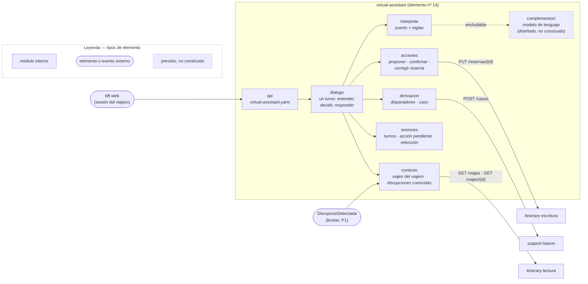
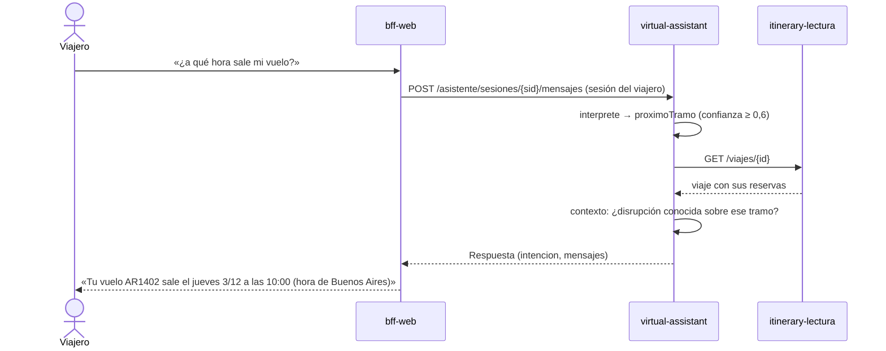
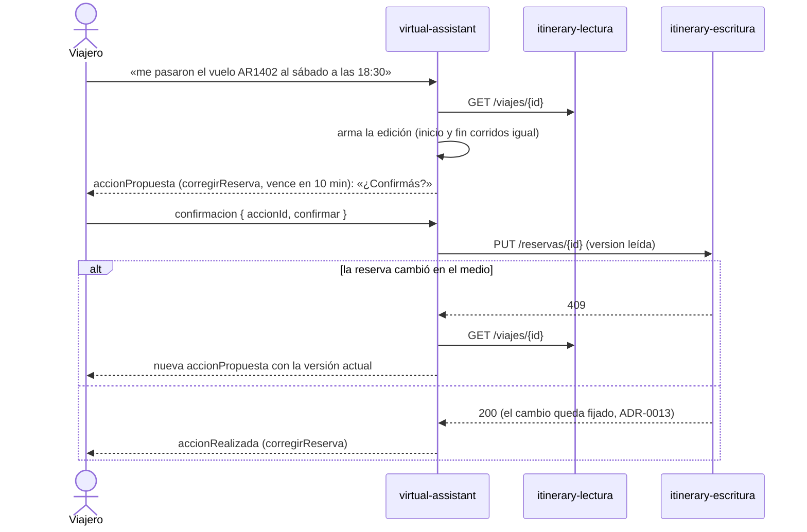
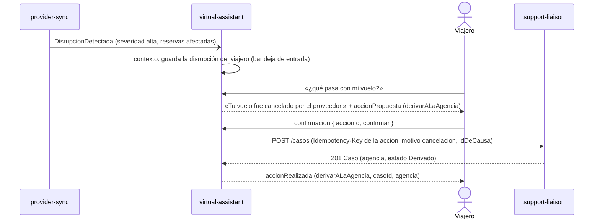

# Iteración 5 — Diseñar el módulo avanzado: asistente virtual (Opción B)

> **Estado:** ✅ Completa · **Fecha:** 2026-11-17 · **Responsable de la iteración:** Francisco Lozano · **Aprobación:** el profesor aceptó una iteración 5 y ADR nuevos para la Opción B (2026-11-16)

| Página de esta iteración | Contenido |
|---|---|
| Esta página | Plan, pasos 1, 2, 3, 5 y 6 del método, vista de módulos del asistente y sus secuencias |
| [Paso 4 — Conceptos de diseño y alternativas](paso-4-alternativas.md) | Las 4 decisiones de la iteración (D37 a D40), con las alternativas evaluadas y descartadas |
| [Paso 7 — Análisis y kanban](paso-7-analisis.md) | Criterios de salida, estado de los drivers, inconsistencias encontradas en la 1ra entrega y riesgos |

---

## Plan de la iteración

La 1ra entrega cerró con cuatro iteraciones y dejó la Opción B **verificada en papel** como el
elemento nº 14 ([ADR-0034](../../03-adr/ADR-0034-punto-de-extension-modulo-avanzado.md), iteración 4
§5.7): su frontera con el resto del sistema está decidida, su interior no. Al elegir la Opción B para
la 2da entrega, esta iteración diseña ese interior.

| Criterio de salida | Cómo se verifica |
|---|---|
| 1. Cada decisión del interior del asistente tiene su ADR en MADR | ADR-0037 a ADR-0040 en `docs/03-adr` |
| 2. El asistente tiene contrato antes de tener código (`CON-04`) | `contratos/openapi/virtual-assistant.yaml`, validado con `openapi-spec-validator` |
| 3. Cero interfaces nuevas en servicios existentes (`CON-06`) | El asistente solo usa operaciones que ya estaban en `itinerary.yaml` y `support-liaison.yaml` |
| 4. `RF-B1` y `RF-B2` quedan trazados a decisiones | Kanban del [paso 7](paso-7-analisis.md) |
| 5. El paso 19 del plan del prototipo puede empezar sin inventar decisiones | Vista de módulos y secuencias de esta página |

---

## Paso 1 — Revisar las entradas

| Categoría de entrada | Contenido | Dónde está |
|---|---|---|
| **Propósito de diseño** | Incorporar el módulo avanzado obligatorio de la 2da entrega sin cambios estructurales | [1.1](../../01-analisis-inicial/01-proposito-y-alcance.md#propósito-de-diseño-en-el-sentido-de-add) |
| **Requisitos funcionales** | **RF-B1** (consultas de estado, reprogramaciones y problemas menores) y **RF-B2** (derivar a la agencia solo lo que el bot no resuelve), registrados en la 1ra entrega sin diseñar | [1.3](../../01-analisis-inicial/03-requisitos-funcionales.md#requisitos-funcionales-de-la-2da-entrega) |
| **Restricciones** | **CON-06** (al menos un módulo avanzado), **CON-05** (alcance acotado), **CON-04** (*spec-driven*), **CON-10** (datos personales), **CON-A4** (`< 15` elementos) | [1.5](../../01-analisis-inicial/05-restricciones.md) |
| **Decisiones heredadas** | La frontera del elemento nº 14 ([ADR-0034](../../03-adr/ADR-0034-punto-de-extension-modulo-avanzado.md)); `POST /casos` idempotente (RF-12); edición manual con fijados y conflictos ([ADR-0013](../../03-adr/ADR-0013-deduplicacion-y-conflictos.md)); supresión en dos fases ([ADR-0030](../../03-adr/ADR-0030-auditoria-y-supresion-datos-personales.md)); degradación por niveles ([ADR-0020](../../03-adr/ADR-0020-contrapresion-y-sobrecarga.md)) | `docs/03-adr` |
| **Contratos existentes** | `GET /viajes`, `GET /viajes/{id}` y `PUT /reservas/{id}` de `itinerary`; `POST /casos` de `support-liaison`; `DisrupcionDetectada` | [`contratos/`](../../../contratos/README.md) |
| **Estado del prototipo** | Pasos 1 a 8 construidos: `itinerary`, `identity-access` y `mail-ingest` | [plan del prototipo](../../../prototipo/README.md#plan-de-construcción) |

### Lo que las entradas dicen antes de diseñar nada

1. **La frontera ya está decidida; lo que falta es el interior.** La iteración 4 verificó que la
   Opción B entra con `0` interfaces nuevas. Esta iteración no la reabre: decide cómo entiende el
   asistente, qué hace solo, cuándo deriva y qué recuerda.
2. **«Reprogramar» no significa lo mismo para Trotamundos que para una aerolínea.** El sistema no
   vende ni cambia pasajes: registra lo que el viajero reservó. El asistente puede corregir el
   itinerario cuando el viajero ya cambió algo; cambiar la reserva ante el proveedor es un caso para
   la agencia.
3. **ADR-0034 tiene un punto que no se puede aplicar tal como está escrito:** suscribirse a
   `CuentaSuprimida` para borrar el estado propio, cuando ese evento no trae el `usuarioId`. Se
   resuelve en D40 (ver también el [paso 7](paso-7-analisis.md#inconsistencias-encontradas-en-la-1ra-entrega)).

---

## Paso 2 — Establecer el objetivo de la iteración

> **Objetivo de la iteración 5:** diseñar el interior del asistente virtual (elemento nº 14) para que
> atienda consultas de estado, corrija el itinerario y derive a la agencia solo lo que no resuelve,
> sin interfaces nuevas en el núcleo, sin enviar datos personales a terceros y con contrato propio
> antes de escribir código.

| Driver | Estado al empezar | Qué debe lograr esta iteración |
|---|---|---|
| **RF-B1** | ⬜ registrado, sin diseñar | Intenciones que entiende, consultas de estado y corrección confirmada del itinerario |
| **RF-B2** | ⬜ registrado, sin diseñar | Disparadores explícitos de derivación y caso idempotente |
| **CON-06** | 🟨 verificado en papel | Interior diseñado y contrato publicado, sin tocar la frontera |
| **QA-14 / CON-10** | 🟩 en el resto del sistema | Que la conversación no sea una fuga de datos personales: retención, supresión y nada a terceros |
| **QA-04** | 🟩 | Que el asistente sea carga degradable y no compita con `itinerary` |
| **QA-12** | 🟩 | Que una sesión o una reserva ajena respondan como inexistentes |
| **CON-01** | ✅ cuatro iteraciones | Quinta iteración, para la 2da entrega |

---

## Paso 3 — Elegir los elementos del sistema a refinar

Se refina un solo elemento, el que ADR-0034 reservó: **`virtual-assistant`**, nº 14 (`14 < 15`,
`CON-A4`). Ningún otro elemento cambia; el contrato de eventos solo suma al asistente como consumidor
de un evento que ya existía.

| Elemento | Qué se refina | Drivers |
|---|---|---|
| `virtual-assistant` (nuevo, nº 14) | Interior: interpretación, diálogo, acciones, derivación, contexto y sesiones | RF-B1, RF-B2, CON-06, QA-14 |
| Contrato de eventos (AsyncAPI) | `virtual-assistant` consume `DisrupcionDetectada` (1.5.0) | ADR-0040 |

---

## Paso 4 — Elegir los conceptos de diseño

### → [Paso 4 — Conceptos de diseño y alternativas](paso-4-alternativas.md)

| # | Decisión | Concepto elegido | ADR |
|---|---|---|---|
| D37 | Cómo entiende al viajero | Puerto `InterpreteDeIntenciones`: reglas en el prototipo, modelo de lenguaje enchufable con datos redactados | [ADR-0037](../../03-adr/ADR-0037-interpretacion-de-intenciones-del-asistente.md) |
| D38 | Qué resuelve solo | Consultas directas; corrección del itinerario propuesta y confirmada; cambios ante el proveedor, derivados | [ADR-0038](../../03-adr/ADR-0038-alcance-y-confirmacion-de-las-acciones-del-asistente.md) |
| D39 | Cuándo deriva | Cuatro disparadores explícitos, con confirmación, por `POST /casos` | [ADR-0039](../../03-adr/ADR-0039-politica-de-derivacion-a-la-agencia.md) |
| D40 | Qué recuerda | Sesión propia y mínima, 30 días, supresión de fase 1, disrupciones por evento | [ADR-0040](../../03-adr/ADR-0040-sesion-conversacional-y-privacidad.md) |

---

## Paso 5 — Instanciar elementos, asignar responsabilidades y definir interfaces

### 5.1 Vista de módulos de `virtual-assistant`

**Leyenda**

| Notación | Significado en esta vista |
|---|---|
| Rectángulo | **Módulo interno** de `virtual-assistant` |
| Rectángulo punteado | Complemento **previsto y no construido** (el adaptador de modelo de lenguaje, ADR-0037) |
| Óvalo | Elemento o evento externo al asistente |
| `-->` flecha | Dependencia «usa a» (o llamada HTTP, si está rotulada con la operación) |
| `-.->` flecha punteada | Realización: el complemento implementa el puerto del intérprete |

| Módulo | Responsabilidad única | Drivers | ADR |
|---|---|---|---|
| `api` | Expone `virtual-assistant.yaml`, valida cuerpos y verifica la sesión del viajero | CON-04, QA-12 | ADR-0028, ADR-0034 |
| `dialogo` | Atiende un turno: interpreta, consulta el contexto, decide si responde, propone o deriva, y registra el turno | RF-B1, RF-B2 | ADR-0038, ADR-0039 |
| `interprete` | Puerto `InterpreteDeIntenciones` y su implementación por reglas: intención, entidades y confianza | RF-B1, QA-14 | ADR-0037 |
| `acciones` | Arma la corrección de una reserva, la propone con vencimiento y la ejecuta solo con confirmación | RF-B1, RF-06 | ADR-0038 |
| `derivacion` | Evalúa los cuatro disparadores, arma la síntesis y abre el caso idempotente | RF-B2, RF-12 | ADR-0039 |
| `contexto` | Lee los viajes del viajero en `itinerary` y mantiene la proyección de disrupciones (consume `DisrupcionDetectada`) | RF-B1, RF-B2 | ADR-0038, ADR-0040 |
| `sesiones` | Sesiones y turnos particionados por `usuario_id`, acción pendiente y retención de 30 días | QA-14, CON-10 | ADR-0040 |
| `complementos/` | Adaptador de modelo de lenguaje con redacción de datos personales (previsto) | RF-B1, QA-14 | ADR-0037 |

**Reglas de dependencia del asistente.** Ningún módulo salvo `interprete` sabe cómo se interpreta un
texto; solo `contexto`, `acciones` y `derivacion` hablan con otros servicios, cada uno con una sola
operación de un solo servicio; el asistente no importa código de ningún otro servicio (regla de
`ADR-0001`, verificada por `tests/test_arquitectura.py`).

### 5.2 Intenciones que entiende

| Intención | Ejemplo | Qué hace | Decisión |
|---|---|---|---|
| `saludo`, `ayuda` | «hola», «¿qué podés hacer?» | Explica qué puede hacer | ADR-0037 |
| `estadoDelViaje` | «¿cómo está mi viaje a Mendoza?» | Resume el viaje, sus reservas y conflictos abiertos | ADR-0038 |
| `proximoTramo` | «¿a qué hora sale mi vuelo?» | Responde el próximo tramo, con hora local y disrupciones conocidas | ADR-0038 |
| `corregirHorario` | «me pasaron el vuelo AR1402 al jueves a las 18:30» | Propone la corrección; con confirmación, `PUT /reservas/{id}` | ADR-0038 |
| `cambioAnteProveedor` | «quiero cambiar el vuelo con la aerolínea», «quiero un reembolso» | Propone derivar a la agencia | ADR-0039 |
| `pedirAgencia` | «quiero hablar con mi agencia», «con una persona» | Propone derivar a la agencia | ADR-0039 |
| `confirmacion` | Una `confirmacion` del cuerpo, o «sí» con una acción pendiente | Ejecuta o descarta la acción pendiente | ADR-0038 |
| `noEntendido` | Cualquier cosa por debajo de la confianza de 0,6 | Repregunta; a la segunda seguida, ofrece derivar | ADR-0037, ADR-0039 |

### 5.3 Secuencias

**Consulta de estado (RF-B1).** El viajero pregunta y el asistente responde con lo que lee en
`itinerary`; si la reserva tiene una disrupción conocida, la menciona.

**Corrección confirmada del itinerario (RF-B1).** Nada cambia hasta que el viajero confirma; si la
reserva cambió en el medio, se vuelve a proponer.

**Derivación por disrupción (RF-B2).** Una cancelación del proveedor no se arregla corrigiendo el
itinerario: el asistente propone derivar, con el `disrupcionId` como causa.

### 5.4 Interfaces

| Interfaz | Contrato | Novedad |
|---|---|---|
| API del asistente (solo para los BFF) | [`virtual-assistant.yaml`](../../../contratos/openapi/virtual-assistant.yaml) 1.0.0 | **Nueva**, del elemento nº 14 |
| `GET /viajes`, `GET /viajes/{id}`, `PUT /reservas/{id}` | [`itinerary.yaml`](../../../contratos/openapi/itinerary.yaml) | Sin cambios |
| `POST /casos` | [`support-liaison.yaml`](../../../contratos/openapi/support-liaison.yaml) | Sin cambios |
| `DisrupcionDetectada` | [`eventos-de-dominio.yaml`](../../../contratos/asyncapi/eventos-de-dominio.yaml) 1.5.0 | Suma a `virtual-assistant` como consumidor |

Las rutas públicas del asistente las expone `bff-web` ([ADR-0005](../../03-adr/ADR-0005-capa-de-clientes-bff.md)),
que reenvía la sesión del viajero: el asistente actúa siempre en su nombre.

### 5.5 Parámetros iniciales (supuestos a calibrar)

| Parámetro | Valor inicial | Se calibra con |
|---|---|---|
| Confianza mínima para actuar sobre una interpretación | 0,6 (el umbral bajo de ADR-0015) | Conversaciones reales |
| Vencimiento de una acción propuesta | 10 minutos | Uso real |
| Malentendidos seguidos antes de ofrecer derivar | 2 | Tasa de derivación |
| Retención de una sesión sin turnos nuevos | 30 días | Normativa de cada región ([ADR-0031](../../03-adr/ADR-0031-residencia-de-datos-por-region.md)) |
| Severidad de disrupción que dispara la derivación | `alta` | Disrupciones reales |

---

## Paso 6 — Bosquejar vistas y registrar las decisiones de diseño

### Vistas producidas en esta iteración

Las vistas de la 1ra entrega (`docs/04-vistas`) no se modifican. Las de esta iteración están en esta
página:

| Vista | Dónde |
|---|---|
| Módulos de `virtual-assistant` (nivel 2 del elemento nº 14) | [§5.1](#51-vista-de-módulos-de-virtual-assistant) |
| Secuencias: consulta, corrección confirmada y derivación por disrupción | [§5.3](#53-secuencias) |

### Decisiones registradas

| ADR | Decisión |
|---|---|
| [ADR-0037](../../03-adr/ADR-0037-interpretacion-de-intenciones-del-asistente.md) | Intérprete intercambiable: reglas en el prototipo, modelo de lenguaje enchufable con datos redactados |
| [ADR-0038](../../03-adr/ADR-0038-alcance-y-confirmacion-de-las-acciones-del-asistente.md) | Consultas directas y corrección del itinerario solo con confirmación explícita |
| [ADR-0039](../../03-adr/ADR-0039-politica-de-derivacion-a-la-agencia.md) | Cuatro disparadores de derivación, con confirmación y caso idempotente |
| [ADR-0040](../../03-adr/ADR-0040-sesion-conversacional-y-privacidad.md) | Sesión mínima de 30 días, supresión de fase 1 y disrupciones por evento (precisa a ADR-0034) |

---

## Paso 7 — Analizar el diseño

### → [Paso 7 — Análisis y kanban](paso-7-analisis.md)
