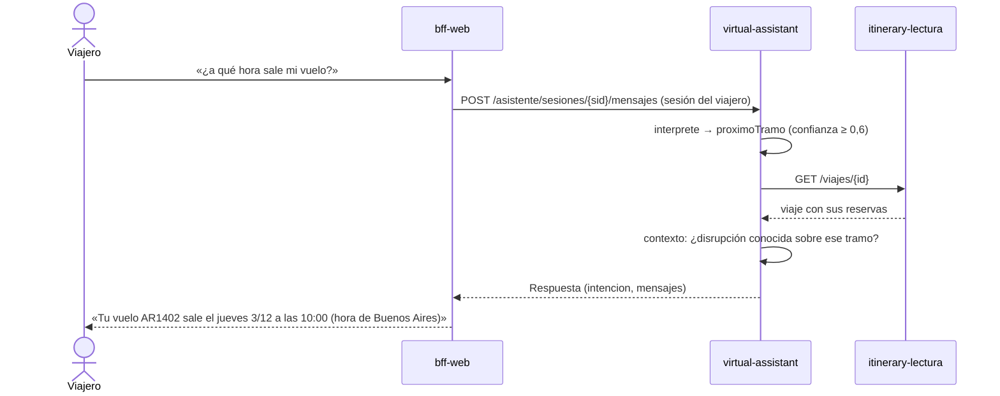
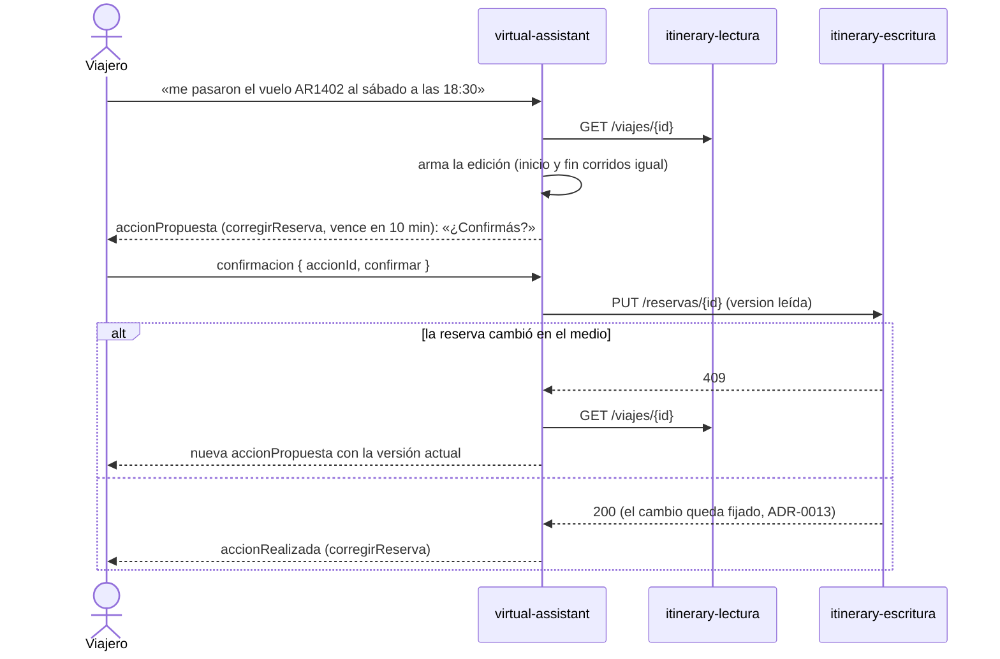
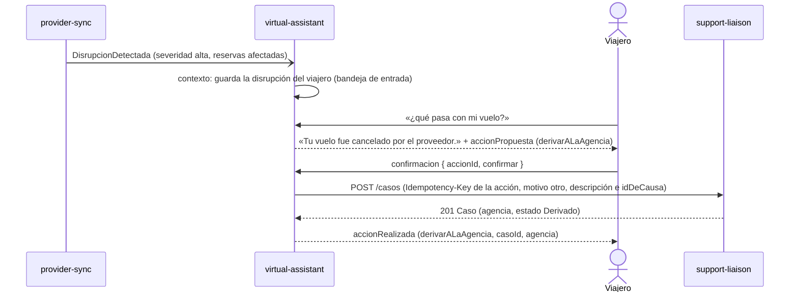

# Secuencias del asistente virtual (Opción B)

**Tipo:** comportamiento (refinamiento dinámico de la [vista C&C del asistente](vista-cyc-asistente.md)).
Los participantes son componentes en ejecución.
**Responde:** ¿qué recorrido sigue una consulta, una corrección confirmada del itinerario y una
derivación a la agencia? ¿Por qué interfaces pasa cada una?
**Para quién:** quien construya el asistente y quien evalúe que `RF-B1` y `RF-B2` tienen un recorrido
completo, sin pasos «por definir».

Producida en la [iteración 5](../02-proceso-add/iteracion-5/README.md#paso-5--instanciar-elementos-asignar-responsabilidades-y-definir-interfaces)
(2da entrega). Completa las [secuencias de los casos primarios](secuencias-casos-primarios.md) de la
1ra entrega y usa los módulos de la [vista de módulos del asistente](vista-modulos-asistente.md).

---

**Leyenda de los diagramas de secuencia** (la misma notación que las
[secuencias de la 1ra entrega](secuencias-casos-primarios.md)):

| Notación | Significado |
|---|---|
| Caja superior | **Participante**: componente en ejecución (sus instancias); el alias corto se define en cada diagrama |
| Muñeco (*actor*) | Persona que inicia la interacción (el viajero) |
| Línea vertical | Línea de vida del participante |
| `->>` flecha continua | **Llamada sincrónica** (HTTP) o acción interna del propio participante |
| `-->>` flecha punteada | **Respuesta** a una llamada |
| `-)` flecha abierta | **Evento asíncrono** entregado por el *broker* |
| Recuadro `alt` / `else` | Caminos alternativos excluyentes, según la condición rotulada |

| Secuencia | Requisito | Decisiones que ejercita |
|---|---|---|
| Consulta de estado | RF-B1 | [ADR-0037](../03-adr/ADR-0037-interpretacion-de-intenciones-del-asistente.md), [ADR-0038](../03-adr/ADR-0038-alcance-y-confirmacion-de-las-acciones-del-asistente.md), [ADR-0040](../03-adr/ADR-0040-sesion-conversacional-y-privacidad.md) |
| Corrección confirmada del itinerario | RF-B1, RF-06 | [ADR-0038](../03-adr/ADR-0038-alcance-y-confirmacion-de-las-acciones-del-asistente.md), [ADR-0013](../03-adr/ADR-0013-deduplicacion-y-conflictos.md) |
| Derivación por disrupción | RF-B2, RF-12 | [ADR-0039](../03-adr/ADR-0039-politica-de-derivacion-a-la-agencia.md), [ADR-0040](../03-adr/ADR-0040-sesion-conversacional-y-privacidad.md) |

**Consulta de estado (RF-B1).** El viajero pregunta y el asistente responde con lo que lee en
`itinerary`; si la reserva tiene una disrupción conocida, la menciona.

**Corrección confirmada del itinerario (RF-B1).** Nada cambia hasta que el viajero confirma; si la
reserva cambió en el medio, se vuelve a proponer.

**Derivación por disrupción (RF-B2).** Una cancelación del proveedor no se arregla corrigiendo el
itinerario: el asistente propone derivar, con el `disrupcionId` como causa.

