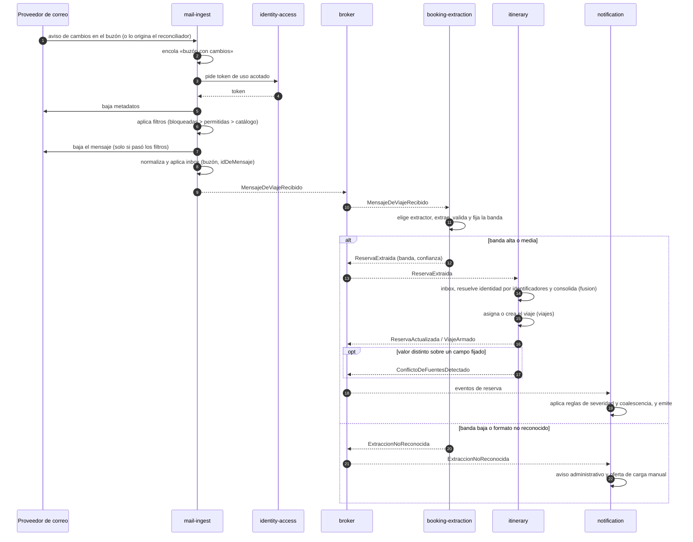
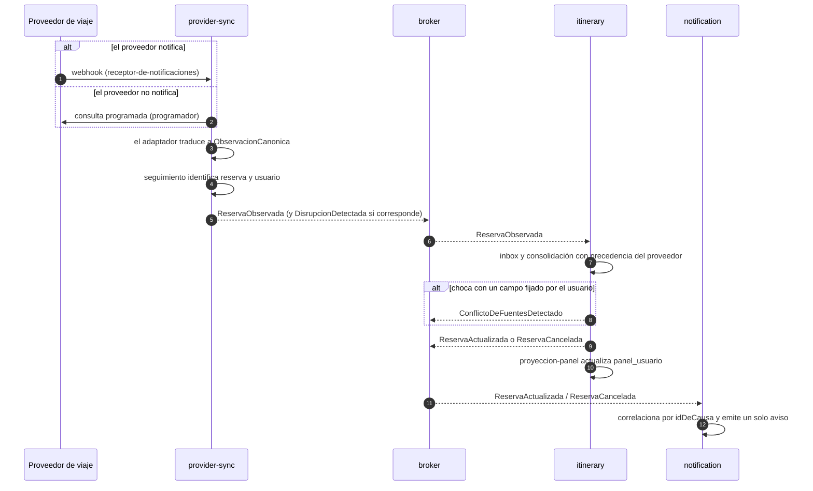
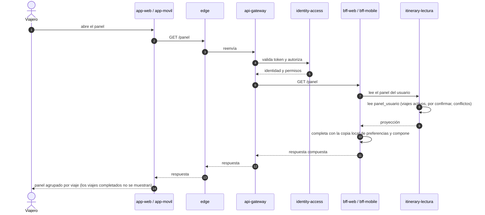
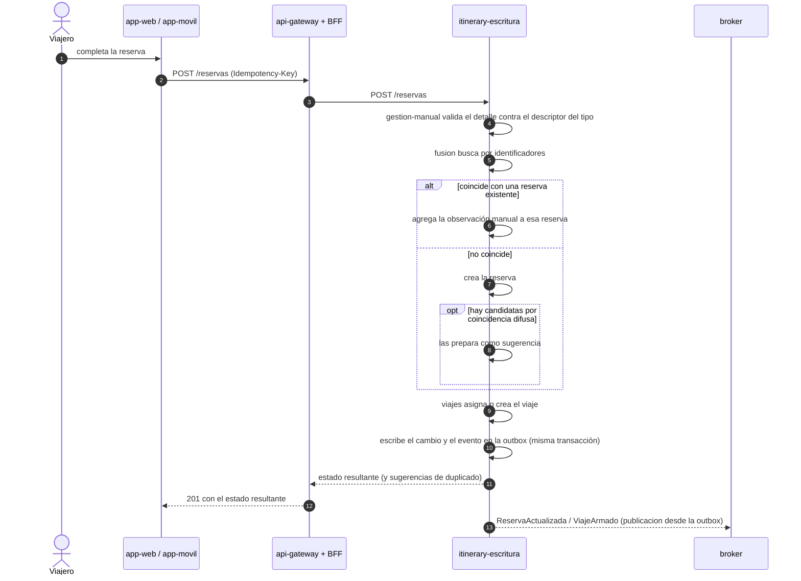
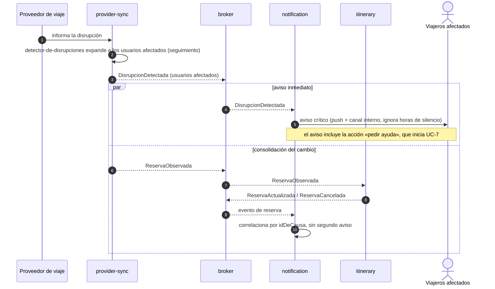
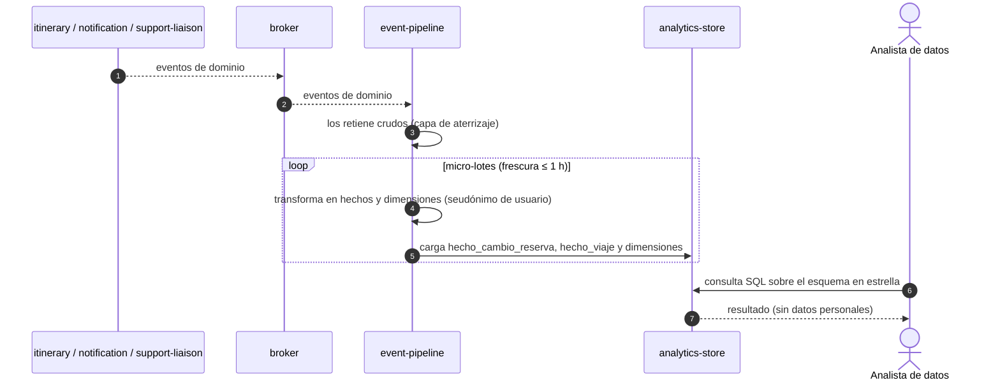
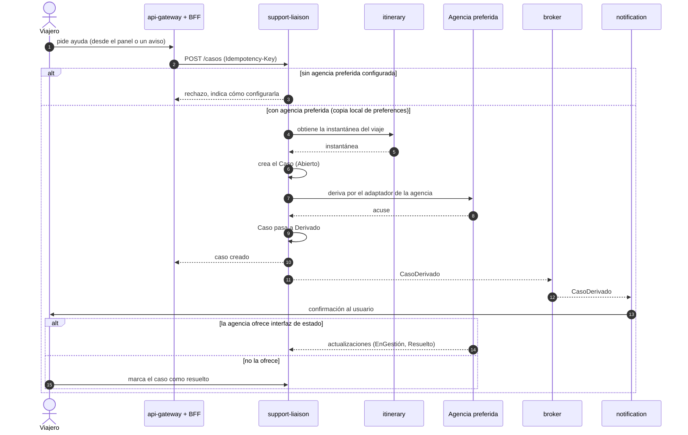

# Secuencias de los casos de uso primarios (UC-1 a UC-7)

**Tipo:** comportamiento (refinamiento dinámico de la vista C&C). Los participantes son
componentes en ejecución; los mensajes son llamadas sincrónicas (flecha continua) o eventos
publicados en el *broker* (flecha punteada).
**Responde:** ¿qué recorrido sigue cada caso de uso primario entre los elementos? ¿Por qué
interfaces pasa?
**Para quién:** quien implemente el prototipo y quien evalúe que cada caso de uso tiene un
recorrido completo, sin pasos «por definir».

Producida en la [iteración 2](../02-proceso-add/iteracion-2/README.md#paso-6--bosquejar-vistas-y-registrar-las-decisiones-de-diseño).
Cada diagrama formaliza el recorrido de la tabla del
[paso 7 de la iteración 2](../02-proceso-add/iteracion-2/paso-7-analisis.md#cada-caso-de-uso-tiene-un-recorrido-completo-y-especificado)
y usa los módulos internos de la [vista de módulos N2](vista-modulos-nivel-2.md). Los nombres de los
eventos son los del [catálogo de eventos](../02-proceso-add/iteracion-2/README.md#510-catálogo-de-eventos-actualizado).

**Leyenda de los diagramas de secuencia**

| Notación | Significado |
|---|---|
| Caja superior | **Participante**: componente en ejecución (sus instancias); el alias corto se define en cada diagrama |
| Muñeco (*actor*) | Persona que inicia la interacción (viajero, analista) |
| Línea vertical | Línea de vida del participante |
| `->>` flecha continua | **Llamada sincrónica** (HTTP) o acción interna del propio participante |
| `-->>` flecha punteada | **Respuesta** a una llamada, o **evento asíncrono** publicado o entregado por el *broker* |
| Número en la flecha | Orden del paso (`autonumber`) |
| Recuadro `alt` / `else` | Caminos alternativos excluyentes, según la condición rotulada |
| Recuadro `opt` | Paso que ocurre solo si se cumple la condición |
| Recuadro `par` / `and` | Pasos que ocurren en paralelo |
| Recuadro `loop` | Paso que se repite |
| Nota amarilla | Aclaración que no es un mensaje |

| UC | Caso de uso | RF | Decisiones que ejercita |
|---|---|---|---|
| [UC-1](#uc-1--ingesta-automática-desde-el-correo) | Ingesta automática desde el correo | RF-01…RF-04, RF-07 | [ADR-0004](../03-adr/ADR-0004-obtencion-de-correo.md), [0013](../03-adr/ADR-0013-deduplicacion-y-conflictos.md), [0014](../03-adr/ADR-0014-idempotencia-de-la-ingesta.md), [0015](../03-adr/ADR-0015-politica-de-confianza-de-extraccion.md) |
| [UC-2](#uc-2--actualización-o-cancelación-desde-un-proveedor) | Actualización o cancelación desde un proveedor | RF-05, RF-07, RF-10 | [ADR-0006](../03-adr/ADR-0006-capa-de-anticorrupcion.md), [0013](../03-adr/ADR-0013-deduplicacion-y-conflictos.md) |
| [UC-3](#uc-3--consulta-del-panel) | Consulta del panel | RF-08, RF-09 | [ADR-0005](../03-adr/ADR-0005-capa-de-clientes-bff.md), [0010](../03-adr/ADR-0010-modelo-canonico-reserva-segmento-viaje.md), [0019](../03-adr/ADR-0019-cache-camino-lectura-arranque-movil.md) |
| [UC-4](#uc-4--alta-manual-de-una-reserva) | Alta manual de una reserva | RF-06, RF-07 | [ADR-0013](../03-adr/ADR-0013-deduplicacion-y-conflictos.md), [0014](../03-adr/ADR-0014-idempotencia-de-la-ingesta.md) |
| [UC-5](#uc-5--notificación-de-una-disrupción) | Notificación de una disrupción | RF-10 | [ADR-0020](../03-adr/ADR-0020-contrapresion-y-sobrecarga.md) |
| [UC-6](#uc-6--consulta-analítica) | Consulta analítica | RF-14 | [ADR-0003](../03-adr/ADR-0003-separacion-planos.md), [0016](../03-adr/ADR-0016-modelo-dimensional-analitico.md) |
| [UC-7](#uc-7--derivación-de-un-caso-a-la-agencia-preferida) | Derivación a la agencia preferida | RF-12 | [ADR-0006](../03-adr/ADR-0006-capa-de-anticorrupcion.md), [0014](../03-adr/ADR-0014-idempotencia-de-la-ingesta.md) |

---

## UC-1 — Ingesta automática desde el correo

Camino de frescura de QA-01 (≤ 5 min de punta a punta). La banda de confianza decide si la reserva
entra como `Confirmada`, como `PorConfirmar` o no entra.

## UC-2 — Actualización o cancelación desde un proveedor

`provider-sync` publica la observación cruda; solo `itinerary` publica la reserva ya fusionada
(ajuste 1 de la [iteración 2](../02-proceso-add/iteracion-2/paso-7-analisis.md#ajustes-a-la-iteración-1)).

## UC-3 — Consulta del panel

Camino crítico de latencia: 800 ms p95 en web y FCP < 1,4 s en móvil (QA-02, QA-03). Una sola ida y
vuelta del cliente al BFF.

## UC-4 — Alta manual de una reserva

El comando es idempotente por `Idempotency-Key`. El sistema nunca fusiona por parecido: si hay
candidatas difusas, las devuelve como sugerencia.

## UC-5 — Notificación de una disrupción

Escenario de pico (QA-04). El aviso crítico sale de inmediato; la consolidación del cambio sigue en
paralelo el camino de UC-2.

## UC-6 — Consulta analítica

El plano analítico solo consume eventos (regla R6 de la
[vista de módulos N1](vista-modulos-nivel-1.md#reglas-de-dependencia)); la consulta del analista no
toca el plano operacional (QA-09).

## UC-7 — Derivación de un caso a la agencia preferida

La creación del caso es idempotente; el caso guarda una instantánea inmutable del viaje.

---

## Cobertura

| Criterio de salida de la iteración 2 | Verificación |
|---|---|
| Los 7 casos de uso tienen un recorrido completo, sin pasos «por definir» | Los 7 diagramas anteriores |
| Toda interacción entre elementos pasa por una interfaz declarada | Las llamadas sincrónicas corresponden a operaciones de los BFF, `itinerary`, `identity-access` y `support-liaison`; los eventos, al catálogo de 15 eventos |
| La secuencia de supresión de datos personales (iteración 4) | En la [vista de seguridad y datos, §5](vista-seguridad-y-datos.md#5-secuencia-de-supresión-verificable-en-ambos-planos--30-días--adr-0030) |
