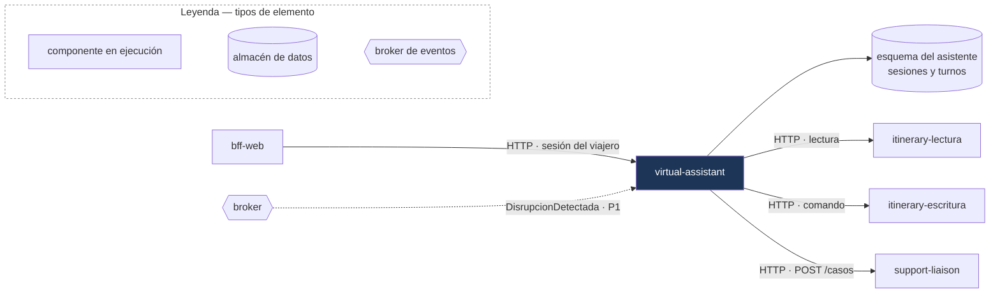

# Componentes y conectores — asistente virtual (elemento nº 14)

**Tipo:** estructura dinámica. Los elementos son componentes en ejecución y las relaciones son
conectores (petición-respuesta y publicación-suscripción).
**Responde:** ¿con qué componentes habla el asistente en ejecución, por qué conector, con qué contrato
y con qué garantía?
**Para quién:** quien construya el asistente y quien verifique que el elemento nº 14 no agrega
interfaces al núcleo (`CON-06`).

Refina a: [Componentes y conectores — nivel 1](vista-cyc-nivel-1.md), con los mismos tipos de conector.
Producida en la [iteración 5](../02-proceso-add/iteracion-5/README.md#paso-5--instanciar-elementos-asignar-responsabilidades-y-definir-interfaces)
(2da entrega). Dónde corre cada componente está en la [vista de despliegue del asistente](vista-despliegue-asistente.md).

---

**Leyenda**

| Notación | Significado en esta vista |
|---|---|
| Rectángulo | **Componente en ejecución** (un proceso con sus réplicas); el asistente, resaltado |
| Cilindro | **Almacén de datos** propio del asistente |
| Hexágono | ***Broker*** de eventos |
| `-->` flecha rotulada | **Conector petición-respuesta** (HTTP/JSON), con lo que transporta |
| `-.->` flecha punteada | **Conector publicación-suscripción** (*broker*), con el evento y su carril |

| Conector | Tipo | Contrato | Garantía |
|---|---|---|---|
| `bff-web` → `virtual-assistant` | Petición-respuesta | [`virtual-assistant.yaml`](../../contratos/openapi/virtual-assistant.yaml) | Idempotente por `Idempotency-Key` |
| `virtual-assistant` → `itinerary-lectura` | Petición-respuesta | [`itinerary.yaml`](../../contratos/openapi/itinerary.yaml) (`lectura`) | Lee la réplica local; si no responde, el asistente lo dice y no adivina |
| `virtual-assistant` → `itinerary-escritura` | Petición-respuesta | [`itinerary.yaml`](../../contratos/openapi/itinerary.yaml) (`comando`) | Control de versión (`409`) y testigo de `itinerary` |
| `virtual-assistant` → `support-liaison` | Petición-respuesta | [`support-liaison.yaml`](../../contratos/openapi/support-liaison.yaml) | Idempotente por `Idempotency-Key` |
| *broker* → `virtual-assistant` | Publicación-suscripción | [`eventos-de-dominio.yaml`](../../contratos/asyncapi/eventos-de-dominio.yaml) | Al menos una vez; bandeja de entrada ([ADR-0014](../03-adr/ADR-0014-idempotencia-de-la-ingesta.md)) |
