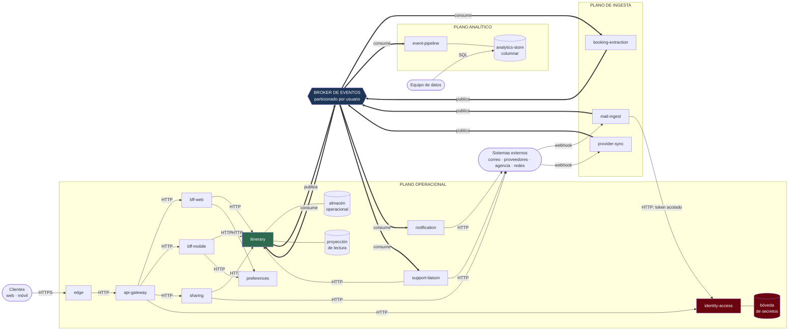

# Vista de componentes y conectores — nivel 1

**Tipo:** estructura dinámica. Los elementos son componentes en ejecución y las relaciones son
conectores (caminos de interacción en tiempo de ejecución).
**Responde:** ¿qué corre en tiempo de ejecución y cómo se comunican las partes?
**Para quién:** quien analiza rendimiento, disponibilidad o seguridad, porque esas propiedades son
propiedades del tiempo de ejecución.

## Diagrama



Flechas: `──→` conector sincrónico (HTTP/JSON) · `══▶` conector asíncrono (publicación-suscripción)
· `───` acceso a repositorio de datos.

## Tipos de conector

Solo hay tres tipos, y cada uno existe por un motivo distinto. Mezclarlos sin criterio es lo que
hace que un sistema distribuido se vuelva imposible de razonar.

| Conector | Dónde se usa | Garantía | Por qué ahí |
|---|---|---|---|
| **Petición-respuesta sincrónica** (HTTP/JSON) | Todo el camino de lectura: cliente → borde → *gateway* → BFF → dominio | Respuesta inmediata o error | El presupuesto de 800 ms de QA-02 no tolera indirección adicional ([ADR-0001](../03-adr/ADR-0001-estilo-arquitectonico.md)) |
| **Publicación-suscripción asíncrona** (*broker*, particionado por usuario) | Todo el plano de ingesta, y la alimentación del plano analítico | Entrega al menos una vez, orden preservado dentro de una partición | Desacopla la ráfaga de QA-04 del camino de lectura, y permite agregar consumidores sin tocar a los productores |
| **Webhook entrante** (HTTP desde el exterior) | Notificaciones de proveedores de correo y de viaje | Sin garantía: la notificación puede perderse | Es lo que ofrecen los terceros; de ahí el sondeo de reconciliación de [ADR-0004](../03-adr/ADR-0004-obtencion-de-correo.md) |

La clave de partición del *broker* es el **identificador de usuario**. Esto da dos propiedades que
los drivers necesitan: los eventos de un mismo usuario se procesan en orden (lo que simplifica la
deduplicación de CRN-12), y el paralelismo escala agregando particiones (QA-04, QA-08).

## Catálogo de componentes

| Componente | Instancias | Estado | Escalado |
|---|---|---|---|
| `edge` | Gestionado, distribuido globalmente | Sin estado | Por el proveedor |
| `api-gateway` | ≥ 2 por región | Sin estado | Horizontal, por peticiones/s |
| `bff-web`, `bff-mobile` | ≥ 2 cada uno por región | Sin estado | Horizontal, por peticiones/s |
| `itinerary` | ≥ 3 por región | Sin estado (el estado está en el almacén) | Horizontal, por peticiones/s y por retraso de consumo |
| `identity-access` | ≥ 3 por región | Sin estado | Horizontal. **Crítico:** su caída detiene la ingesta |
| `mail-ingest` | Variable | Sin estado | Horizontal, por retraso de la cola |
| `booking-extraction` | Variable | Sin estado | Horizontal, por retraso de la cola |
| `provider-sync` | Variable | Sin estado | Horizontal, por retraso de la cola. Un grupo de recursos por proveedor (mamparo) |
| `sharing`, `support-liaison`, `notification`, `preferences` | ≥ 2 por región | Sin estado | Horizontal |
| `event-pipeline` | Variable | Sin estado | Horizontal. **Degradable primero** |
| Almacén operacional | Por región, replicado | Con estado | Particionado por usuario |
| Proyección de lectura | Por región | Con estado derivado | Reconstruible desde los eventos |
| Bóveda de secretos | Gestionada, por región | Con estado | Por el proveedor |
| `analytics-store` | Global | Con estado | Columnar, por volumen |

**Que todos los componentes de cómputo sean sin estado no es casualidad:** es lo que hace posible
el activo-activo de [ADR-0002](../03-adr/ADR-0002-despliegue-multirregion.md) y el despliegue
progresivo de QA-07. Todo el estado vive en los repositorios de datos, que es donde se concentra el
problema de consistencia entre regiones (riesgo **R-1**).

## Caminos críticos

### Camino de lectura — sostiene QA-02 y QA-03

```
Cliente → edge → api-gateway → bff-* → itinerary → proyección de lectura
         120ms      60ms         70ms     120ms          80ms
```

Cinco saltos, presupuesto total de 800 ms con 200 ms de reserva. **Es sincrónico de punta a punta y
no toca el *broker***: ninguna lectura del panel espera a un evento. Es lo que permite que el
presupuesto cierre.

### Camino de ingesta — sostiene QA-01

```
Proveedor → webhook → mail-ingest → BROKER → booking-extraction → BROKER → itinerary → BROKER → notification
   60s                    15s                       45s                       15s                  60s
```

Asíncrono de punta a punta, presupuesto de 300 s con 60 s de reserva. **Es la única parte del
sistema que puede acumular retraso durante un pico**, y eso es deliberado: el retraso es
preferible a la pérdida.

### Frontera de degradación — sostiene QA-04

Ante sobrecarga, el orden de sacrificio es explícito:

| Prioridad | Componentes | Durante un pico |
|---|---|---|
| 1 — nunca se degrada | `edge`, `api-gateway`, `bff-*`, `itinerary` (lectura), `identity-access` | Capacidad garantizada |
| 2 — se degrada en último lugar | `notification`, `itinerary` (escritura) | Puede acumular retraso |
| 3 — se degrada primero | `event-pipeline`, `sharing` (publicaciones), consultas analíticas | Se detienen si hace falta |

Esta frontera es la misma que define [ADR-0008](../03-adr/ADR-0008-alcance-disponibilidad.md) para
el alcance de la medición de disponibilidad. **Una sola frontera sirve a los dos drivers**, lo cual
es señal de que está bien trazada.

## Pendiente para las iteraciones siguientes

| Qué falta | Iteración |
|---|---|
| Diagramas de secuencia de UC-1 a UC-7 | 2 |
| Umbrales de los cortacircuitos, políticas de reintento y contrapresión | 3 |
| Políticas de autoescalado, incluido el escalado predictivo por el calendario de picos conocidos | 3 |
| Topología del plano de datos entre regiones (resolución de **R-1**) | 3 |
