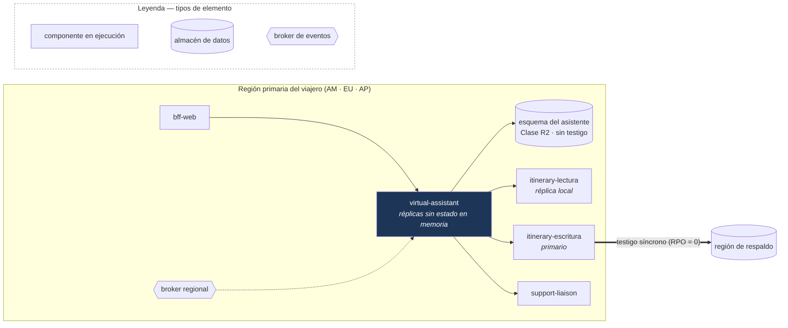

# Despliegue — asistente virtual (elemento nº 14)

**Tipo:** de asignación. Los elementos son componentes y almacenes ubicados en regiones, y las
relaciones son accesos dentro de la región y escrituras entre regiones.
**Responde:** ¿dónde corre el asistente, dónde viven sus datos, qué pasa si cae la región y cómo se
degrada ante un pico?
**Para quién:** quien opere el sistema y quien evalúe que el elemento nº 14 respeta las reglas de
ubicación y degradación de la 1ra entrega.

Refina a: [Despliegue — nivel 2](vista-despliegue-nivel-2.md). No agrega decisiones: aplica las reglas
de ubicación por región de [ADR-0018](../03-adr/ADR-0018-consistencia-datos-multirregion.md) y
[ADR-0031](../03-adr/ADR-0031-residencia-de-datos-por-region.md) y la degradación de
[ADR-0020](../03-adr/ADR-0020-contrapresion-y-sobrecarga.md). Producida en la
[iteración 5](../02-proceso-add/iteracion-5/README.md#paso-5--instanciar-elementos-asignar-responsabilidades-y-definir-interfaces) (2da entrega).

---

**Leyenda**

| Notación | Significado en esta vista |
|---|---|
| Recuadro con título | La **región primaria** del viajero ([ADR-0018](../03-adr/ADR-0018-consistencia-datos-multirregion.md)) |
| Rectángulo | **Componente en ejecución** desplegado en la región; el asistente, resaltado |
| Cilindro | **Almacén de datos** con su clase de residencia ([ADR-0031](../03-adr/ADR-0031-residencia-de-datos-por-region.md)) |
| Hexágono | ***Broker*** de eventos de la región |
| `-->` flecha | Acceso dentro de la región |
| `-.->` punteada | Flujo **asíncrono** de eventos |
| `==>` flecha gruesa | Escritura **síncrona** entre regiones (testigo, que aplica `itinerary`, no el asistente) |

## Reglas de despliegue

| Regla | De dónde sale |
|---|---|
| El asistente corre en las tres regiones, y atiende a cada viajero en su **región primaria**, donde viven su itinerario primario, sus casos y sus conversaciones | [ADR-0018](../03-adr/ADR-0018-consistencia-datos-multirregion.md), [ADR-0031](../03-adr/ADR-0031-residencia-de-datos-por-region.md) |
| Las réplicas no guardan estado en memoria: la sesión está en su esquema, así que cualquier réplica atiende cualquier turno | [ADR-0021](../03-adr/ADR-0021-estrategia-autoescalado.md) |
| Ante `Disrupción masiva` es carga de prioridad 2/3: responde con un mensaje de servicio reducido antes de quitarle recursos a `itinerary`, con su propio mamparo de conexiones | [ADR-0020](../03-adr/ADR-0020-contrapresion-y-sobrecarga.md), [ADR-0024](../03-adr/ADR-0024-cortacircuitos-reintentos-y-cuotas.md), [ADR-0040](../03-adr/ADR-0040-sesion-conversacional-y-privacidad.md) |
| Las conversaciones **no** se copian al testigo de la región de respaldo: si cae la región, se pierde la conversación en curso, no lo que el viajero confirmó, que ya está en `itinerary` con su testigo | Decisión menor de esta iteración (perder una conversación es aceptable para una carga degradable) |
