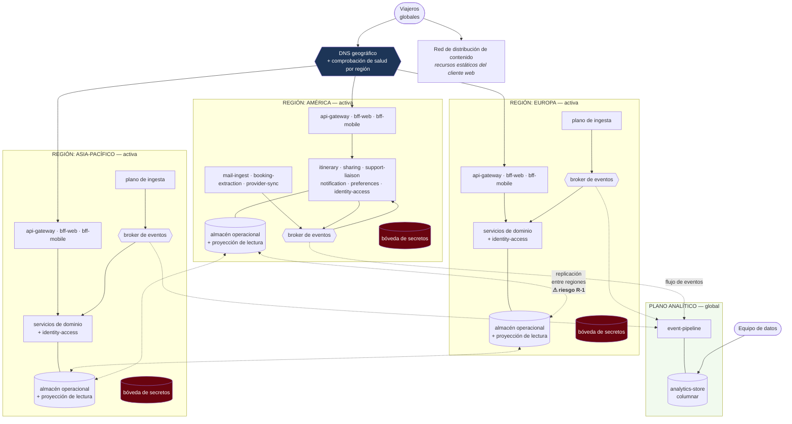

# Vista de despliegue — nivel 1

**Tipo:** estructura de asignación. Relaciona los componentes del tiempo de ejecución con los
elementos de infraestructura donde se ejecutan.
**Responde:** ¿dónde corre cada cosa? ¿qué pasa si se cae una región?
**Para quién:** quien analiza disponibilidad, latencia geográfica y costo.

## Diagrama

## Decisiones de asignación

| Decisión | Contenido | Driver |
|---|---|---|
| **Tres regiones activas** | América, Europa, Asia-Pacífico. Las tres sirven tráfico simultáneamente | QA-05, QA-18 ([ADR-0002](../03-adr/ADR-0002-despliegue-multirregion.md)) |
| **Enrutamiento geográfico con comprobación de salud** | El DNS dirige a cada usuario a la región más cercana que esté sana. Al caer una región, el tráfico se redistribuye entre las otras dos | QA-05: detección ≤ 30 s, redirección ≤ 60 s |
| **Pila completa por región** | Cada región tiene su *gateway*, sus BFF, sus servicios de dominio, su plano de ingesta, su *broker* y su almacén. Ninguna depende de otra para servir una petición | QA-05: la pérdida de una región no deja funciones sin dueño |
| **`identity-access` y la bóveda replicados en las tres regiones** | Es un componente crítico: su caída detiene la ingesta | QA-13, [ADR-0007](../03-adr/ADR-0007-identidad-y-comparticion.md) |
| **Plano analítico global, no regional** | Un solo `analytics-store`, alimentado por los tres *brokers* | QA-09 y CRN-08: replicarlo por región triplicaría su costo sin servir a ningún driver |
| **Recursos estáticos en red de distribución** | Los recursos del cliente web se sirven desde el borde | QA-02, QA-03: es parte del presupuesto de 120 ms de red |

## Reparto del presupuesto de error sobre esta topología

| Elemento de infraestructura | Presupuesto mensual | Mecanismo que lo sostiene |
|---|---|---|
| DNS y enrutamiento global | 1,0 min | Servicio gestionado con acuerdo de nivel de servicio propio |
| Plano de aplicación por región | 2,0 min | ≥ 2 instancias de cada componente, en zonas de disponibilidad distintas; despliegue progresivo |
| Plano de datos | 2,0 min | Replicación entre regiones, de las cuales ≤ 1,5 min se asignan a la pérdida de una región (QA-05) |
| **Total** | **5,0 min** | 99,9884 % ([ADR-0008](../03-adr/ADR-0008-alcance-disponibilidad.md)) |

## Qué pasa si se cae una región

Este es el escenario QA-05, recorrido sobre la topología:

| t | Qué ocurre |
|---|---|
| t = 0 | La región Europa deja de responder |
| t ≤ 30 s | La comprobación de salud del DNS la marca como no sana y deja de dirigir tráfico hacia ella |
| t ≤ 60 s | El tráfico europeo se reparte entre América y Asia-Pacífico. Los usuarios europeos pagan más latencia (se degrada QA-02), pero **el sistema sigue disponible** |
| t ≤ 60 s | Los *webhooks* entrantes dirigidos a Europa se redirigen; las notificaciones perdidas durante la transición se recuperan por el sondeo de reconciliación de [ADR-0004](../03-adr/ADR-0004-obtencion-de-correo.md) |
| Durante | Las escrituras que la región europea había confirmado y aún no replicado son el punto de riesgo. **Que la pérdida de datos sea 0 depende de la decisión de consistencia que todavía no está tomada (R-1)** |
| Al volver | La región se reincorpora, recibe la replicación acumulada y vuelve al enrutamiento solo después de estar al día |

El renglón «Durante» es la razón por la que QA-05 quedó marcado como *habilitado con riesgo
residual* en el [análisis de la iteración 1](../02-proceso-add/iteracion-1/paso-7-analisis.md#riesgos-residuales):
la topología es la correcta, pero la garantía de cero pérdida de datos depende de un diseño del
plano de datos que corresponde a la iteración 3.

## Costo — el contrapeso de esta topología

Esta vista es también donde se ve el **riesgo R-3**. Tres regiones activas significan
aproximadamente el triple de capacidad de cómputo y almacenamiento, más el tráfico de replicación
entre regiones, más un plano analítico propio con ≈ 3.300 millones de registros.

Para una *startup* sin ingresos todavía, esto puede ser inviable. La iteración 3 debe modelar el
costo y evaluar un **camino escalonado** —por ejemplo, empezar con dos regiones activas y una
tercera que participe solo del plano de datos para conservar mayoría en el consenso— **sin cambiar
la estructura**, de modo que escalar a tres regiones completas no requiera rediseñar.

## Pendiente para las iteraciones siguientes

| Qué falta | Iteración |
|---|---|
| Dimensionamiento concreto: cantidad de instancias y tamaño por componente | 3 |
| Políticas de autoescalado, incluido el escalado predictivo por el calendario de picos conocidos (domingo-lunes, jueves-viernes) | 3 |
| Topología del plano de datos entre regiones y modelo de consistencia (**R-1**) | 3 |
| Modelo de costo y camino escalonado (**R-3**) | 3 |
| Residencia de datos por región, exigida por CON-10 (CRN-15) | 4 |
