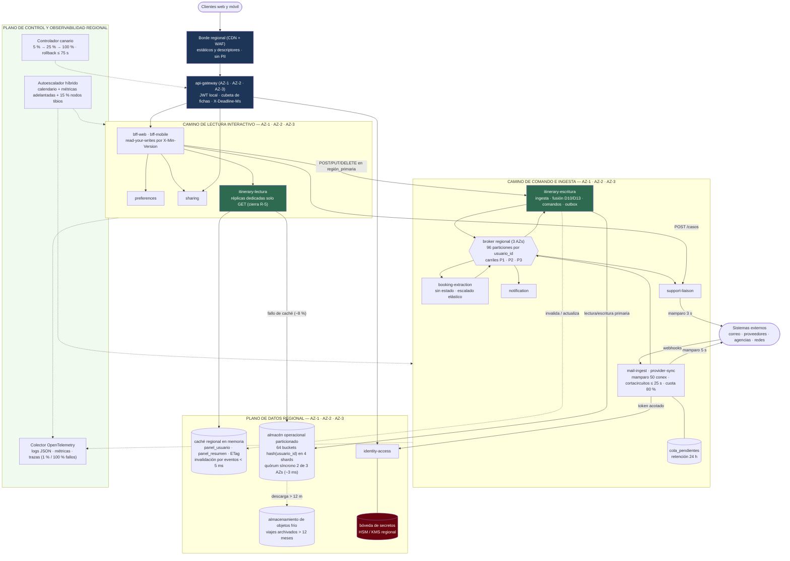
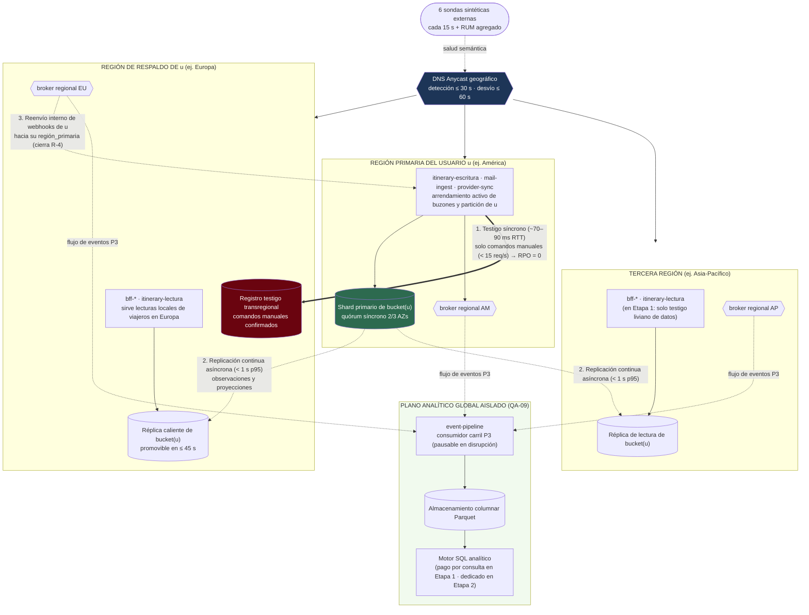

# Vista de despliegue — nivel 2

**Tipo:** estructura de asignación refinada. Detalla el interior de una región activa en tres zonas
de disponibilidad, la topología física del plano de datos multirregión, el dimensionamiento de
réplicas y las políticas de autoescalado y entrega progresiva definidas en la
[iteración 3](../02-proceso-add/iteracion-3/README.md).
**Responde:** ¿cómo se despliega cada servicio dentro de una región? ¿cómo se garantiza cero pérdida
de datos confirmados (`R-1`) y serialización por usuario (`R-4`) entre regiones? ¿con cuántas
réplicas arranca y hasta dónde escala cada componente? ¿cómo evoluciona el costo sin rediseñar
(`R-3`)?
**Para quién:** equipo de ingeniería/operaciones y evaluadores de disponibilidad (`QA-05`, `QA-06`,
`QA-07`), rendimiento (`QA-01`, `QA-02`, `QA-03`, `QA-04`), escalabilidad (`QA-08`, `QA-09`) y costo
(`CRN-08`).

Refina a: [Vista de despliegue — nivel 1](vista-despliegue-nivel-1.md).

---

## 1. Interior de una región activa (3 zonas de disponibilidad)

Todas las unidades de ejecución críticas se distribuyen en **tres zonas de disponibilidad
independientes (`AZ-1`, `AZ-2`, `AZ-3`)** dentro de cada región activa. El módulo `itinerary` se
despliega en **dos grupos de ejecución separados** (`itinerary-lectura` e `itinerary-escritura`,
[ADR-0021](../03-adr/ADR-0021-estrategia-autoescalado.md)) para desacoplar la lectura interactiva del
procesamiento de ingesta y fusión (`R-5` cerrado), conservando un único módulo lógico y los mismos
contratos publicados (`CON-A4`).

---

## 2. Topología de datos multirregión y plano analítico (`D18` · cierre de `R-1` y `R-4`)

Para sostener simultáneamente `QA-05` (`0` pérdida de datos confirmados, redirección `≤ 60 s`),
`QA-02` (lectura local rápida en cualquier continente) y `CRN-12` (idempotencia estricta por usuario),
cada cuenta tiene una **`región_primaria`** y una **`región_respaldo`** determinista
([ADR-0018](../03-adr/ADR-0018-consistencia-datos-multirregion.md)):

### Reglas de asignación que cierran `R-1` y `R-4`

| Flujo | Regla física sobre la topología | Qué riesgo o driver resuelve |
|---|---|---|
| **Lectura desde cualquier continente** | Siempre atiende la región sana más cercana contra su caché/réplica local (`< 1 s` de desfase). Si la sesión porta `X-Min-Version > version_local` tras editar, el BFF sirve de caché de sesión o consulta el primario (*read-your-writes*) | `QA-02` (`≤ 800 ms`) sin lecturas incoherentes tras cambios propios |
| **Ingesta automática (`mail-ingest`, `provider-sync`)** | El arrendamiento del buzón/cuenta vive únicamente en la `región_primaria` de `usuario_id`. Si un *webhook* entra por otra región, se reenvía por red troncal interna | **Cierra `R-4` y `CRN-12`:** `bandeja_entrada` y la fusión `D13` se serializan siempre en una sola partición |
| **Escritura manual del usuario** | Confirma `200/201` recién después de persistir en quórum `2/3` AZs local **y** en el `registro testigo` de su `región_respaldo` (`~70–90 ms` sobre `< 15 req/s` globales) | **Cierra `R-1` y `QA-05`:** pérdida de datos confirmados estrictamente igual a **`0` (`RPO = 0`)** |
| **Analítica global** | `event-pipeline` consume de los tres *brokers* en el carril diferible `P3` y escribe objetos Parquet separados de los nodos OLTP | `QA-09` (`< 5 %` de impacto operacional, frescura `≤ 1 h`) |

---

## 3. Dimensionamiento por componente (Etapa 2 nominal: 15 M cuentas · 2 M WAU)

Dimensionamiento calculado para una región grande (`AM` o `EU`, que absorben hasta el `45 %` del
tráfico normal y hasta el `65 %` si cae otra región), manteniendo utilización objetivo `≤ 65 %` en
pico normal ([ADR-0021](../03-adr/ADR-0021-estrategia-autoescalado.md)):

| Unidad de despliegue | Tamaño por réplica | Réplicas base / región (3 AZs) | Réplicas en pico semanal (`3.000 req/s` globales) | Tope en disrupción `QA-04` (`9.000 req/s` · `450 ev/s`) | Notas de asignación |
|---|---|---|---|---|---|
| `api-gateway` | 2 vCPU · 4 GB | 3 | 6 | 16 | Sin estado; verificación JWT local y límite de tasa |
| `bff-web` | 2 vCPU · 4 GB | 3 | 6 | 16 | Composición de `panel_usuario` + preferencias |
| `bff-mobile` | 2 vCPU · 4 GB | 3 | 5 | 14 | Contrato compacto `≤ 15 KB` comprimido (`QA-03`) |
| `itinerary-lectura` | 2 vCPU · 4 GB | 3 | 8 | 24 | Solo consultas `GET`; aislado de ingesta (`R-5`) |
| `itinerary-escritura` | 4 vCPU · 8 GB | 3 | 6 | 18 | Fusión `D10/D13`, *inbox*/*outbox* y comandos; tope sincronizado con *pool* OLTP |
| `mail-ingest` | 2 vCPU · 4 GB | 3 | 4 | 15 | Receptor *webhook* + descargador con mamparo por proveedor |
| `booking-extraction` | 4 vCPU · 8 GB | 2 | 4 | 24 | Intensivo en CPU (parsing MIME/PDF/HTML); escala rápido sin tocar BD |
| `provider-sync` | 2 vCPU · 4 GB | 3 | 4 | 12 | Cortacircuitos, `cola_pendientes` y limitador al `80 %` de cuota |
| `notification` | 2 vCPU · 4 GB | 3 | 4 | 12 | Prioriza carril `P1` sin ventana de coalescencia en primer aviso |
| `identity-access` | 2 vCPU · 4 GB | 3 | 4 | 8 | Crítico para tokens delegados; replicado en 3 AZs junto a bóveda |
| `preferences` | 1 vCPU · 2 GB | 2 | 3 | 6 | Lecturas absorbidas en `> 95 %` por caché regional |
| `sharing` | 1 vCPU · 2 GB | 2 | 3 | 4 | En modo disrupción apaga publicación a redes (`ADR-0020`) |
| `support-liaison` | 1 vCPU · 2 GB | 2 | 3 | 6 | Baja tasa; mamparo de `3 s` hacia agencias |
| **Caché regional en memoria** | 4 vCPU · 32 GB | 3 fragmentos × 2 (primario + réplica AZ) | 3 × 2 | 6 × 2 | Retiene `panel_usuario` de WAU activos con tasa de acierto `≥ 92 %` |
| **Almacén operacional (OLTP)** | 8 vCPU · 64 GB NVMe | `4` *shards* × `3` nodos (quórum 2/3 AZs) | `4 × 3` | `4 × 3` *(escala a `8–16 × 3` en `QA-08`)* | `64` *buckets* lógicos por `hash(usuario_id)` ([ADR-0023](../03-adr/ADR-0023-particionamiento-y-crecimiento.md)) |
| ***Broker* regional de eventos** | 4 vCPU · 16 GB NVMe | 3 nodos (1 por AZ) | 3 | 6 | `96` particiones por tópico; retención durable de `7 días` |
| `event-pipeline` *(global)* | 4 vCPU · 8 GB | 2 | 4 | 0 *(pausado en disrupción)* | Vuelca micro-lotes Parquet cada `5 min` a almacenamiento de objetos |
| `analytics-store` *(global)* | Clúster elástico columnar | Pago por consulta (E1) / 4 nodos horario laboral (E2) | 4 nodos | Aislado de OLTP | `~3.300 M` eventos/año; consultas `≤ 30 s` (`QA-09`) |

---

## 4. Políticas de autoescalado y entrega progresiva

| Familia de componentes | Escalado predictivo (calendario) | Disparo reactivo (indicador adelantado) | Tiempo de reacción | Regla de reducción (*scale-down*) y protección |
|---|---|---|---|---|
| **Camino HTTP** (`api-gateway`, `bff-*`, `itinerary-lectura`) | `30 min` antes de ventanas dom-lun y jue-vie sube el piso al `100 %` del pico semanal | `req/s por réplica > 65 %` nominal **o** `p95 > 500 ms` durante `60 s` | Contenedor listo `≤ 45 s`; nodo nuevo `≤ 150 s` sobre **colchón tibio del `15 %`** (`< 3 min` de `QA-04`) | Enfriamiento `15 min`; baja máx. `20 %` cada `5 min` con drenaje `SIGTERM` (`0 s` corte) |
| **Consumidores asíncronos** (`mail-ingest`, `booking-extraction`, `provider-sync`, `itinerary-escritura`, `notification`) | Precalentamiento junto con ventana semanal | `edad_mensaje_mas_antiguo > 20 s` en carril `P1` o `> 45 s` en `P2` | `≤ 45 s` (hasta `96` consumidores por región en `booking-extraction`; techo de `18` en `itinerary-escritura` para proteger conexiones OLTP) | Rebalanceo cooperativo de particiones sin detener el grupo entero |
| **Entrega progresiva (`QA-07`)** | Secuencial región por región (empieza en región en valle horario; `15 min` al `100 %` antes de pasar a la siguiente) | Rampa `5 % (5 min) → 25 % (10 min) → 100 %` evaluada cada `30 s` contra SLIs | **Reversión automática en `≤ 75 s`** si 2 ventanas seguidas superan `0,5 %` de `5xx` o `p95 > 800 ms` ([ADR-0022](../03-adr/ADR-0022-despliegue-progresivo-y-reversion.md)) | Bloqueo automático de *releases* funcionales si el presupuesto mensual consumido supera el `75 %` ([ADR-0025](../03-adr/ADR-0025-observabilidad-sli-slo-presupuesto-error.md)) |

---

## 5. Recorrido de caída regional (`QA-05`) con `R-1` y `R-4` cerrados

Actualización directa de la tabla de [vista-despliegue-nivel-1](vista-despliegue-nivel-1.md#qué-pasa-si-se-cae-una-región)
una vez aplicado el diseño de la iteración 3:

| Instante | Qué ocurre en la infraestructura | Resultado frente a `QA-05` |
|---|---|---|
| `t = 0 s` | La región Europa pierde conectividad o cae por completo | — |
| `t ≤ 30 s` | Dos rondas consecutivas de las `6` sondas sintéticas externas (`15 s`) detectan el fallo y marcan a Europa como no sana en el DNS Anycast | **Detección `≤ 30 s` cumplida** |
| `t ≤ 45 s` | Los *clusters* de América y Asia-Pacífico promueven los *buckets* cuyos usuarios tenían `región_primaria = EU` hacia su respectiva `región_respaldo`, aplicando primero todos los **registros testigo** confirmados | **Cero escrituras manuales confirmadas perdidas (`RPO = 0`, `R-1` cerrado)** |
| `t ≤ 60 s` | El tráfico de usuarios europeos converge sobre `AM`/`AP` (que escalan sobre su reserva tibia del `15 %`). Los *webhooks* y arrendamientos de buzones se reanudan en la `región_respaldo` | **Redirección `≤ 60 s` cumplida; presupuesto consumido `≈ 1,0 min ≤ 1,5 min`** |
| Durante la caída | Cualquier correo o cambio de proveedor generado en el `< 1 s` previo al corte que no hubiera llegado por replicación asíncrona es reentregado por el proveedor o capturado por la reconciliación y fusionado sin duplicados mediante `D10`/`D13` | Convergencia determinista sin doble notificación (`R-4` cerrado) |
| Al recuperarse `EU` | `EU` entra en **modo sincronización pasiva**: replica el delta acumulado desde `AM`/`AP`, valida paridad de versiones por *bucket* y recién entonces vuelve a recibir peso en el DNS global | Reincorporación limpia sin ventana de cerebro dividido (*split-brain*) |

---

## 6. Evolución por etapas sobre la misma topología (`D26` · cierre de `R-3`)

La topología anterior no cambia de forma cuando la empresa crece; cambian únicamente parámetros
declarativos de infraestructura como código ([ADR-0026](../03-adr/ADR-0026-modelo-costo-y-camino-escalonado.md)):

| Parámetro de despliegue | **Etapa 1 — Lanzamiento** (`USD 4.800/mes`) | **Etapa 2 — Escala enunciado** (`USD 28.500/mes`) | **Etapa 3 — Duplicación `QA-08`** (`USD 51.200/mes`) |
|---|---|---|---|
| Regiones con cómputo activo | **2** (`AM` y `EU`); `AP` corre solo como nodo testigo liviano de datos (`replicas_app_ap = 0`) | **3** activas con base asimétrica (`45 % AM · 35 % EU · 20 % AP`) | **3** activas a doble capacidad |
| Fragmentos físicos OLTP por región (`64` *buckets* fijos) | `2` *shards* pequeños | `4` *shards* NVMe | `8` a `16` *shards* NVMe (división en línea sin corte) + archivo frío `> 12 m` |
| Motor de `analytics-store` | SQL sin servidor pago por consulta sobre Parquet | Clúster columnar dedicado en franja laboral | Clúster columnar ampliado |

---

## 7. Pendiente para la iteración 4

| Qué falta refinar sobre esta vista | Driver / Riesgo | Iteración |
|---|---|---|
| Reglas de residencia estricta por jurisdicción sobre la asignación de `región_primaria` y el cifrado/alcance del registro testigo en `región_respaldo` | `CON-10`, `CRN-15`, **riesgo `R-6`** | 4 |
| Rotación automática de claves en la bóveda regional (`VAULT`) sin corte de ingesta y controles contra extracción masiva | `QA-13`, `CRN-05` | 4 |
| Ejecución del barrido de supresión verificable de datos personales tanto en los `64` *buckets* operacionales como en los archivos Parquet de `analytics-store` | `QA-14` | 4 |
