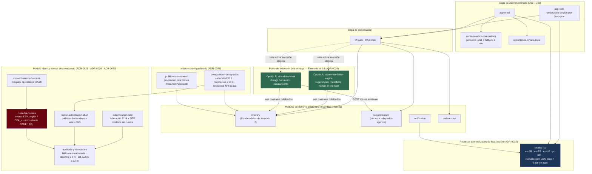

# Vista de módulos — nivel 2 (subsistema de adaptadores, identidad, localización y extensión)

**Tipo:** estructura estática refinada. Los elementos son unidades de implementación (módulos,
registros de complementos y paquetes de recursos declarativos) y las relaciones son dependencias
«usa a / implementa contrato de».
**Responde:** ¿cómo se estructuran por dentro la capa de anticorrupción, `identity-access`, `sharing` y
los recursos de localización para que agregar un proveedor (`QA-10`), un medio de transporte (`QA-15`),
un idioma/región (`QA-18`) o el módulo avanzado de la 2da entrega (`CON-06`) no modifique los servicios
de dominio?
**Para quién:** desarrolladores de integraciones, responsables de seguridad y evaluadores de
modificabilidad/evolucionabilidad.

Refina a: [Vista de módulos — nivel 1](vista-modulos-nivel-1.md) (cierra los pendientes declarados para
la iteración 4) y complementa el diseño interno de `itinerary` de la
[iteración 2](../02-proceso-add/iteracion-2/README.md#51-itinerary-descomposición-interna).

---

## 1. Subsistema de anticorrupción y contratos versionados (`QA-10` · `QA-11` · `QA-15` · `CRN-14`)

El diagrama muestra cómo los anfitriones `provider-sync`, `booking-extraction`, `mail-ingest` y
`support-liaison` desacoplan por inversión de dependencias los modelos externos (`NDC`, `HTNG`,
`OTA`, `OSDM`, plantillas MIME/HTML/PDF) del resto del sistema mediante contratos versionados con
`SemVer` ([ADR-0027](../03-adr/ADR-0027-versionado-y-evolucion-de-contratos.md)):

```mermaid
flowchart TB
    subgraph anfitrion_prov["Módulo provider-sync"]
        direction TB
        PS_REG["registro-de-adaptadores<br/>verifica apiContrato SemVer"]
        PS_PROT["proteccion<br/>mamparo 50 · cortacircuitos ≤ 25 s · cuota 80 %"]
        PS_CORE["seguimiento · receptor-notificaciones<br/>programador · detector-disrupciones · publicador"]
        PS_API[["«interfaz»<br/>AdaptadorDeProveedor v1.x"]]
        PS_CORE --> PS_REG --> PS_PROT --> PS_API
    end

    subgraph plugins_prov["Complementos de proveedor (0 dependencias entre sí)"]
        direction LR
        PL_NDC["adaptador-ndc-aerolinea"]
        PL_HTNG["adaptador-htng-hotel"]
        PL_AUTO["adaptador-ota-autos"]
        PL_TREN["adaptador-ferroviario<br/><i>(caso QA-15: tren)</i>"]
    end

    subgraph anfitrion_extr["Módulo booking-extraction"]
        direction TB
        BE_REG["registro-de-extractores<br/>verifica apiContrato SemVer"]
        BE_VAL["validador-canonico + evaluador-de-confianza<br/>3 bandas (≥ 0,90 · 0,60–0,90 · < 0,60)"]
        BE_OBS["observabilidad-de-calidad<br/>disyuntor + fingerprint estructural sin PII"]
        BE_API[["«interfaz»<br/>Extractor v1.x"]]
        BE_VAL --> BE_REG --> BE_API
        BE_OBS --> BE_VAL
    end

    subgraph plugins_extr["Complementos extractores (aislados por remitente)"]
        direction LR
        EX_AIR["extractor-aerolineas"]
        EX_HOT["extractor-hoteles"]
        EX_TRN["extractor-ferroviario<br/><i>(caso QA-15: tren)</i>"]
    end

    subgraph ingesta_mail["Módulo mail-ingest (ADR-0004 · ADR-0035)"]
        direction TB
        MI_PUSH["suscripciones + receptor push + reconciliador"]
        MI_ALIAS["receptor-reenvio-verificado<br/>alias dedicado DKIM/SPF/ARC (sin OAuth)"]
        MI_DL["filtros (metadatos) + descargador<br/>(IMAP solo XOAUTH2 / clave de app)"]
        MI_NORM["normalizador + deduplicador + publicador"]
        MI_PUSH --> MI_DL --> MI_NORM
        MI_ALIAS --> MI_NORM
    end

    subgraph comun_ref["Artefactos comunes transversales"]
        direction LR
        CANON["modelo-canonico<br/>ObservacionCanonica · Lugar · InstanteUTC+TZ"]
        DESC["descriptores TipoDeSegmento<br/>vuelo.v1 · hotel.v1 · auto.v1 · tren.v1"]
        CONTR["contratos publicados<br/>OpenAPI · AsyncAPI (versionEsquema)"]
    end

    PL_NDC -.->|"implementa"| PS_API
    PL_HTNG -.->|"implementa"| PS_API
    PL_AUTO -.->|"implementa"| PS_API
    PL_TREN -.->|"implementa"| PS_API

    EX_AIR -.->|"implementa"| BE_API
    EX_HOT -.->|"implementa"| BE_API
    EX_TRN -.->|"implementa"| BE_API

    PS_CORE --> CANON
    BE_VAL --> CANON
    BE_VAL --> DESC
    PL_TREN --> CANON
    EX_TRN --> CANON
    MI_NORM --> CONTR

    style CANON fill:#1d3557,color:#fff
    style DESC fill:#2d6a4f,color:#fff
    style PL_TREN stroke-dasharray: 5 5
    style EX_TRN stroke-dasharray: 5 5
```

### Invariantes estáticas verificadas sobre el subsistema de adaptadores

| Propiedad estructural | Cómo se garantiza en los módulos | Driver que sostiene |
|---|---|---|
| **Aislamiento total entre complementos** | Ningún `adaptador-*` ni `extractor-*` puede importar a otro complemento ni a módulos de `dominio`. Solo dependen de la interfaz anfitriona (`v1.x`) y de `modelo-canonico` (`Reglas R2` y `R3`) | `QA-10`, `QA-11` |
| **Envoltura operativa transversal** | Las tácticas de `ADR-0024` (mamparo, cortacircuitos, `cola_pendientes` y tope al `80 %` de cuota) residen en `proteccion` del anfitrión, no dentro de cada complemento: un adaptador nuevo hereda la resiliencia declarando únicamente su manifiesto | `QA-06`, `QA-10`, `CRN-09` |
| **Compatibilidad contractual versionada** | `registro-de-adaptadores` y `registro-de-extractores` validan en el arranque la compatibilidad `SemVer` (`apiContrato`) y corren en CI la suite de conformidad (`D17`, `ADR-0027`) | `CRN-14`, `CON-04` |
| **Extensión por datos para nuevos transportes** | Incorporar `tren` agrega `tren.v1` en `descriptores`, los recursos de icono/etiquetas y los dos complementos punteados en el diagrama, tocando **`0` módulos de dominio** ([guía verificada](../02-proceso-add/iteracion-4/guias-de-extension.md)) | `QA-15` |

---

## 2. Descomposición interna de `identity-access`, `sharing`, clientes y punto de extensión (`QA-12`…`QA-18` · `CON-06`)

Cierra los dos pendientes explícitos de la [vista de módulos de nivel 1](vista-modulos-nivel-1.md#pendiente-para-las-iteraciones-siguientes)
y deja documentada la costura estática del elemento nº `14` reservado para la 2da entrega:

---

## 3. Catálogo de submódulos refinados en la iteración 4

| Contenedor / Área | Submódulo | Responsabilidad única | Dependencias internas permitidas | ADRs |
|---|---|---|---|---|
| `identity-access` | `autenticacion-oidc` | Federación con proveedores de identidad (`E-14`) y desafío OTP sin contraseña para designados sin cuenta previa | `auditoria-y-revocacion` | [ADR-0007](../03-adr/ADR-0007-identidad-y-comparticion.md), [ADR-0028](../03-adr/ADR-0028-autorizacion-comparticion-y-publicacion.md) |
| `identity-access` | `consentimiento-buzones` | Ciclo de vida `Solicitado → Activo → RequiereReautorizacion → Revocado` y coordinación de bajas de cuenta (`Fase 1`) | `custodia-boveda`, `auditoria-y-revocacion` | [ADR-0029](../03-adr/ADR-0029-cifrado-custodia-y-rotacion-de-claves.md), [ADR-0030](../03-adr/ADR-0030-auditoria-y-supresion-datos-personales.md) |
| `identity-access` | `motor-autorizacion-abac` | Evaluación de políticas declarativas por atributos y firma de vales internos de corta vida (`TTL 60 s`) | `auditoria-y-revocacion` | [ADR-0028](../03-adr/ADR-0028-autorizacion-comparticion-y-publicacion.md) |
| `identity-access` | `custodia-boveda` | **Único módulo con dependencia hacia el cliente HSM/KMS (`Regla R5`)**: gestión de sobres `DEK_u`/`KEK_region`, rotación cada 90 días y emisión de tokens efímeros (`TTL ≤ 15 min`) | `auditoria-y-revocacion`, SDK KMS | [ADR-0029](../03-adr/ADR-0029-cifrado-custodia-y-rotacion-de-claves.md) |
| `identity-access` | `auditoria-y-revocacion` | Escritura *append-only* encadenada, exportación de inventario (`< 2 h ≤ 72 h`), detector de extracción masiva (`≤ 2 min`) y revocación regional en bloque (`≤ 12 min`) | `custodia-boveda` (para bloqueo de emergencia) | [ADR-0029](../03-adr/ADR-0029-cifrado-custodia-y-rotacion-de-claves.md), [ADR-0030](../03-adr/ADR-0030-auditoria-y-supresion-datos-personales.md) |
| `sharing` | `comparticion-designados` | Gestión de enlaces autenticados por lista nominal, caducidad automática a 30 días, respuesta opaca `404` e invalidación `< 5 s` | `itinerary` (lectura), `motor-autorizacion-abac` | [ADR-0028](../03-adr/ADR-0028-autorizacion-comparticion-y-publicacion.md) |
| `sharing` | `publicacion-resumen` | Transformación hacia el DTO de lista blanca `ResumenPublicable` e invocación de conectores `E-13` bajo confirmación del usuario | `itinerary` (lectura) | [ADR-0028](../03-adr/ADR-0028-autorizacion-comparticion-y-publicacion.md) |
| `mail-ingest` | `receptor-reenvio-verificado` | Recepción de correos reenviados al alias único del usuario verificando firmas `DKIM/SPF/ARC` para cuentas sin OAuth | `normalizador` | [ADR-0035](../03-adr/ADR-0035-buzones-sin-oauth-y-formatos-desconocidos.md) |
| `support-liaison` | `adaptador-agencia-*` | Complementos que traducen el `Caso` canónico a la API o correo estructurado de cada agencia corporativa (`E-12`) | `contratos` | [ADR-0006](../03-adr/ADR-0006-capa-de-anticorrupcion.md), [ADR-0027](../03-adr/ADR-0027-versionado-y-evolucion-de-contratos.md) |
| `app-movil` | `contexto-ubicacion` | Cruce espacial en el dispositivo (Haversine + ventana horaria) contra coordenadas del viaje `EnCurso` y degradación automática sin GPS | `instantanea-cifrada-local` | [ADR-0033](../03-adr/ADR-0033-capacidades-nativas-gps-y-degradacion.md) |
| Transversal | `locales-icu` | Catálogos externalizados `ICU MessageFormat` por idioma/región sin lógica ejecutable (`0` literales en servicios de negocio) | — (recurso estático puro) | [ADR-0032](../03-adr/ADR-0032-internacionalizacion-y-localizacion.md) |
| Punto de extensión | `recommendation-engine` *(A)* o `virtual-assistant` *(B)* | Elemento autónomo nº `14` de la 2da entrega; consume eventos de dominio y APIs existentes sin agregar interfaces en el núcleo | `contratos`, `modelo-canonico` | [ADR-0034](../03-adr/ADR-0034-punto-de-extension-modulo-avanzado.md) |

---

## 4. Verificación de las reglas estáticas de dependencia (`R1`–`R7`)

Todas las dependencias introducidas en las iteraciones 2, 3 y 4 respetan estrictamente las siete
reglas fijadas en [vista-modulos-nivel-1](vista-modulos-nivel-1.md#reglas-de-dependencia), y se
amplían con tres chequeos estáticos adicionales en CI:

1. **Chequeo `R5-estricto` (`QA-13`):** dentro de `identity-access`, ni siquiera `autenticacion-oidc` o
   `motor-autorizacion-abac` pueden importar el SDK de KMS; **únicamente `custodia-boveda`** tiene esa
   dependencia permitida.
2. **Chequeo `R8-sin-literales` (`QA-18`):** ningún módulo de dominio ni de composición contiene
   cadenas visibles al usuario final; solo `app-web`, `app-movil` y `notification` consumen
   `locales-icu`.
3. **Chequeo `R9-extension-limpia` (`CON-06`):** el elemento nº `14` no puede ser importado por ningún
   módulo de dominio (`itinerary`, `preferences`, `sharing`, `support-liaison`, `notification`),
   asegurando que activar, pausar o reemplazar el módulo avanzado deje intacto el núcleo.
