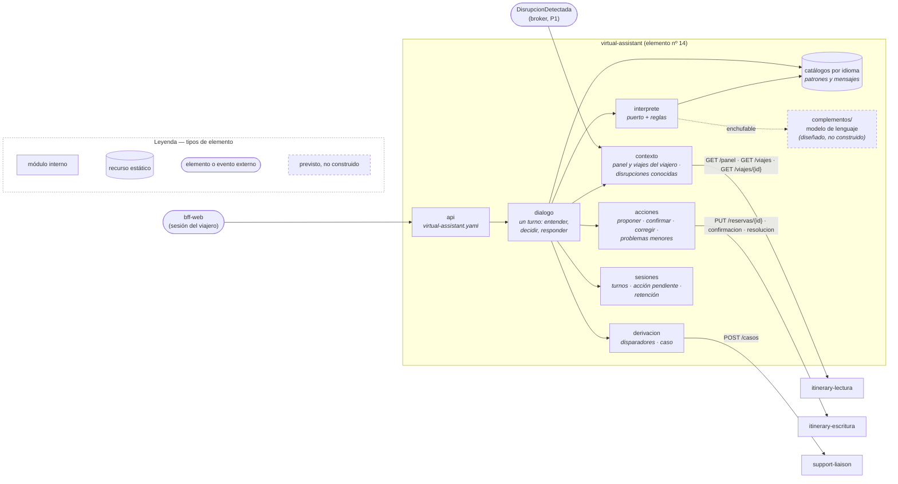

# Vista de módulos — nivel 2 (asistente virtual, elemento nº 14)

**Tipo:** estructura estática refinada. Los elementos son los módulos internos de `virtual-assistant`,
sus recursos declarativos y sus complementos, y las relaciones son dependencias «usa a / implementa».
**Responde:** ¿cómo está organizado por dentro el asistente de la Opción B? ¿Qué módulo habla con qué
servicio, y dónde queda la comprensión del lenguaje para poder cambiarla sin tocar el resto?
**Para quién:** quien construya el asistente (paso 19 del prototipo) y quien evalúe que el módulo
avanzado encaja sin cambios estructurales (`CON-06`).

Refina a: [Vista de módulos — nivel 2 (adaptadores, identidad y extensión)](vista-modulos-adaptadores.md),
que reservó el elemento nº 14. Producida en la [iteración 5](../02-proceso-add/iteracion-5/README.md#paso-5--instanciar-elementos-asignar-responsabilidades-y-definir-interfaces)
(2da entrega).

---

**Leyenda**

| Notación | Significado en esta vista |
|---|---|
| Rectángulo | **Módulo interno** de `virtual-assistant` |
| Cilindro | **Recurso estático**: catálogos de patrones y de mensajes por idioma, sin lógica (ADR-0032, ADR-0037) |
| Rectángulo punteado | Complemento **previsto y no construido** (el adaptador de modelo de lenguaje, ADR-0037) |
| Óvalo | Elemento o evento externo al asistente |
| `-->` flecha | Dependencia «usa a» (o llamada HTTP, si está rotulada con la operación) |
| `-.->` flecha punteada | Realización: el complemento implementa el puerto del intérprete |

| Módulo | Responsabilidad única | Drivers | ADR |
|---|---|---|---|
| `api` | Expone `virtual-assistant.yaml`, valida cuerpos y verifica la sesión del viajero | CON-04, QA-12 | ADR-0028, ADR-0034 |
| `dialogo` | Atiende un turno: interpreta, consulta el contexto, decide si responde, propone o deriva, y registra el turno. Sus textos salen del catálogo de mensajes | RF-B1, RF-B2, QA-18 | ADR-0037, ADR-0038, ADR-0039 |
| `interprete` | Puerto `InterpreteDeIntenciones` y su implementación por reglas: intención, entidades y confianza | RF-B1, QA-14 | ADR-0037 |
| `acciones` | Arma la corrección de una reserva o la resolución de un problema menor (confirmar o descartar una reserva por confirmar, resolver un conflicto), la propone con vencimiento y la ejecuta solo con confirmación | RF-B1, RF-06, QA-11 | ADR-0038 |
| `derivacion` | Evalúa los cuatro disparadores, arma la síntesis y abre el caso idempotente | RF-B2, RF-12 | ADR-0039 |
| `contexto` | Lee el panel del viajero (viajes, reservas por confirmar y conflictos abiertos) y sus viajes en `itinerary`, y mantiene la proyección de disrupciones (consume `DisrupcionDetectada`) | RF-B1, RF-B2 | ADR-0038, ADR-0040 |
| `sesiones` | Sesiones y turnos particionados por `usuario_id`, acción pendiente y retención de 30 días | QA-14, CON-10 | ADR-0040 |
| `catalogos/` (recurso) | Patrones de cada intención y mensajes `ICU MessageFormat` por idioma; el prototipo trae solo español | QA-18, CRN-10 | ADR-0032, ADR-0037 |
| `complementos/` | Adaptador de modelo de lenguaje con redacción de datos personales (previsto) | RF-B1, QA-14 | ADR-0037 |

**Reglas de dependencia del asistente.** Ningún módulo salvo `interprete` sabe cómo se interpreta un
texto, y ningún texto para el viajero está fuera de los catálogos. Solo `contexto`, `acciones` y
`derivacion` hablan con otros servicios, y cada uno con uno solo: `contexto` lee de
`itinerary-lectura`, `acciones` escribe en `itinerary-escritura` y `derivacion` abre casos en
`support-liaison`. El asistente no importa código de ningún otro servicio (regla de `ADR-0001`,
verificada por `tests/test_arquitectura.py`).
