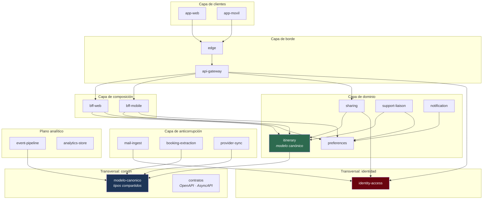

# Vista de módulos — nivel 1

**Tipo:** estructura estática. Los elementos son unidades de implementación (módulos) y las
relaciones son dependencias «usa a».
**Responde:** ¿cómo se divide el código? ¿qué módulo puede depender de qué otro?
**Para quién:** el equipo de desarrollo, al decidir dónde va un cambio.

## Diagrama

Las dependencias hacia `contratos` se omiten del diagrama por legibilidad: **todos** los módulos
dependen de él.

## Catálogo de módulos

| Módulo | Capa | Responsabilidad | ADR que lo justifica |
|---|---|---|---|
| `app-web` | Clientes | Interfaz web del panel | [ADR-0005](../03-adr/ADR-0005-capa-de-clientes-bff.md) |
| `app-movil` | Clientes | Aplicación móvil multiplataforma con módulos nativos de GPS y notificaciones | [ADR-0005](../03-adr/ADR-0005-capa-de-clientes-bff.md) |
| `edge` | Borde | Terminación TLS, caché de recursos estáticos, enrutamiento geográfico | [ADR-0002](../03-adr/ADR-0002-despliegue-multirregion.md) |
| `api-gateway` | Borde | Autenticación de la petición, autorización gruesa, limitación de tasa | [ADR-0007](../03-adr/ADR-0007-identidad-y-comparticion.md) |
| `bff-web` | Composición | Composición del panel completo en una ida y vuelta | [ADR-0005](../03-adr/ADR-0005-capa-de-clientes-bff.md) |
| `bff-mobile` | Composición | Composición de carga reducida con detalles diferidos | [ADR-0005](../03-adr/ADR-0005-capa-de-clientes-bff.md) |
| `itinerary` | Dominio | **Núcleo.** Custodia del modelo canónico, deduplicación y fusión, agrupación en viajes, ciclo de vida, gestión manual | [ADR-0001](../03-adr/ADR-0001-estilo-arquitectonico.md) |
| `sharing` | Dominio | Compartición con designados y publicación de resumen a redes (dos operaciones separadas) | [ADR-0007](../03-adr/ADR-0007-identidad-y-comparticion.md) |
| `support-liaison` | Dominio | Armado y derivación del caso de soporte a la agencia preferida | [ADR-0001](../03-adr/ADR-0001-estilo-arquitectonico.md) |
| `notification` | Dominio | Decisión de qué notificar y por qué canal | [ADR-0001](../03-adr/ADR-0001-estilo-arquitectonico.md) |
| `preferences` | Dominio | Preferencias: agencia, idioma, región, zona horaria, archivado | [ADR-0001](../03-adr/ADR-0001-estilo-arquitectonico.md) |
| `mail-ingest` | Anticorrupción | Suscripciones y recepción de notificaciones, descarga de mensajes, filtros y whitelists | [ADR-0004](../03-adr/ADR-0004-obtencion-de-correo.md) |
| `booking-extraction` | Anticorrupción | Registro de extractores por formato, con puntaje de confianza | [ADR-0006](../03-adr/ADR-0006-capa-de-anticorrupcion.md) |
| `provider-sync` | Anticorrupción | Registro de adaptadores de proveedores de viaje | [ADR-0006](../03-adr/ADR-0006-capa-de-anticorrupcion.md) |
| `identity-access` | Transversal | Autenticación, consentimiento, **custodia exclusiva de tokens**, decisiones de autorización | [ADR-0007](../03-adr/ADR-0007-identidad-y-comparticion.md) |
| `event-pipeline` | Analítico | Captura de eventos de dominio y materialización analítica | [ADR-0003](../03-adr/ADR-0003-separacion-planos.md) |
| `analytics-store` | Analítico | Almacén columnar de la historia de viajes | [ADR-0003](../03-adr/ADR-0003-separacion-planos.md) |
| `modelo-canonico` | Común | Tipos compartidos de Reserva, Segmento, Viaje y Tipo de segmento | [ADR-0006](../03-adr/ADR-0006-capa-de-anticorrupcion.md) |
| `contratos` | Común | Especificaciones OpenAPI y AsyncAPI de todas las interfaces | [ADR-0009](../03-adr/ADR-0009-contratos-spec-driven.md) |

## Reglas de dependencia

Estas reglas **se verifican automáticamente** en la construcción (es la confirmación de
[ADR-0001](../03-adr/ADR-0001-estilo-arquitectonico.md)). No son recomendaciones.

| # | Regla | Por qué |
|---|---|---|
| **R1** | Las dependencias van **de arriba hacia abajo** en las capas: clientes → borde → composición → dominio. Nunca al revés | Evita ciclos y mantiene el dominio independiente de cómo se lo presenta |
| **R2** | La capa de anticorrupción **no depende** de la capa de dominio, y la de dominio **no depende** de la de anticorrupción. Se comunican solo por eventos y por `modelo-canonico` | Es lo que hace que agregar un adaptador no toque el dominio (QA-10, QA-15) |
| **R3** | **Ningún módulo de dominio importa un tipo de un modelo externo.** Los tipos de NDC, de HTNG o de un formato de correo no existen fuera de su adaptador | Es la definición de la capa de anticorrupción (QA-11) |
| **R4** | Los módulos de composición (`bff-*`) **no contienen lógica de dominio**: solo componen y adaptan | Evita que la lógica se duplique entre los dos BFF ([ADR-0005](../03-adr/ADR-0005-capa-de-clientes-bff.md)) |
| **R5** | **Solo `identity-access` accede a la bóveda de secretos.** Ningún otro módulo tiene dependencia hacia ella | Es la consecuencia estructural de QA-13 ([ADR-0007](../03-adr/ADR-0007-identidad-y-comparticion.md)) |
| **R6** | El plano analítico **no depende** de ningún módulo del plano operacional: consume eventos y nada más | Es lo que hace que QA-09 se cumpla por construcción ([ADR-0003](../03-adr/ADR-0003-separacion-planos.md)) |
| **R7** | `modelo-canonico` **no depende de nada**. Es un módulo de tipos puros | Si dependiera de algo, ese algo se volvería transitivamente dependencia de todo el sistema |

## Mapa de responsabilidad por integrante

La descomposición también sirve para repartir el trabajo (CRN-02). Las cuatro áreas son
mayoritariamente independientes, lo que permite trabajar en paralelo:

| Integrante | Módulos a su cargo |
|---|---|
| Jeremias Aguilar | `itinerary`, `modelo-canonico`, `contratos` |
| Francisco Lozano | `edge`, `api-gateway`, `event-pipeline`, `analytics-store` |
| Juan Emilio Pardo | `mail-ingest`, `booking-extraction`, `provider-sync` |
| Ivo Iriarte | `identity-access`, `sharing`, `bff-web`, `bff-mobile`, `app-web`, `app-movil` |

`notification`, `support-liaison` y `preferences` son módulos pequeños y se asignan en la iteración
2, cuando se conozca su tamaño real.

## Pendiente para las iteraciones siguientes

| Qué falta | Iteración |
|---|---|
| Descomposición interna de `itinerary` (es el módulo más grande y el que más riesgo concentra) | 2 |
| Descomposición interna de `booking-extraction` y el contrato del extractor | 2 |
| Descomposición de `identity-access` en autenticación, consentimiento y autorización | 4 |
| Estructura de los recursos de localización (QA-18) | 4 |
