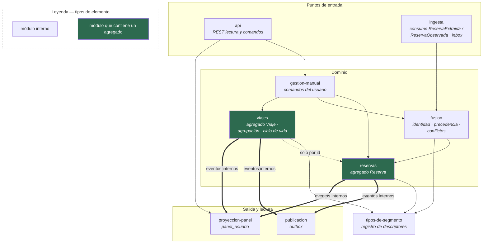
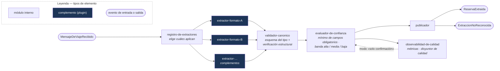
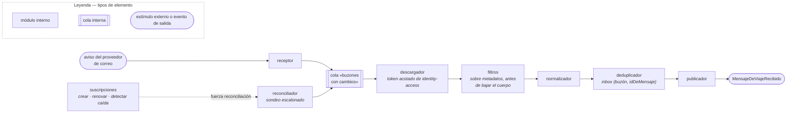

# Vista de módulos — nivel 2 (funcionalidad primaria)

**Tipo:** estructura estática refinada. Los elementos son los módulos internos de los elementos de
nivel 1 y las relaciones son dependencias «usa a».
**Responde:** ¿cómo se organizan por dentro `itinerary`, `booking-extraction` y `mail-ingest`?
¿Qué módulo puede depender de cuál?
**Para quién:** el equipo de desarrollo del prototipo, al decidir dónde va un cambio del dominio o
de la ingesta.

Refina a: [Vista de módulos — nivel 1](vista-modulos-nivel-1.md). Producida en la
[iteración 2](../02-proceso-add/iteracion-2/README.md#paso-5--instanciar-elementos-asignar-responsabilidades-y-definir-interfaces).
El interior de `provider-sync`, de la capa de anticorrupción y de `identity-access` está en la
[vista de módulos N2 de adaptadores](vista-modulos-adaptadores.md) (iteración 4).

Ninguno de estos módulos es un elemento nuevo: se despliegan dentro de su elemento y no agregan
interfaces de red, de modo que CON-A4 (menos de 15 elementos) se mantiene.

---

## 1. `itinerary` — núcleo del dominio

**Leyenda**

| Notación | Significado en esta vista |
|---|---|
| Rectángulo | **Módulo interno** de `itinerary`; se despliega dentro del mismo elemento |
| Verde | Módulo que contiene un agregado (`Reserva` o `Viaje`, ADR-0010) |
| Recuadro con título | Agrupación por rol (entrada, dominio, salida); no es un elemento |
| `-->` flecha fina | Dependencia «usa a» en código |
| `==>` flecha gruesa | Evento interno: el destino reacciona sin importar el código del origen |
| `-.->` flecha punteada | Referencia solo por identificador, sin dependencia de código |

Las flechas finas son dependencias «usa a» en código. Las flechas dobles son **eventos internos**,
no dependencias de código: `publicacion` y `proyeccion-panel` reaccionan a ellos sin importar
lógica de dominio. La flecha punteada indica que `viajes` conoce las reservas solo por su id.

### Catálogo

| Módulo | Responsabilidad única | Depende de | Drivers | ADR |
|---|---|---|---|---|
| `tipos-de-segmento` | Registro de descriptores versionados; valida el detalle de cada segmento | — | QA-15 | [ADR-0011](../03-adr/ADR-0011-extensibilidad-del-tipo-de-segmento.md) |
| `reservas` | Agregado `Reserva`: observaciones, segmentos, estados e invariantes | `tipos-de-segmento` | RF-03, RF-06 | [ADR-0010](../03-adr/ADR-0010-modelo-canonico-reserva-segmento-viaje.md) |
| `fusion` | Resolución de identidad por identificadores, consolidación por precedencia y apertura de conflictos | `reservas`, `tipos-de-segmento` | CRN-11, RF-06 | [ADR-0013](../03-adr/ADR-0013-deduplicacion-y-conflictos.md) |
| `viajes` | Agregado `Viaje`: membresía, agrupación por rol y lugar, ciclo de vida | `tipos-de-segmento` (el rol), `reservas` (solo por id) | RF-07, RF-08 | [ADR-0010](../03-adr/ADR-0010-modelo-canonico-reserva-segmento-viaje.md) |
| `gestion-manual` | Alta, edición, baja, fijar un campo, mover entre viajes, resolver un conflicto | `reservas`, `fusion`, `viajes` | RF-06 | [ADR-0013](../03-adr/ADR-0013-deduplicacion-y-conflictos.md) |
| `ingesta` | Consumo de `ReservaExtraida` y `ReservaObservada`; bandeja de entrada | `fusion` | CRN-12 | [ADR-0014](../03-adr/ADR-0014-idempotencia-de-la-ingesta.md) |
| `proyeccion-panel` | Modelo de lectura `panel_usuario`, mantenido por eventos internos | — (solo eventos) | RF-09, QA-02 | [ADR-0010](../03-adr/ADR-0010-modelo-canonico-reserva-segmento-viaje.md), [ADR-0019](../03-adr/ADR-0019-cache-camino-lectura-arranque-movil.md) |
| `publicacion` | *Outbox* y publicación de los eventos de dominio | — (solo eventos) | CRN-12 | [ADR-0012](../03-adr/ADR-0012-persistencia-del-plano-operacional.md), [ADR-0014](../03-adr/ADR-0014-idempotencia-de-la-ingesta.md) |
| `api` | Exposición REST de lectura y de comandos | `gestion-manual`, `proyeccion-panel` | RF-09 | [ADR-0009](../03-adr/ADR-0009-contratos-spec-driven.md) |

### Reglas de dependencia internas

| # | Regla | Por qué |
|---|---|---|
| **I1** | `reservas` no importa a `viajes`, ni `viajes` a `reservas` más allá del id. Se comunican por eventos internos | Son dos agregados con límites transaccionales propios; ninguna transacción los abarca a ambos (ADR-0010) |
| **I2** | Solo `api` e `ingesta` son puntos de entrada al elemento | Toda escritura pasa por `fusion` o por `gestion-manual`, que aplican las reglas de precedencia |
| **I3** | `proyeccion-panel` y `publicacion` no importan lógica de dominio | La lectura se puede desplegar sola (`itinerary-lectura`) sin arrastrar la fusión |
| **I4** | Ningún módulo menciona un tipo de segmento concreto (`vuelo`, `tren`…); se razona por `rolEnViaje` | Agregar un tipo no toca código (QA-15, ADR-0011) |
| **I5** | `tipos-de-segmento` no depende de ningún otro módulo | Es la base de validación de todos los demás |

### Asignación a los dos modos de despliegue

El mismo código se despliega en dos modos ([ADR-0021](../03-adr/ADR-0021-estrategia-autoescalado.md)):

| Modo | Módulos activos |
|---|---|
| `itinerary-escritura` | `ingesta`, `fusion`, `reservas`, `viajes`, `gestion-manual`, `tipos-de-segmento`, `publicacion`, `api` (solo comandos) |
| `itinerary-lectura` | `proyeccion-panel`, `tipos-de-segmento`, `api` (solo lectura) |

Las reglas I1 a I3 son lo que hace posible esta separación sin cambiar contratos.

---

## 2. `booking-extraction` — extracción desde el correo

**Leyenda**

| Notación | Significado en esta vista |
|---|---|
| Rectángulo | **Módulo interno** de `booking-extraction` |
| Azul | **Complemento** extractor cargado por configuración; implementa el contrato `Extractor` |
| Óvalo | Evento del *broker* que entra o sale del elemento |
| `-->` flecha | Flujo de procesamiento entre módulos (el origen invoca al destino) |
| `-.->` flecha punteada | Control: el disyuntor de calidad cambia el modo del evaluador |

| Módulo | Responsabilidad única | Drivers | ADR |
|---|---|---|---|
| `registro-de-extractores` | Catálogo de extractores cargados como complementos por configuración | QA-11, QA-15 | [ADR-0006](../03-adr/ADR-0006-capa-de-anticorrupcion.md) |
| `extractor-<formato>` *(complementos)* | Entiende un formato de remitente y cumple el contrato `Extractor` | RF-03 | [ADR-0006](../03-adr/ADR-0006-capa-de-anticorrupcion.md) |
| `validador-canonico` | Valida la salida contra el esquema del tipo y aplica las verificaciones estructurales | QA-11 | [ADR-0011](../03-adr/ADR-0011-extensibilidad-del-tipo-de-segmento.md), [ADR-0015](../03-adr/ADR-0015-politica-de-confianza-de-extraccion.md) |
| `evaluador-de-confianza` | Calcula la confianza y fija la banda con los umbrales del extractor | QA-11 | [ADR-0015](../03-adr/ADR-0015-politica-de-confianza-de-extraccion.md) |
| `observabilidad-de-calidad` | Métricas por extractor y disyuntor de calidad | R-2 | [ADR-0015](../03-adr/ADR-0015-politica-de-confianza-de-extraccion.md) |
| `publicador` | Publica `ReservaExtraida` o `ExtraccionNoReconocida` | RF-03 | [ADR-0014](../03-adr/ADR-0014-idempotencia-de-la-ingesta.md) |

**Regla:** ningún extractor depende de otro ni del resto de los módulos; todos implementan el mismo
contrato y pasan la misma suite de conformidad
([ADR-0017](../03-adr/ADR-0017-estrategia-de-pruebas-y-contratos.md)). Agregar un formato es agregar
un complemento.

---

## 3. `mail-ingest` — obtención del correo

Los dos caminos de [ADR-0004](../03-adr/ADR-0004-obtencion-de-correo.md) (el *push* y la
reconciliación) convergen en una cola de «buzones con cambios»; desde ahí hay un único camino.

**Leyenda**

| Notación | Significado en esta vista |
|---|---|
| Rectángulo | **Módulo interno** de `mail-ingest` |
| Rectángulo con doble borde | Cola interna «buzones con cambios» donde convergen los dos caminos de ingesta |
| Óvalo | Estímulo externo (aviso del proveedor) o evento publicado |
| `-->` flecha | Flujo de procesamiento entre módulos |
| `-.->` flecha punteada | Control: una suscripción caída fuerza una reconciliación |

| Módulo | Responsabilidad única | Drivers | ADR |
|---|---|---|---|
| `suscripciones` | Crea, renueva y detecta la caída de las suscripciones; ante una caída fuerza una reconciliación | RF-02 | [ADR-0004](../03-adr/ADR-0004-obtencion-de-correo.md) |
| `receptor` | Recibe el aviso del proveedor y encola | RF-02, QA-01 | [ADR-0004](../03-adr/ADR-0004-obtencion-de-correo.md) |
| `reconciliador` | Sondeo escalonado por actividad del buzón | RF-02, CRN-09 | [ADR-0004](../03-adr/ADR-0004-obtencion-de-correo.md), [ADR-0024](../03-adr/ADR-0024-cortacircuitos-reintentos-y-cuotas.md) |
| `descargador` | Pide un token acotado a `identity-access`, baja metadatos y, si pasan los filtros, el mensaje | QA-13 | [ADR-0007](../03-adr/ADR-0007-identidad-y-comparticion.md) |
| `filtros` | Bloqueadas > permitidas > catálogo de remitentes reconocidos | RF-04 | [iteración 2, §5.4](../02-proceso-add/iteracion-2/README.md#54-mail-ingest) |
| `normalizador` | Convierte el mensaje a `MensajeNormalizado` | RF-02 | — |
| `deduplicador` | Bandeja de entrada por `(buzón, idDeMensaje)` | CRN-12 | [ADR-0014](../03-adr/ADR-0014-idempotencia-de-la-ingesta.md) |
| `publicador` | Publica `MensajeDeViajeRecibido` | RF-02 | — |

**Regla:** `mail-ingest` no interpreta el contenido del mensaje; eso es de `booking-extraction`.
Los filtros viven aquí y no en `preferences`, para que el camino caliente de ingesta no dependa
de otro elemento.

---

## 4. Verificación de consistencia con las otras vistas

| Regla de [04-vistas](README.md#reglas-de-consistencia-entre-vistas) | Verificación |
|---|---|
| Todo módulo tiene un componente que lo realiza | Los módulos de §1 se realizan en `itinerary-escritura` / `itinerary-lectura`; los de §2 y §3 en los componentes `booking-extraction` y `mail-ingest` de la [vista C&C](vista-cyc-nivel-1.md) |
| Toda dependencia corresponde a un conector o es interna | Todas las dependencias de esta vista son internas a un componente; entre elementos solo hay eventos (§5.10 de la iteración 2) |
| Toda interfaz tiene contrato | `api` → OpenAPI de `itinerary`; contratos `Extractor` y `AdaptadorDeProveedor`; eventos en AsyncAPI ([ADR-0009](../03-adr/ADR-0009-contratos-spec-driven.md)) |

Los recorridos dinámicos que usan estos módulos están en
[secuencias de los casos primarios](secuencias-casos-primarios.md).
