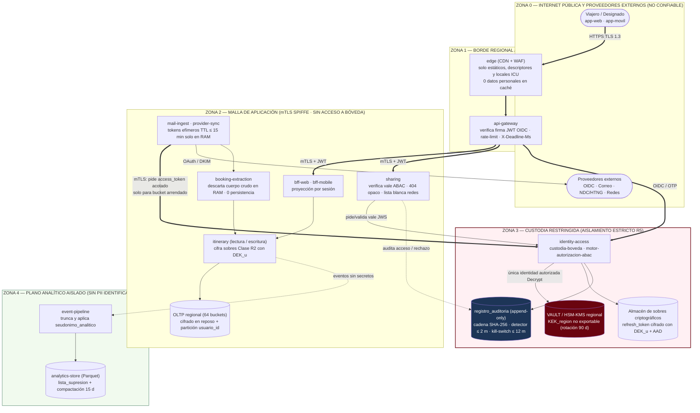
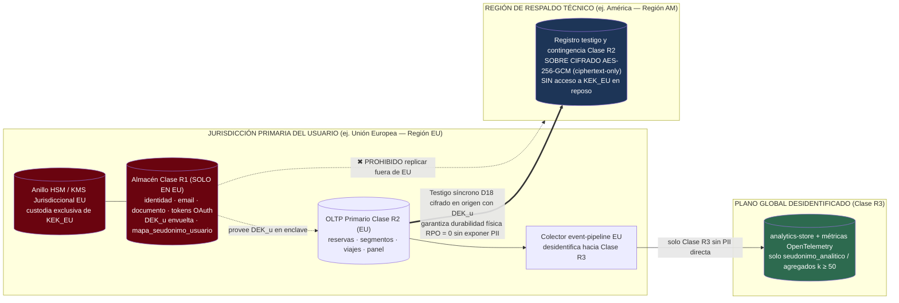
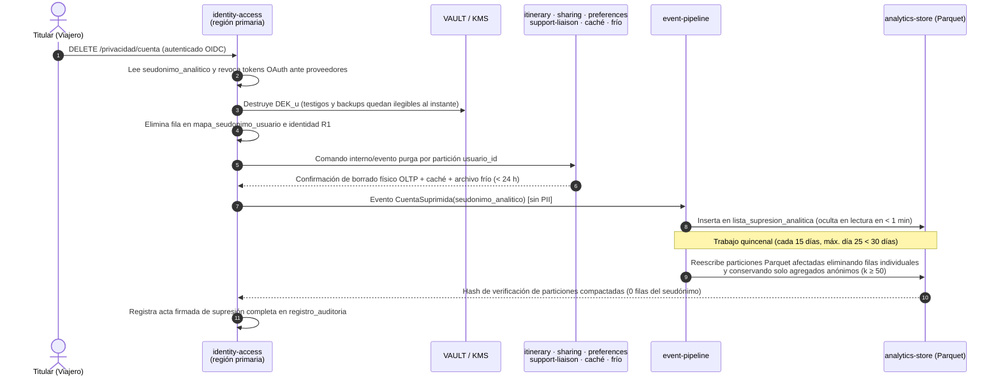

# Vista de seguridad, privacidad y residencia de datos

**Tipo:** vista transversal híbrida (superpone fronteras de confianza y controles criptográficos sobre
la estructura dinámica C&C y la estructura de asignación multirregión de datos).
**Responde:** ¿dónde están las fronteras de confianza? ¿quién puede descifrar un token de correo si otro
servicio interno es comprometido (`QA-13`)? ¿qué dato personal vive en qué almacén, con qué base legal y
por cuánto tiempo (`CON-10`)? ¿cómo se suprime de forma verificable en ambos planos en `≤ 30 días`
(`QA-14`)? ¿y cómo convive el registro testigo transregional (`QA-05`) con la residencia normativa de
datos (`CRN-15` / cierre de `R-6`)?
**Para quién:** responsables de seguridad, auditores de protección de datos personales (GDPR / Ley
25.326) y equipo de operaciones.

Relacionada con: [Vista C&C — nivel 1](vista-cyc-nivel-1.md), [Vista de despliegue — nivel 2](vista-despliegue-nivel-2.md)
y decisiones [ADR-0028](../03-adr/ADR-0028-autorizacion-comparticion-y-publicacion.md) a
[ADR-0035](../03-adr/ADR-0035-buzones-sin-oauth-y-formatos-desconocidos.md).

---

## 1. Fronteras de confianza, custodia criptográfica y puntos de auditoría (`QA-12` · `QA-13`)

El sistema se divide en **cinco zonas de confianza** con autenticación mutua y privilegios mínimos.
La arquitectura asume explícitamente que un contenedor en la Zona 2 podría ser comprometido (`QA-13`)
y aun así impide la extracción de credenciales de correo:

### Controles defensivos en profundidad sobre las fronteras

| Salto de frontera | Control aplicado | Qué ataque mitiga |
|---|---|---|
| `Z0 → Z1` | `TLS 1.3`, WAF, límites de tasa por IP/cuenta, `Cache-Control: private, no-cache` en respuestas autenticadas y validación `DKIM/SPF/ARC` en correo entrante | Interceptación en tránsito, fuerza bruta, envenenamiento de caché en CDN y suplantación de correo en el alias de reenvío (`ADR-0019`, `ADR-0035`) |
| `Z1 → Z2` | Certificados de carga mTLS rotados automáticamente + JWT de usuario + vale JWS firmado por `motor-autorizacion-abac` para recursos compartidos; respuesta uniforme `404` ante no autorizados | Suplantación interna (*confused deputy*) y enumeración de itinerarios compartidos (`QA-12`, `ADR-0028`) |
| `Z2 → Z3` | **Único punto de cruce hacia secretos:** solo la identidad criptográfica de `custodia-boveda` posee permiso `Decrypt` sobre `KEK_region` en el HSM; `mail-ingest` solo recibe *access tokens* en RAM (`TTL ≤ 15 min`) para *buckets* bajo su arrendamiento activo | **Escenario `QA-13`:** un atacante que controle `booking-extraction`, `itinerary` o incluso una réplica de `mail-ingest` no puede descifrar la base de 9 M de buzones; cualquier barrido anómalo se bloquea en `≤ 2 min` (`< 5 min`) y la región entera puede revocarse en `≤ 12 min` (`< 15 min`, `ADR-0029`) |
| `Z2 → Z4` | `event-pipeline` actúa como dique unidireccional (`Regla R6`): descarta identificadores directos y sustituye `usuario_id` por `seudonimo_analitico` antes de escribir Parquet | Reidentificación masiva desde consultas analíticas (`CON-10`, `ADR-0030`) |

---

## 2. Residencia normativa por región y cierre gráfico de `R-6` (`CRN-15` · `ADR-0031`)

El diagrama muestra cómo un viajero con residencia regulatoria en Europa (`región_primaria = EU`)
mantiene **`0` fuga de datos personales en claro fuera de su jurisdicción** (`CON-10`) sin renunciar al
**`RPO = 0` ante pérdida total de región** (`QA-05` / `ADR-0018`):

---

## 3. Puntos obligatorios de auditoría (`QA-14`)

Toda acción sensible atraviesa un punto de registro obligatorio hacia `registro_auditoria` (inmutable y
encadenado por `SHA-256`, conservado `24 meses` para defensa regulatoria sin incluir secretos ni cuerpos
de mensajes):

1. Otorgamiento, renovación, fallo o revocación de consentimiento de buzón o proveedor (`RF-01`).
2. Cada desenvolvimiento de `DEK_u` o emisión de token efímero hacia `mail-ingest`, incluyendo la
   identidad SPIFFE de la réplica solicitante (`QA-13`).
3. Creación, acceso exitoso, intento denegado (`404` opaco) y revocación de cualquier compartición de
   viaje (`QA-12`), así como toda publicación confirmada en redes (`RF-13`).
4. Apertura y derivación de casos de soporte hacia agencias externas (`RF-12`).
5. Solicitudes de exportación de datos personales (`≤ 72 h`) y ejecución de las dos fases de supresión
   con su acta criptográfica de cierre (`≤ 30 días`, `QA-14`).

---

## 4. Catálogo de datos personales (CON-10 · QA-14)

Inventario normativo completo conforme a **GDPR (Art. 30)** y **Ley 25.326**: detalla qué datos existen
(y cuáles se **excluyen deliberadamente** por minimización), en qué almacén residen, su clase de
residencia, su base legal y cómo se eliminan dentro de los `30 días`:

| Categoría de dato | Elementos concretos | Almacén donde vive | Clase residencia | Base legal (GDPR / Ley 25.326) | Retención activa | Mecanismo de supresión (`≤ 30 días`) |
|---|---|---|---|---|---|---|
| **Identidad de cuenta** | `usuario_id`, nombre visible, correo verificado, identificador federado OIDC, jurisdicción | `identity-access` (OLTP primario) | **Clase R1** (solo región primaria) | Ejecución de contrato (Art. 6.1.b / Art. 5.2.c) | Mientras la cuenta esté activa | Borrado físico en `< 24 h` + destrucción de `DEK_u` |
| **Credenciales delegadas y claves** | *Refresh tokens* OAuth, credenciales delegadas de app, alias de reenvío, clave `DEK_u` envuelta | `identity-access` (`almacén de sobres` + HSM) | **Clase R1** (solo región primaria) | **Consentimiento explícito** revocable (Art. 6.1.a · `CON-08`) | Hasta desconexión del buzón o baja | Revocación en proveedor + borrado físico y destrucción de `DEK_u` en `< 24 h` (o al instante al desconectar buzón) |
| **Vínculo de seudonimización** | Par `(usuario_id, seudonimo_analitico)` | `identity-access` (`mapa_seudonimo_usuario`) | **Clase R1** (solo región primaria) | Interés legítimo / base estadística con salvaguarda (Art. 6.1.f / Art. 89) | Mientras la cuenta esté activa | Borrado físico en `< 24 h`, desvinculando de forma irreversible el historial analítico |
| **Datos de reservas e itinerarios** | Localizadores PNR, tramos, horarios `UTC+TZ`, operadores, asientos/habitación, notas manuales, pasajeros | `itinerary` (`OLTP` primario, caché regional, frío `> 12 m` y testigo cifrado `R2`) | **Clase R2** (primario local + testigo cifrado) | Ejecución de contrato (Art. 6.1.b) | Activo en OLTP hasta `12 m` post-viaje; luego archivo frío hasta baja o límite configurado (`RF-08`) | Borrado físico en OLTP/caché/frío + inutilización criptográfica instantánea del testigo al destruir `DEK_u` (`< 24 h`) |
| **Preferencias del viajero** | Idioma, región, huso horario, canales, horas de silencio, agencia preferida | `preferences` (`OLTP` + réplicas locales) | **Clase R2** | Ejecución de contrato | Mientras la cuenta esté activa | Borrado físico por `usuario_id` e invalidación de caché en `< 24 h` |
| **Comparticiones con designados** | `comparticion_id`, correos normalizados de `designados`, fecha de expiración | `sharing` (`OLTP`) | **Clase R2** | Acción iniciada por el titular (Art. 6.1.b) | Caduca automáticamente a los `30 días` de finalizar el viaje (`QA-12`) | Purga automática al vencer o borrado físico en `< 24 h` ante revocación/baja |
| **Casos de soporte** | Instantánea de la reserva afectada, motivo de reclamo, identificador externo en agencia | `support-liaison` (`OLTP`) | **Clase R2** | Ejecución de contrato a pedido del usuario (`RF-12`) | `24 meses` tras cierre del reclamo o hasta supresión de cuenta | Borrado físico en `< 24 h` en Trotamundos + notificación de baja al adaptador si aplica |
| **Hechos analíticos históricos** | `hecho_cambio_reserva`, `hecho_viaje` con `seudonimo_analitico`, mes, país/ciudad y tipo de segmento | `analytics-store` (objetos Parquet) | **Clase R3** (desidentificado) | Fines estadísticos y mejora del servicio (Art. 89) | Serie histórica agregada | Exclusión inmediata en lectura (`< 24 h`) + compactación Parquet quincenal (`≤ 25 d`) que purga filas del seudónimo conservando solo cubos anónimos (`k ≥ 50`) |
| **Rastro de auditoría de seguridad** | Actor/sujeto enmascarado, operación, recurso, resultado, firma encadenada `SHA-256` | `identity-access` (`registro_auditoria`) | **Clase R1** | Obligación legal de seguridad y demostración de cumplimiento (GDPR Art. 5.2 y Art. 32 — excepción Art. 17.3.b) | `24 meses` en almacén inmutable restringido | Tras supresión de cuenta solo conserva el hash irreversible del identificador en el acta de borrado para probar ante auditoría que la baja ocurrió |
| **Datos EXCLUIDOS por diseño *(no almacenados jamás)*** | **Contraseñas de usuario o clave maestra de correo**, **cuerpo crudo de correos/adjuntos** y **posición GPS del dispositivo móvil** | **Ninguno (`0` bytes persistidos en servidor)** | — | Minimización estricta (GDPR Art. 5.1.c · `CON-08` · `AMB-09`) | `0 s` (descartado en RAM o evaluado en el teléfono) | No requiere borrado: nunca ingresa a almacenamiento persistente |

---

## 5. Secuencia de supresión verificable en ambos planos (`≤ 30 días` · `ADR-0030`)

